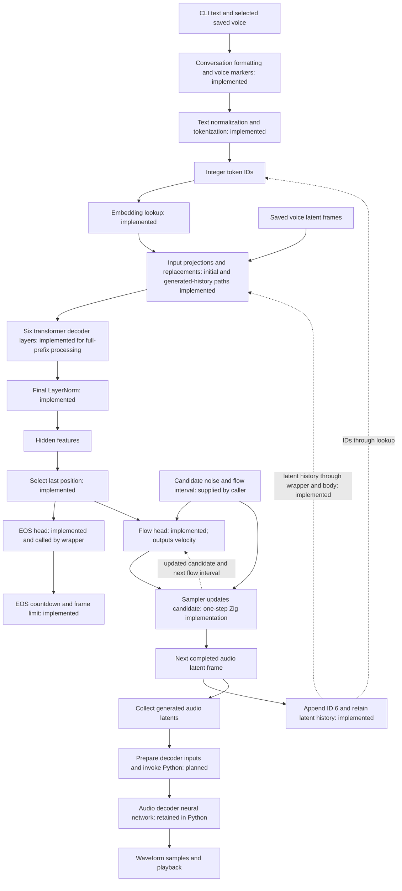
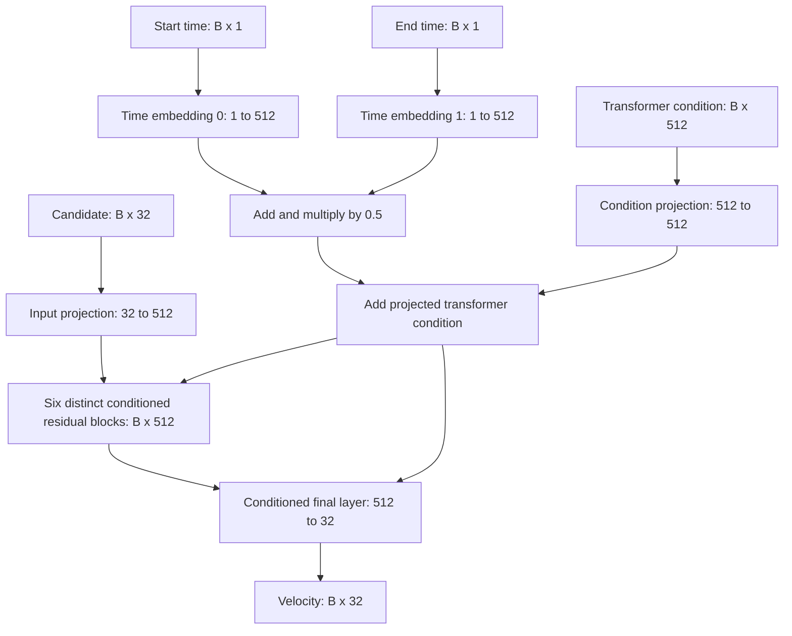

# Phonon in ZML: a walkthrough of the implementation so far

This document describes the code in `examples/phonon` as it stands on 13 November 2026, expanding the walkthrough first written on 12 November. It is written for a systems programmer learning machine learning while implementing this model. It explains the computations actually present in the code, including the computations inside the ZML helpers we call.

**The current executable repeatedly runs the transformer, complete flow head, and EOS head, applies one-step sampling, and accumulates normalized audio latents until EOS or the frame limit. It prints token IDs and per-frame progress, then saves `phonon.normalized.safetensors`. Waveform decoding remains in Python; `reference/decode.py` now consumes the saved file for decoding and playback.** The earlier milestone stopped at transformer hidden features, with EOS tested separately and the flow head still a scaffold. The timestep embeddings, both flow projections, six flow residual blocks, final flow layer, and combined prediction wrapper have since been implemented and tested. The Python reference already runs the complete speech pipeline.

**Generated-audio input replacement is also implemented and tested against the first four uncached Python calls.** The history is now threaded through the transformer body and combined wrapper, and the full transformer matches all four captured outputs. The CLI supplies empty history initially, then its own sampled history on later iterations. Sampling, the driving loop, and stopping are now implemented; the Python decoder bridge is now available as a separate script.

**Using f32 is not preventing this from becoming a working speech generator.** It is a sensible reference implementation choice. It has memory and performance costs, which we will examine separately from missing functionality.

Throughout this walkthrough, “why” has two levels. Some choices are part of the computation the checkpoint was trained to use: changing them changes the model. Others are engineering choices in our port, such as keeping activations in f32 or recompiling each prefix. We explain their purposes separately. Useful intuitions about learned features describe what an operation enables; they do not establish a human-readable meaning for every feature coordinate or prove why the authors chose one exact width or layer count.

**Cached execution update:** the default CLI now compiles one prefill executable and one fixed-shape decode executable, retaining per-layer K/V buffers across frames. The uncached path and its explanations/code snapshots are preserved below as a reference; [chapter 26](#26-cached-prefill-and-single-position-decoding) describes the current default, its ownership rules, and its tests.

## Contents

1. [What we are building](#1-what-we-are-building)
2. [Vocabulary and notation](#2-vocabulary-and-notation)
3. [Files and responsibilities](#3-files-and-responsibilities)
4. [Assets, names, and offline execution](#4-assets-names-and-offline-execution)
5. [ZML objects and the execution lifecycle](#5-zml-objects-and-the-execution-lifecycle)
6. [Preparing text and voice data](#6-preparing-text-and-voice-data)
7. [Embedding lookup](#7-embedding-lookup)
8. [Input projection and special-position replacement](#8-input-projection-and-special-position-replacement)
9. [The Linear operation used throughout](#9-the-linear-operation-used-throughout)
10. [One transformer decoder layer](#10-one-transformer-decoder-layer)
11. [Layer normalization, operation by operation](#11-layer-normalization-operation-by-operation)
12. [Attention, operation by operation](#12-attention-operation-by-operation)
13. [The MLP, operation by operation](#13-the-mlp-operation-by-operation)
14. [Six layers and the final normalization](#14-six-layers-and-the-final-normalization)
15. [The EOS head](#15-the-eos-head)
16. [What main actually executes and prints](#16-what-main-actually-executes-and-prints)
17. [The Python reference and numerical tests](#17-the-python-reference-and-numerical-tests)
18. [Dtypes: what f32 means here](#18-dtypes-what-f32-means-here)
19. [Assumptions and unfinished work](#19-assumptions-and-unfinished-work)
20. [An operation checklist](#20-an-operation-checklist)
21. [The complete flow head, operation by operation](#21-the-complete-flow-head-operation-by-operation)
22. [The combined prediction wrapper](#22-the-combined-prediction-wrapper)
23. [Four uncached calls and the generated-audio feedback boundary](#23-four-uncached-calls-and-the-generated-audio-feedback-boundary)
24. [The uncached generation loop](#24-the-uncached-generation-loop)
25. [Decoding and playing the Zig output](#25-decoding-and-playing-the-zig-output)
26. [Cached prefill and single-position decoding](#26-cached-prefill-and-single-position-decoding)

## 1. What we are building

Phonon is a text-to-speech system: given text and information about a voice, it produces audio of that text being spoken.

The model architecture separates several jobs:

- The **transformer** processes the input sequence and the generated history into internal feature vectors.
- The **flow head** uses those features to help generate the next compact audio representation, called an audio latent frame.
- The **EOS head** produces a score used to decide when speech generation should end.
- A separate **audio decoder neural network** converts generated audio latents into waveform samples that speakers can play.

The transformer, flow head, and EOS head are components of the TTS model represented in Python by `GradiumPhononTTSForConditionalGeneration`. Calling them components is useful: their being separate modules does not make them unrelated models trained for independent tasks. The audio decoder is a separate model in the complete system.

Our `Gradium_Phonon_TTS_Model` corresponds to the inner Python `GradiumPhononTTSModel`, not to the entire `GradiumPhononTTSForConditionalGeneration` wrapper.

The new outer `Gradium_Phonon_TTS_For_Conditional_Generation` owns that transformer body and both output heads. Its `forward` performs one combined prediction; the name does not imply that the Python `.generate()` loop has been ported. [Section 22](#22-the-combined-prediction-wrapper) explains its exact boundary.

Here is the complete intended workflow. Boxes marked implemented refer to the Zig port, not merely to Python functionality:



The graph's loop is important. A transformer pass does not produce an entire spoken sentence directly. Generation repeatedly creates audio frames. A flow sampling procedure can itself evaluate the flow network multiple times while constructing one frame. The number of text tokens, the number of voice-reference frames, the number of generated audio frames, and the number of flow sampling steps are different quantities.

The earlier executable stopped at **I**. The single-prediction milestone continued through the last-position selection and both heads, stopping at the **velocity from K and the score from J**. The current executable drives the sampling/history loop and saves completed normalized frames; the prediction wrapper still exposes those two intermediate results. Those remain useful intermediate results to compare with Python, not playable audio. A velocity says how to update the supplied candidate; it is not itself the completed audio latent.

## 2. Vocabulary and notation

### 2.1 Tensor, shape, rank, and dtype

A tensor is a rectangular collection of numbers. A vector is a rank-1 tensor; a matrix is rank 2. Higher ranks just add indexing axes.

For example:

```text
shape [1, 140, 512]
       │   │    └─ 512 numbers describing each position
       │   └────── 140 positions in a sequence
       └────────── 1 independent sequence
```

This is 71,680 numbers. With f32, each takes four bytes, so the data occupies 286,720 bytes, excluding metadata and allocation overhead.

The **shape** describes the sizes of the axes. The **rank** is the number of axes. The **dtype** describes the representation of one element: f32, bf16, i64, boolean, and so on.

`[1, 140, 512]` and `[1, 512]` are not interchangeable. The former contains 140 feature vectors. Linear layers operate on every vector, preserving the leading axes.

### 2.2 Sequence, position, token, and feature

A **sequence** is the ordered list presented to the transformer. A **position** is an index in that list, starting at zero.

In our initial prompt, positions represent voice markers, text tokens, and an audio-start marker. After the input replacements, each position contains the appropriate feature vector. During generation, further positions will represent generated audio frames.

A **token ID** is an integer identifying a vocabulary entry. It is not itself a feature vector, and numerical closeness of two IDs does not imply semantic similarity.

A **feature vector** is the collection of floating-point values associated with a position. This model uses 512 transformer features. Individual coordinates do not have human-assigned labels such as “pitch” or “French.” Their collective interpretation was learned during training.

A **latent** is an internal representation rather than the final observable data. An audio latent vector is not a tiny waveform that can be played directly. A decoder must translate it into waveform samples.

### 2.3 Parameters, activations, and configuration

**Parameters**, also called weights, are the learned numbers loaded from the checkpoint. Biases and normalization gains are parameters too.

**Activations** are the intermediate values computed for a particular input. An attention input, an MLP output, and the final hidden states are activations. Saving activations gives us test inputs and expected outputs.

**Configuration** describes the computation: layer count, feature width, head count, epsilon, token IDs, and other settings. These are commonly called hyperparameters, although a configuration file can also contain operational metadata rather than only training hyperparameters.

Loading trained weights is not training. Our Zig implementation performs inference: it evaluates an already trained numerical program.

### 2.4 The dimension tags used in our code

Tags are semantic axis names, not values stored in the tensor:

| Tag      | Meaning                                                            | Size in this implementation                                                                      |
| -------- | ------------------------------------------------------------------ | -----------------------------------------------------------------------------------------------: |
| `.b`     | Batch: independent sequences                                       | 1 in the executable                                                                              |
| `.s`     | Sequence positions                                                 | Prompt positions plus generated-history positions (uncached); new positions only in cached calls |
| `.d`     | Transformer or flow hidden feature dimension                       | 512                                                                                              |
| `.dout`  | A distinct output-feature axis during a projection                 | Depends on the layer                                                                             |
| `.voc`   | Rows of an embedding vocabulary                                    | 4001 for text; 32 for speaker count                                                              |
| `.p`     | Frames in the saved voice prompt                                   | 125 for the currently selected voice                                                             |
| `.ad`    | Features per voice-prompt frame                                    | 512                                                                                              |
| `.ld`    | Features per generated-audio latent / BOS latent                   | 32                                                                                               |
| `.a`     | Completed generated-audio frames supplied as history               | 0 initially, then 1, 2, 3, …                                                                     |
| `.t`     | Scalar flow time per batch row                                     | 1; its value is progress within one frame's sampling                                             |
| `.f`     | Timestep frequency/features                                        | 128 stored frequencies, then 256 cosine/sine features                                            |
| `.m`     | Condition-derived modulation features                              | 1536 for shift/scale/gate; 1024 for shift/scale                                                  |
| `.spk`   | Features in the speaker-count embedding                            | 16                                                                                               |
| `.dur`   | Features in the duration encoding                                  | 128                                                                                              |
| `.qkv`   | Packed projection output, or one chunk before splitting into heads | 1536, then 512                                                                                   |
| `.h`     | Attention heads                                                    | 8                                                                                                |
| `.hd`    | Features per attention head                                        | 64                                                                                               |
| `.q`     | Query positions in attention                                       | Same as `.s` during prefill; 1 during cached decode                                              |
| `.k`     | Key/value positions in attention                                   | Same as `.s` during prefill; C cache slots on the cached path                                    |
| `.hq`    | Internal SDPA query-head grouping axis                             | 1 here                                                                                           |
| `.layer` | Transformer layer selected in packed K/V storage                   | 6                                                                                                |

`.d` is a naming convention for a feature dimension, not a mathematical operator. We give different names to axes when they have different roles, even if their lengths happen to match.

For example, `.q` and `.k` are both length 140 in prefill, but an attention score has one axis for the position asking a question and another for the position being consulted. Merging those concepts would produce the wrong computation.

We use `A` for generated-history length and `P` for reference-voice length. A tensor `[B,0,32]` has rank 3 and zero elements: it describes an empty history with a known feature width. It is different from a `[B,1,32]` tensor filled with zeros, which would describe one actual frame. The flow time axis `.t=1` is different again: one scalar time for the candidate currently being refined, not a history axis.

### 2.5 Broadcasting, elementwise work, contraction, and reduction

**Elementwise** means operating independently on corresponding numbers: adding two `[B,S,D]` tensors, for example.

**Broadcasting** means treating a smaller tensor as repeated along missing or singleton axes. Adding a `[D]` vector to `[B,S,D]` adds the same feature-specific offsets at every position in every batch item. The compiler does not necessarily allocate all those repeated copies.

A **reduction** combines many numbers into fewer numbers. Summing over `.d` combines the features in each vector. In ZML, `sum` retains the reduced axis with length 1, which permits later broadcasting.

A **contraction** multiplies corresponding coordinates and sums over a shared axis. A dot product is a contraction. Matrix multiplication is many dot products arranged into an output tensor.

These meanings matter more than a particular physical memory layout. ZML tags help specify which axes are contracted, preserved, or shared as batch axes.

The semantic question behind an axis is: **which things may interact here?** A batch axis separates independent examples. A sequence axis distinguishes positions that attention can connect. A feature axis holds the coordinates used to describe one position. Contracting `.d` in a Linear layer mixes features within a position; contracting key positions in attention combines information across positions. Two equal-sized axes are not interchangeable merely because either contraction would fit numerically. Tags help express these roles, but their names alone cannot ensure that we supplied the intended data.

## 3. Files and responsibilities

| File | Responsibility |
|---|---|
| [main.zig](main.zig) | CLI, local asset loading, voice transpose, combined prediction wrapper, candidate creation, compilation, execution, velocity/EOS printing |
| [tokenizer.zig](tokenizer.zig) | Tokenizer JSON loading, normalization, special tokens, prompt formatting, token IDs |
| [tokenizer_regex.c](tokenizer_regex.c) / [header](tokenizer_regex.h) | Small PCRE2 wrapper used for normalization rules |
| [transformer.zig](transformer.zig) | Embedding, input projection, attention, norms, MLP, decoder layer, six-layer model |
| [eos_head.zig](eos_head.zig) | Learned projection from hidden features to one raw EOS score |
| [flow_head.zig](flow_head.zig) | Complete flow network, timestep embeddings, candidate/condition projections, six residual blocks, final velocity projection, checkpoint mapping notes |
| [util.zig](util.zig) | Central runtime asset names, Bazel runfile resolution, numerical test helpers for single or named multiple outputs |
| [reference/main.py](reference/main.py) | Full PyTorch reference, annotated module tree, component and four-call captures, synthetic fixtures, uncached generation and playback |
| [reference/zml_utils.py](reference/zml_utils.py) | Python-side inspection/capture utilities available alongside the reference |
| [BUILD.bazel](BUILD.bazel) | Binary/test sources, C dependency, assets available as runfiles |

Shared implementations we rely on live in [zml/nn.zig](../../zml/nn.zig) and [zml/tensor.zig](../../zml/tensor.zig). A short call such as `zml.nn.sdpa(...)` can expand into many tensor operations; those are explained below.

In Python, `torch.nn.Module` supplies parameter/submodule registration and the conventions around `forward`. Our Zig components do not inherit from an equivalent base class. They are structs containing tensors, child structs, and settings, with methods that compose tensor operations. The compiler and loader inspect that structure through ZML's APIs. A module boundary organizes the implementation; it does not inherently require a separate device execution or host round trip.

The struct docstrings now enumerate their semantic inputs and outputs, including checkpoint tensors, implicit constants, runtime tensors, and host settings. Each `forward` documents its tags and comments the shape/dtype transitions at tensor operations. The earlier custom `pub fn format` methods have been removed; diagnostics print concrete tensor shapes and values at the boundaries that matter.

## 4. Assets, names, and offline execution

### 4.1 What a safetensors file contains

A safetensors file has a metadata header identifying named tensors, their shapes, dtypes, and byte ranges, followed by their data.

It does not contain executable model code. The file supplies numbers; the Zig or Python implementation supplies the program that uses those numbers.

Consequently, possessing a checkpoint does not tell a runtime to “run the model” without an implementation. Our structs and `forward` methods are that implementation.

### 4.2 Why checkpoint names differ from Python names

The original checkpoint and the Hugging Face implementation organize the same learned computation differently. Loading can involve renaming, splitting, concatenation, and coordinate permutation.

Examples:

| Hugging Face name | Original checkpoint name |
|---|---|
| `model.embed_tokens.weight` | `flow_lm.condition_provider.conditioners.transcript_in_segment.embed.weight` |
| `model.layers.0.mlp.fc1.weight` | `flow_lm.transformer.layers.0.linear1.weight` |
| `model.layers.0.mlp.fc2.weight` | `flow_lm.transformer.layers.0.linear2.weight` |
| `model.layers.0.input_layernorm.weight` | `flow_lm.transformer.layers.0.norm1.weight` |
| `model.layers.0.post_attention_layernorm.weight` | `flow_lm.transformer.layers.0.norm2.weight` |
| `model.norm.weight` | `flow_lm.out_norm.weight` |
| `eos_head.weight` | `flow_lm.out_eos.weight` |
| `flow_head.input_proj.weight` | `flow_lm.flow_net.input_proj.weight` |
| `flow_head.cond_proj.weight` | `flow_lm.flow_net.cond_embed.weight` |
| `flow_head.timestep_embeddings.0.fc1.weight` | `flow_lm.flow_net.time_embed.0.mlp.0.weight` |
| `flow_head.timestep_embeddings.0.norm.weight` | `flow_lm.flow_net.time_embed.0.mlp.3.alpha` |
| `flow_head.layers.0.adaln_proj.weight` | `flow_lm.flow_net.res_blocks.0.adaLN_modulation.1.weight` |
| `flow_head.final_layer.proj.weight` | `flow_lm.flow_net.final_layer.linear.weight` |

The three Python Q/K/V projections originate from a single packed checkpoint tensor, `self_attn.in_proj.weight`. Our implementation consumes that packed tensor directly. Q and K also require the correct RoPE coordinate convention; this is more than a name substitution.

A store view at `flow_lm.transformer.layers.0` therefore contains attention, both norms, and both MLP matrices. It is a view of the whole original layer, not of only the Python `mlp` submodule. This explains the earlier surprise of finding eight tensors when expecting two.

Our Python tree printer annotates loaded parameter names with original checkpoint names. A tree of registered modules is still not a complete execution graph: additions, masks, tensor reshapes, and functional operations need not appear as child modules.

### 4.3 Build-time downloads versus runtime execution

The Hugging Face repositories, pinned revisions, selected filenames, and SHA-256 checksums are declared in [MODULE.bazel](../../MODULE.bazel), using the helper in [bazel/huggingface.bzl](../../bazel/huggingface.bzl).

The example declares the resulting files in Bazel `data`. Bazel makes them available as **runfiles**. `util.assetPath` resolves a logical asset name to a local path, returning an allocated string that the caller frees.

The runtime keys are centralized in `util.zig`:

```text
phonon_31m_en/model.safetensors
phonon_31m_en/tokenizer.5.0.0.json
phonon_voices/voices/Tek4tJXiX6_yvXq7.safetensors
```

The executable uses ordinary local IO. It does not contact Hugging Face or fall back to a runtime download.

A clean first Bazel invocation may still download the declared dependencies before launching the program. That is build/fetch activity, not activity performed by the executable. `--nofetch` requires the dependencies to be available already.

This distinction matters because the previous runtime path incurred substantial latency while loading many small remote weight ranges. Making model files local removes that network dependency without changing any tensor mathematics.

The Python reference is separate: its `from_pretrained` and Hugging Face download calls may still access the network when their caches are incomplete.

## 5. ZML objects and the execution lifecycle

### 5.1 The objects are different layers of abstraction

A systems analogy is helpful, provided we do not take it literally:

| Object | Role | Rough analogy |
|---|---|---|
| `Shape` | Axis lengths, dtype, tags | Type/layout information |
| `Tensor` | Symbolic value in the computation being compiled | An IR value |
| `Slice` | Host-accessible data plus tensor metadata | A typed multidimensional host allocation |
| `Buffer` | Actual data owned by the execution platform | A runtime/device allocation |
| `TensorRegistry` | Named file tensors and their metadata | An index of sections in a data file |
| `TensorStore` | Source mappings and scoped views for parameters | A symbol/source table |
| `Loader` | Reads tensor sources into runtime buffers | A data transfer/loading layer |
| Compiled executable | Platform program for the chosen shapes and method | Compiled machine program plus runtime interface |

A CPU is an execution platform too. “Device buffer” does not necessarily mean GPU memory.

`Tensor.fromShape(...)` does not read the activation file or initialize a buffer with its contents. It creates a symbolic input with that shape. The numerical input must be supplied separately as a `Buffer` when executing.

Similarly, `slice.constItems(f32)` gives a typed view of bytes already represented as f32. It does not convert bf16 bytes into f32. Numerical conversion requires an actual conversion operation or correctly constructed host data.

### 5.2 Registry and store

`TensorRegistry.fromPath` reads enough file information to expose entries such as:

```text
name:  flow_lm.transformer.layers.0.linear1.weight
shape: [2048, 512]
dtype: bf16
source byte range: ...
```

Opening the registry is not equivalent to transferring all checkpoint weights to the platform.

`TensorStore.fromRegistry` builds the source mapping used by the model. Its views support prefixes and layer indices so each struct can request relative names.

`createReplicatedTensor` creates a symbolic parameter descriptor associated with the selected checkpoint tensor and axis tags. It does not train or randomly initialize that parameter. “Replicated” describes its placement across the execution mesh; it does not refer to duplicating attention heads.

### 5.3 init, compile, load, call

Our lifecycle is:

1. Parse arguments and prepare host input data.
2. Read checkpoint metadata and construct the store.
3. Call model `init` to construct symbolic parameter descriptors.
4. Compile the selected `forward` method for symbolic inputs with specific shapes and dtypes.
5. Load actual parameter bytes into buffers.
6. Copy host input slices into buffers.
7. Bind the weight/input buffers to executable arguments.
8. Execute the compiled computation.
9. Read the resulting buffer back to a host slice when needed.
10. Release resources in ownership order.

Compilation calls our Zig `forward` code to construct the numerical graph. Tensor operations in that code describe runtime work. Ordinary Zig work performed while tracing—such as constructing the duration feature array—happens while building the graph and can become constants.

`Bufferized(Model)` is the buffer counterpart of the model's tensor fields. Our loading code handles the six-layer transformer array explicitly, and likewise the flow head's two timestep embeddings and six residual blocks. The traversal used here does not automatically populate tensors nested in those arrays. The wrapper delegates loading and unloading to its children, with cleanup for partially completed loads; constructing the symbolic model and populating its buffer counterpart are separate jobs.

The executable's argument/result containers manage the interface to runtime buffer handles. They are not themselves the vectors of activation values. For a single-tensor method, `results.get(zml.Buffer)` obtains the output buffer. The combined wrapper instead uses `results.get(zml.Bufferized(Model.Output))`, producing a struct with `eos_score` and `velocity` buffers. `toSliceAlloc` makes a buffer's values host-accessible and requires completion of the relevant computation/data transfer. `zml.Buffer.deinitAll(Model.Output, &result)` releases both result buffers.

The explicit `defer` calls matter: host allocations, model buffers, input buffers, result buffers, executable slots, the executable, registry, store, and platform have separate lifetimes. Inference does not erase ownership concerns.

### 5.4 What is static here?

The compiled graph specializes to the input shapes, dtypes, and chosen model structure. For one invocation, the sequence length and voice-frame count are known at compilation time. Different token values of the same shape are runtime data; changing the shape generally requires another suitable executable.

The 140-position example is not a universal model constant. It happens to be the shape produced by one prompt and voice.

Configuration loaded from JSON could still determine the graph before compilation. “Read at runtime by the host program” does not mean “freely change head count in the middle of one compiled invocation.” Our current implementation simply hardcodes several of these architectural choices.

Compiler `pushLocationFmt` / `popLocation` calls attach debugging context. They perform no model mathematics.

### 5.5 How compile-time reflection connects call arguments

`platform.compile` inspects the selected method and its symbolic arguments. The model's tensor fields and the runtime input tensors establish an ordered set of graph inputs. At execution, `call_args.set(...)` traverses the corresponding buffer values and binds them to those slots.

For the current wrapper the caller supplies:

```zig
call_args.set(.{ weights, token_buffer, voice_buffer, audio_buffer, candidate_buffer, start_buffer, end_buffer });
```

The model receiver corresponds to `weights`; the remaining buffers follow the six runtime arguments of `forward`. This uses Zig type reflection and structural traversal, not a lookup of Python parameter names. Runtime checks can catch incompatible shapes/dtypes and shard counts, but they cannot determine semantic intent: swapping `start_buffer` and `end_buffer`, both `[B,1]` f32, still fits the signature and changes the meaning. No Python module dispatch occurs inside this compiled invocation.

## 6. Preparing text and voice data

### 6.1 The input voice is already encoded

The selected voice file contains `speaker_wavs`, shaped:

```text
[1, 512, P]
```

For the currently selected voice, `P = 125`.

Despite the field name, this is not a raw waveform in our loader. It is a saved sequence of voice-prompt latent features. Each frame contains 512 floating-point features describing the reference voice information expected by this TTS implementation.

Those 512-dimensional voice-prompt frames are different from the 32-dimensional audio latents that the generator will produce. Equal use of the word “latent” does not make the representations interchangeable.

Why provide a voice representation at all? The same sentence can be spoken in different voices, so text alone does not specify the desired result. The saved reference frames supply conditioning information that the trained model can use when producing speech. They are input observations for this request, not a replacement set of trained weights. Selecting another compatible voice changes this input while leaving the learned TTS computation intact. The distinction between 512-value reference frames and 32-value generated frames reflects their different learned interfaces; those sizes alone do not tell us which coordinate represents a particular audible property.

### 6.2 Voice loading and the transpose

`load_voice` checks that the tensor is rank 3, has first dimension 1, has feature dimension 512, and is f32. It reads the bytes into a host slice.

It then allocates:

```text
[.b=1, .p=P, .ad=512]
```

and copies:

```text
output[frame, feature] = input[feature, frame]
```

The actual flattened indexing is:

```text
dst[frame * 512 + feature] = src[feature * P + frame]
```

This matches Python's `speaker_wavs[0].T`, with a batch axis retained in the Zig representation.

This is a real host-side transpose/copy. Merely changing the tags or relabeling the shape would not put the same logical values in the required locations.

At P=125, this output contains 64,000 f32 values, occupying 256,000 bytes. Nothing is learned or predicted during this copy.

The frame count describes this saved reference. It does not specify how many frames of generated speech the sentence will require.

### 6.3 Conversation formatting

The Python processor accepts a structured conversation. Our Zig `encodePrompt` implements the relevant single-prompt inference form directly:

```text
<audio_prompt marker repeated P times> + trimmed text + <audio_bos marker>
```

The actual marker strings are `<|audio_prompt|>` and `<|audio_bos|>`.

Their token IDs are:

```text
5 = audio prompt position
4 = beginning of generated audio
```

A voice placeholder in the higher-level conversation does not represent one vector. It expands into one marker position for each frame of the supplied voice prompt. That creates the positions into which projected voice features will later be inserted.

Our implementation is not a general interpreter for every possible conversation template. It implements the format required for our one selected voice and one text input.

Semantically, the template tells the model which information is reference voice, which is text to speak, and where generated audio begins. It establishes an ordered interface, not decorative formatting. Placing the reference voice and complete text before BOS lets the final prompt position access both under causal attention. One voice marker per reference frame gives each distinct frame a place in that context; one marker for an entire multi-frame reference would discard the expected alignment.

### 6.4 Text normalization

Text normalization is deterministic string processing before ordinary text is segmented into tokens. This is unrelated to numerical LayerNorm inside the neural network.

The tokenizer JSON defines a sequence of 191 normalization steps: replacements, stripping, and a prepend operation. Examples of their roles include making punctuation consistent, handling whitespace, and adding the boundary character `▁`. A rule can add a final period where the input ends in an alphabetic or numeric character.

A rule such as:

```text
(?<=[\p{Alphabetic}\p{N}])$
```

means “the end of the string, provided the preceding character is alphabetic or numeric.” The implementation can replace that zero-width match with a period.

This illustrates why simple byte replacement alone was insufficient: the definition includes regular expressions with Unicode character classes and context-sensitive matching.

`Tokenizer.zig` builds normalizer objects from the JSON. `Replace` becomes a compiled literal or regex replacement. `Strip` becomes an appropriate boundary-whitespace regex. `Prepend` concatenates a prefix.

For each ordinary text span, the implementation applies those transformations in order, allocating the next string and freeing the previous one. The C wrapper uses PCRE2 for compilation and global substitution. It retries with a larger output allocation when replacement expansion needs more capacity.

The C code exists to expose the regex API conveniently to Zig. It is not a neural network or a second tokenizer vocabulary.

Why reproduce these string rules instead of feeding equivalent-looking text directly? The learned embedding table and downstream model were trained with a particular tokenization pipeline. Different normalization can produce different IDs, punctuation, and boundaries, changing the input the trained program receives. Canonicalizing certain spellings or whitespace can make inputs share a representation, but the precise equivalences come from this tokenizer's rules. Text normalization can deliberately change the string, so it should not be assumed to preserve every distinction a user might care about.

### 6.5 Why there is a tokenizer backend plus a local normalizer

ZML's tokenizer interface can use different implementations underneath. That underlying implementation is its **backend**.

For this JSON, the backend used here is IREE's tokenizer implementation. We removed normalization from the JSON supplied to that backend and perform the original normalization sequence ourselves: the original sequence exceeded its supported normalizer count, and its regex support did not cover the required general lookaround behavior.

The remainder of the JSON still supplies vocabulary/segmentation information to the backend. We did not replace tokenization with our own ad hoc word splitter.

This model's ordinary text tokenization is Unigram-based. It selects a segmentation using vocabulary entries and their scores. It is not simply “take the longest possible piece at each byte.” SentencePiece is associated with this tokenizer family and alternate tokenizer artifacts, but the exact released tokenizer JSON also carries preprocessing and special-token behavior we need to preserve.

### 6.6 Special tokens are handled separately from ordinary text

`encode` scans for the JSON's added-token strings. At a given byte position it selects the longest matching special-token string, sends the preceding ordinary span through normalization and tokenization, then emits the special token's ID directly.

This prevents a control marker from being normalized or split as if it were literal prose.

For ordinary spans, backend IDs are produced as u32 and copied into the i64 list used by this implementation. This is an integer representation conversion, not an embedding lookup.

The final list becomes a host `zml.Slice` shaped `[.b=1,.s=S]` with dtype i64.

`encodeBuffer` is a convenience for encoding raw text and uploading it; it calls `encode`, not `encodePrompt`. A caller that needs voice markers and the audio-start marker must use the prompt-formatting path.

### 6.7 The concrete 140-position example

For:

```text
Bonjour Corentin dit Cerisier
```

with the selected 125-frame voice, our sequence is:

```text
125 voice markers
 14 ordinary text tokens after normalization
  1 audio-start marker
──────────────────────────────────────────────
140 positions
```

The ordinary text IDs in this example are:

```text
1538, 697, 1709, 939, 2887, 945, 765,
995, 674, 840, 707, 983, 2160, 663
```

The final `663` comes from the normalized punctuation in this example. The complete list starts with 125 copies of `5` and ends with `4`.

A different sentence changes the number and values of text tokens. A different saved voice can change the number of voice positions. Neither changes the model's 512-feature width.

## 7. Embedding lookup

The embedding table is a learned matrix:

```text
weight[.voc=4001, .d=512]
```

The corresponding checkpoint name is:

```text
flow_lm.condition_provider.conditioners.transcript_in_segment.embed.weight
```

For every input ID, the embedding operation selects the corresponding row:

```text
embeddings[b,s,d] = weight[token_ids[b,s],d]
```

Conceptually:

```text
for each batch b:
    for each position s:
        id = token_ids[b,s]
        for each feature d:
            embeddings[b,s,d] = table[id,d]
```

The ZML operation is `gather(.{ .voc = ids }, .{})`, followed by `.convert(.f32)`.

The shapes are:

```text
IDs:      [B,S]       integer
Table:    [4001,512]  checkpoint dtype
Result:   [B,S,512]   f32 after conversion
```

This is indexed row selection, not multiplication by the numerical ID. It is mathematically equivalent to multiplying a one-hot representation by the table, but we do not construct thousands of mostly zero entries per token.

The table contains learned representations. Their usefulness comes from training the whole network to perform its task; there is no manually written rule that gives token 1538 its 512 coordinates.

All positions go through this lookup, including IDs 4 and 5. Therefore all voice-marker positions initially receive the same ID-5 embedding. That does not describe the selected voice yet. The next stage overwrites those rows.

The lookup assumes IDs are valid indices. A production-facing input boundary should report invalid IDs deliberately rather than relying on a later gather failure.

Why embed integer IDs instead of sending the integers into a Linear layer directly? Vocabulary numbering is an indexing convention. Treating ID 100 as a scalar twice as large as ID 50 would impose an arbitrary numerical relationship on two vocabulary entries. Row lookup gives each entry a learned feature vector whose coordinates the rest of the network can use. That vector initially identifies the entry; its later contextual meaning depends on surrounding positions and the transformer computation.

The same reasoning explains why an ID-5 or ID-6 lookup cannot supply a particular voice or generated frame. The ID specifies a role shared by many positions. The per-position voice/audio data must arrive through the replacement path.

Actual code from [transformer.zig](transformer.zig), `Embedding.forward`:

```zig
const ids = input.withTags(.{ .b, .s }); // [B,S] integer -> [b=B,s=S] integer
const rows = self.weight.gather(.{ .voc = ids }, .{}); // [voc=4001,d=512] bf16 + [B,S] integer indices -> [B,S,d=512] bf16
const output = rows.convert(.f32); // [B,S,512] bf16 -> [B,S,512] f32
return output;
```

## 8. Input projection and special-position replacement

`transformer.Input_Projection.forward` receives four runtime tensors:

```text
embeddings:    [B,S,512]  f32
IDs:           [B,S]      integer
voice:         [B,P,512]  f32
audio_latents: [B,A,32]   f32, complete generated history; A=0 initially
```

It returns `[B,S,512]` f32.

It does not insert or remove positions. The template already made room for voice frames and audio start; a generation caller must append positions for completed generated frames. This stage replaces the values stored at selected positions. `audio_latents` uses the TTS model's normalized latent representation, before conversion to the decoder's latent scale.

### 8.1 Learned projections in this struct

| Projection | Weight shape `[output,input]` | Role |
|---|---|---|
| `audio_prompt_proj` | `[512,512]` | Voice-prompt features → transformer features |
| `audio_latent_proj` | `[512,32]` | BOS/generated-audio latent → transformer features |
| `num_speakers_proj` | `[512,16]` | Speaker-count embedding → transformer conditioning |
| `duration_delta_proj` | `[512,128]` | Duration encoding → transformer conditioning |

These projections have no bias in this implementation. Same-sized input/output does not make the first projection redundant: a learned 512×512 matrix can mix and rescale the coordinates into the representation the transformer expects.

A projection is also an interface between representations. Voice features and transformer features both happen to be width 512, but their coordinates were learned for different roles. A 512-to-512 projection can rearrange and mix those features into the representation expected by the transformer. Equal width therefore does not make it an identity operation. Combining modalities by replacement gives attention one consistently sized sequence to process, while the input-specific projections preserve distinct ways of interpreting the incoming data.

Actual code from [transformer.zig](transformer.zig), `Input_Projection.init`:

```zig
.audio_prompt_proj = .init(store.createReplicatedTensor("flow_lm.condition_provider.conditioners.speaker_wavs.output_proj.weight", .{ .d, .ad }), null, .ad),
.audio_latent_proj = .init(store.createReplicatedTensor("flow_lm.input_linear.weight", .{ .d, .ld }), null, .ld),
.bos_latent = store.createReplicatedTensor("flow_lm.bos_emb", .{.ld}),
.num_speakers_embed = store.createReplicatedTensor("flow_lm.condition_provider.conditioners.num_speakers.embed.weight", .{ .voc, .spk }),
.num_speakers_proj = .init(store.createReplicatedTensor("flow_lm.condition_provider.conditioners.num_speakers.output_proj.weight", .{ .d, .spk }), null, .spk),
```

### 8.2 Speaker-count conditioning

A speaker is a person/voice participating in the speech. The **speaker count** is how many speakers are involved, not the selected voice's identifier and not the number of voice frames.

We currently set:

```text
num_speakers = 1
```

There is a learned embedding table `[.voc=32,.spk=16]`. The code makes an integer scalar tensor containing the count, gathers that row, and converts the 16 selected values to f32.

Then:

```text
speaker_condition[d] = Σ_j speaker_projection[d,j] * speaker_embedding[j]
```

The result is `[.d=512]`. The summation symbol `Σ` means “add up the terms for every j.”

The count selects a row; it does not multiply the table by one. The chosen voice identity arrives through the separate voice-prompt frames.

Actual code from [transformer.zig](transformer.zig), `Input_Projection.forward`:

```zig
const speaker_count = zml.Tensor.constant(.{ .i64 = self.num_speakers }); // host speaker count -> [] i64
const speaker_row = self.num_speakers_embed.gather(.{ .voc = speaker_count }, .{}); // [voc=32,spk=16] bf16 + [] i64 index -> [spk=16] bf16
const speaker = speaker_row.convert(.f32); // [spk=16] bf16 -> [spk=16] f32
const speaker_condition = self.num_speakers_proj.forward(speaker, .f32); // [spk=16] f32 -> [d=512] f32
```

### 8.3 Duration conditioning

The current host field is:

```text
duration_delta = 0
```

For `i` from 0 through 63, the code constructs:

```text
exponent = i / 63
phase = 1000 * duration_delta / 10000^exponent
features[i]      = cos(phase)
features[i + 64] = sin(phase)
```

That gives a 128-value encoding of one scalar. Different frequencies make different scalar values produce distinguishable patterns, after which a learned projection can interpret those patterns.

The array is constructed by ordinary Zig code during graph construction and embedded as a constant tensor `[.dur=128]`. It is not a runtime input that can differ between tokens in this executable.

At zero duration delta, the first 64 values are 1 and the remaining 64 are 0. **The projected conditioning is not generally zero**, because multiplying that pattern by learned weights need not produce zero.

Projection produces `[.d=512]`; adding the speaker-count vector gives:

```text
condition[d] = speaker_condition[d] + duration_condition[d]
```

This duration condition is a control understood by the trained model. It is not a loop bound declaring exactly how many samples to generate.

Speaker count and duration delta are explicit controls, separate from the reference voice's identity. Their projections let the trained model interpret those controls in its hidden-feature representation. Adding them to BOS and generated-frame projections supplies the same request-level guidance at those audio positions. Their exact audible effects are learned behavior, not a rule in Zig such as “add one second” or “increase pitch by coordinate 7.” A fixed host control can still contribute a nonzero, necessary vector: default does not mean semantically absent.

Actual code from [transformer.zig](transformer.zig), `Input_Projection.forward`:

```zig
var duration_features: [128]f32 = undefined;
for (0..64) |i| {
    const exponent = @as(f32, @floatFromInt(i)) / 63.0;
    const phase = 1000.0 * self.duration_delta / std.math.pow(f32, 10000.0, exponent);
    duration_features[i] = @cos(phase);
    duration_features[i + 64] = @sin(phase);
}
const duration = zml.Tensor.constantTensor(.init(.{ .dur = 128 }, .f32), std.mem.asBytes(&duration_features)); // host [128] f32 -> [dur=128] f32
const duration_condition = self.duration_delta_proj.forward(duration, .f32); // [dur=128] f32 -> [d=512] f32
const condition = speaker_condition.add(duration_condition); // [d=512] f32 + [d=512] f32 -> [d=512] f32
```

### 8.4 Building the audio-start representation

The checkpoint contains a learned BOS latent `[.ld=32]` at `flow_lm.bos_emb`. BOS means “beginning of sequence”; here it specifically starts audio generation.

The operations are:

```text
bos32 = convert(checkpoint_bos_latent, f32)
bos512 = audio_latent_proj(bos32)
bos512 = bos512 + condition
```

The result is one 512-value vector.

The code compares every token ID with 4:

```text
bos_mask[b,s] = (IDs[b,s] == 4)
```

This produces a boolean `[B,S]` tensor. Broadcasting it to `[B,S,512]` repeats the decision across all features. Broadcasting `bos512` supplies the same replacement vector at each candidate position.

`select` then computes:

```text
output[b,s,d] = bos512[d]       if bos_mask[b,s]
                  embeddings[b,s,d] otherwise
```

A tensor `select` describes elementwise choice. It is not a host-language branch for each token.

Why a learned audio BOS latent? Before the first generated frame exists, the prediction still needs an audio-start position with the representation the model learned to use there. BOS provides that starting state. The row can attend to the preceding text and voice, so its final hidden features condition the first frame. A zero vector, the last text token alone, or the raw vocabulary embedding for ID 4 would be different starting states. BOS is not a silent frame inserted into the final waveform.

Actual code from [transformer.zig](transformer.zig), `Input_Projection.forward`:

```zig
const bos_latent = self.bos_latent.convert(.f32); // [ld=32] bf16 -> [ld=32] f32
const projected_bos = self.audio_latent_proj.forward(bos_latent, .f32); // [ld=32] f32 -> [d=512] f32
const bos = projected_bos.add(condition); // [d=512] f32 + [d=512] f32 -> [d=512] f32
const bos_id = zml.Tensor.scalar(4, ids.dtype()); // host 4 -> [] integer
const bos_mask = ids.cmp(.EQ, bos_id); // [B,S] integer == [] integer -> [B,S] bool
const broadcast_bos_mask = bos_mask.broad(x.shape()); // [B,S] bool -> [B,S,d=512] bool
const broadcast_bos = bos.broad(x.shape()); // [d=512] f32 -> [B,S,d=512] f32
var output = broadcast_bos_mask.select(broadcast_bos, x); // [B,S,512] bool, 2 x [B,S,512] f32 -> [B,S,512] f32
```

### 8.5 Matching voice markers to voice frames

Next, the code compares IDs with 5:

```text
voice_mask[b,s] = (IDs[b,s] == 5)
```

We need the first voice marker to select frame 0, the second marker frame 1, and so on. An ID alone cannot distinguish these markers because every marker has the same value, 5.

The code constructs the ordinal using:

```text
indices = max(cumulativeSum(convert(voice_mask,i32), sequence_axis) - 1, 0)
```

For an illustrative marker arrangement:

```text
mask:         false true false true true false
as integers:      0    1     0    1    1     0
prefix sum:       0    1     1    2    3     3
minus one:       -1    0     0    1    2     2
clamp to zero:    0    0     0    1    2     2
```

Only marker positions will use their gathered values. The clamp gives positions before the first marker a valid frame index whose result will be discarded by the mask.

The cumulative sum runs independently for each batch row.

Actual code from [transformer.zig](transformer.zig), `Input_Projection.forward`:

```zig
const marker = zml.Tensor.scalar(5, ids.dtype()); // host 5 -> [] integer
const mask = ids.cmp(.EQ, marker); // [B,S] integer == [] integer -> [B,S] bool
// Occurrence order pairs markers with frames; pre-marker indices are masked out.
const counts = mask.convert(.i32); // [B,S] bool -> [B,S] i32
const cumulative = counts.cumulativeSum(.s); // [B,S] i32 -> [B,S] i32
const zero_based = cumulative.subConstant(1); // [B,S] i32 - scalar i32 -> [B,S] i32
const zero = zml.Tensor.scalar(0, .i32); // host 0 -> [] i32
const indices = zero_based.maximum(zero); // [B,S] i32, [] i32 -> [B,S] i32
```

### 8.6 Projecting and gathering the voice features

First project every reference frame:

```text
projected_voice[b,p,d] = Σ_a voice[b,p,a] * voice_weight[d,a]
```

Shapes:

```text
[B,P,512 audio features] → [B,P,512 transformer features]
```

Then gather along `.p` using the ordinal index tensor:

```text
replacements[b,s,d] = projected_voice[b,indices[b,s],d]
```

The shared `.b` axis keeps each batch item associated with its own voice. It does not gather a voice from a different batch row.

Finally:

```text
output[b,s,d] = replacements[b,s,d] if IDs[b,s] == 5
                  previous_output[b,s,d] otherwise
```

The result has:

- Unchanged embedding rows at ordinary text positions.
- Projected reference-voice frames at ID-5 positions.
- The projected learned BOS latent plus conditioning at ID-4 positions.

When P is zero, the voice branch is omitted. This is a shape-based decision during graph construction.

Actual code from [transformer.zig](transformer.zig), `Input_Projection.forward`:

```zig
const projected = self.audio_prompt_proj.forward(frames, .f32); // [B,p=P,ad=512] f32 -> [B,p=P,d=512] f32
const replacements = projected.gather(.{ .p = indices }, .{}); // [B,p=P,512] f32 + [B,S] i32 indices -> [B,S,512] f32
const broadcast_mask = mask.broad(x.shape()); // [B,S] bool -> [B,S,d=512] bool
output = broadcast_mask.select(replacements, output); // [B,S,512] bool, 2 x [B,S,512] f32 -> [B,S,512] f32
```

### 8.7 Assumptions specific to this stage

The prompt builder supplies exactly P voice markers. The projection does not validate arbitrary malformed combinations of marker counts and voice tensor lengths. Extra markers could generate out-of-range indices; missing markers could leave frames unused.

The voice is unpadded. There is no per-example voice-length mask for a batch of differently sized references.

At the initial-prompt milestone, generated-audio replacement was still missing even though its projection matrix already existed. That branch is now implemented below. The remaining distinction is between owning/implementing the projection and wiring the complete recurrent data path: the body now exposes `forward(token_ids, voice, audio_latents)`, and the wrapper passes that complete history through. The driving loop now accumulates and supplies its own sampled frames.

### 8.8 Replacing generated-audio markers

ID 6 marks a position containing a completed generated audio frame. Every such position has the same vocabulary ID, so—as with the voice markers—we need its occurrence number to select the right frame:

```text
audio_mask[B,S] bool = (IDs == 6)
indices[B,S] i32 = max(cumulativeSum(convert(audio_mask,i32), .s) - 1, 0)
```

The first ID 6 selects history frame 0, the second selects frame 1, and so on. Each batch row counts independently. The history and marker order must agree, with exactly A markers for A frames.

Then:

```text
audio_latents[B,A,32] f32
→ audio_latent_proj                         [B,A,512] f32
→ add speaker + duration condition          [B,A,512] f32
→ gather along .a using indices[B,S]         [B,S,512] f32
→ select only at ID-6 positions              [B,S,512] f32
```

The projection reuses `audio_latent_proj`, the same bias-free `[512,32]` matrix used for BOS. It adds the same speaker/duration condition described above, broadcast over all generated frames. The voice projection is different: it consumes 512-value reference frames, and its branch does not add this condition.

The final output therefore contains all the rows listed in section 8.6, plus projected, conditioned generated latents at ID-6 positions. Ordinary text, voice markers, and BOS retain their respective values. Looking up ID 6 alone would give the same learned row everywhere and lose the actual generated audio history.

When A is zero, the generated-audio branch is omitted while constructing the graph. No gather from an empty history is attempted. The input is explicitly `[B,0,32]` f32; it is not a fabricated zero-valued frame. Likewise P=0 omits the voice branch. The four projection fixtures exercise A=0, 1, 2, and 3; see [section 23](#23-four-uncached-calls-and-the-generated-audio-feedback-boundary).

Why feed generated frames back at all? Later audio should depend on what has already been produced as well as the original request. The frame history gives the transformer evidence of its own previous output while it predicts what comes next. An ID-6 sequence without the actual latent values would tell it only how many audio positions exist, not what those positions contain. The reference uses completed audio latents as this interface; reusing arbitrary previous hidden states instead would define a different recurrence.

Appending a completed frame does not mean consuming one text token. All text is already in the initial context. The model learns how speech progresses through the requested text across audio steps; the host has no explicit word cursor advancing once per frame.

Actual code from [transformer.zig](transformer.zig), `Input_Projection.forward`:

```zig
const marker = zml.Tensor.scalar(6, ids.dtype()); // host 6 -> [] integer
const mask = ids.cmp(.EQ, marker); // [B,S] integer == [] integer -> [B,S] bool
// Occurrence order pairs markers with frames; pre-marker indices are masked out.
const counts = mask.convert(.i32); // [B,S] bool -> [B,S] i32
const cumulative = counts.cumulativeSum(.s); // [B,S] i32 -> [B,S] i32
const zero_based = cumulative.subConstant(1); // [B,S] i32 - scalar i32 -> [B,S] i32
const zero = zml.Tensor.scalar(0, .i32); // host 0 -> [] i32
const indices = zero_based.maximum(zero); // [B,S] i32, [] i32 -> [B,S] i32
const projected = self.audio_latent_proj.forward(latents, .f32); // [B,a=A,ld=32] f32 -> [B,a=A,d=512] f32
const broadcast_condition = condition.broad(projected.shape()); // [d=512] f32 -> [B,a=A,d=512] f32
const conditioned = projected.add(broadcast_condition); // [B,A,512] f32 + [B,A,512] f32 -> [B,A,512] f32
const replacements = conditioned.gather(.{ .a = indices }, .{}); // [B,a=A,512] f32 + [B,S] i32 indices -> [B,S,512] f32
const broadcast_mask = mask.broad(x.shape()); // [B,S] bool -> [B,S,d=512] bool
output = broadcast_mask.select(replacements, output); // [B,S,512] bool, 2 x [B,S,512] f32 -> [B,S,512] f32
```

## 9. The Linear operation used throughout

A Linear layer computes a learned weighted sum, optionally followed by a learned bias:

```text
y[...,o] = Σ_i x[...,i] * W[o,i] + bias[o]
```

The `...` means any preserved leading axes, such as batch and sequence.

For each output coordinate `o`, the weights specify how much each input coordinate contributes. This is called a projection because it maps one feature space into another, although it need not be an orthogonal projection in the strict mathematical sense.

For example:

```text
input:  [1,140,512]
weight: [2048,512]
output: [1,140,2048]
```

The 512 input coordinates are contracted. We do not try to multiply 140 by 2048 or demand the tensors have identical ranks.

The ZML helper:

1. Converts the weight tensor to the input's dtype.
2. Contracts the named feature axis with `dot`.
3. Converts the result to the requested output dtype.
4. If present, converts and broadcasts the bias and adds it.

We store weights in `[output,input]` order, matching the checkpoint. A conventional matrix formula might write `X × Wᵀ`; named-axis contraction expresses the same calculation without requiring us to manually transpose the checkpoint matrix first.

Axis labels must identify the correct input dimension. A matrix `[512,2048]` must contract its 2048 axis with an incoming 2048-vector, even if someone accidentally labeled the 512 axis “hidden.” Names do not override dimension sizes.

A requested output dtype is not a complete precision policy. If input and converted weights are f32, asking for a bf16 output rounds the result afterward; it does not by itself make the multiplication consume bf16 operands.

Actual code from [../../zml/nn.zig](../../zml/nn.zig), `Linear.forward (unquantized path)`:

```zig
const y = x.dot(self.weight.convert(x.dtype()), self.tag).convert(out_dtype);
return if (self.bias) |bias| y.add(bias.convert(y.dtype()).broad(y.shape())) else y;
```

## 10. One transformer decoder layer

The exact structure is:

```text
u = x + Attention(LayerNorm1(x))
y = u + MLP(LayerNorm2(u))
```

All four visible intermediate representations have shape `[B,S,512]`, except the MLP's internal expansion.

This is a **pre-normalization** transformer layer: normalization happens before the attention and MLP sublayers. Moving normalization after the additions would define a different network and would not reproduce the checkpoint.

### 10.1 Why two sublayers?

Attention allows one position to retrieve information from other permitted positions. Its job is communication across the sequence.

The MLP transforms the features within each position. Its matrix multiplications do not mix different sequence positions.

Their combination lets the network retrieve contextual information and then compute new features from it. Six layers repeat this pattern with different learned parameters, building further transformations of the context-aware representation.

Actual code from [transformer.zig](transformer.zig), `Gradium_Phonon_TTS_Decoder_Layer.forward`:

```zig
const attention_input = self.input_layernorm.forward(x); // [B,S,512] f32 -> [B,S,512] f32
const attention_output = self.self_attn.forward_uncached(attention_input); // [B,S,512] f32 -> [B,S,512] f32
const attended = x.add(attention_output); // [B,S,512] f32 + [B,S,512] f32 -> [B,S,512] f32

const mlp_input = self.post_attention_layernorm.forward(attended); // [B,S,512] f32 -> [B,S,512] f32
const mlp_output = self.mlp.forward(mlp_input); // [B,S,512] f32 -> [B,S,512] f32
const output = attended.add(mlp_output); // [B,S,512] f32 + [B,S,512] f32 -> [B,S,512] f32
return output;
```

### 10.2 Residual connections

The `+ x` and `+ u` are **residual connections**. They are ordinary elementwise additions:

```text
y[b,s,d] = old[b,s,d] + update[b,s,d]
```

They preserve a direct route for the incoming representation while letting each sublayer learn an update. During training, that route also helps gradients propagate through deep networks.

There is no concatenation, no extra learned matrix on this bypass, and no automatic averaging. The update and the incoming value must have matching shapes.

The attention projection and the second MLP projection return to width 512 partly so that these additions are possible.

“Decoder layer” here names a causal transformer component. It is not the separate audio decoder that turns latents into waveform samples.

## 11. Layer normalization, operation by operation

`Input_Layer_Norm` and `Post_Attention_Layer_Norm` use the same computation but load different learned vectors. The final model norm uses another separate pair.

For each individual 512-value vector, let its coordinates be `x[0] ... x[511]`.

The purpose of LayerNorm is to present a sublayer with features whose overall offset and spread are controlled for each position. Otherwise changes in those magnitudes can strongly affect subsequent projections, activations, and attention scores. The learned gain/bias then allow useful feature-specific scales and offsets. In this pre-normalized architecture the residual stream also keeps the incoming representation through the bypass; normalizing the branch does not replace that entire stream with standardized values.

These are statistics across learned feature coordinates, not across waveform samples. Removing their mean is not removing the voice's average loudness or stripping silence. Normalization neither labels individual features nor makes different tokens mean the same thing. Its exact placement, axes, epsilon, and learned parameters are part of the checkpoint contract.

### 11.1 Compute the mean

```text
mean = (x[0] + x[1] + ... + x[511]) / 512
```

For input `[B,S,512]`, summing the last axis produces `[B,S,1]`. Scaling by `1/512` produces the mean for every position independently.

No values from another token or another batch item enter this mean.

Actual code from [../../zml/nn.zig](../../zml/nn.zig), `normalizeVariance`:

```zig
const N: f32 = @floatFromInt(x.dim(-1));

// Upcast to improve precision
const xf32 = x.convert(.f32);
const mean = xf32.sum(-1).scale(1.0 / N);
```

### 11.2 Subtract the mean

```text
deviation[d] = x[d] - mean
```

Broadcasting the singleton feature axis lets this subtraction produce `[B,S,512]` again. Subtracting the mean recenters each vector.

Actual code from [../../zml/nn.zig](../../zml/nn.zig), `normalizeVariance`:

```zig
const mean_dev = xf32.sub(mean);
```

### 11.3 Compute the variance

```text
variance = Σ_d deviation[d] * deviation[d] / 512
```

The operations are elementwise multiplication, reduction along the feature axis, and division by 512. The denominator is 512, not 511: this is the population-variance convention used here.

Squaring makes negative and positive deviations both contribute positively. A larger result means the coordinates are more spread out.

Actual code from [../../zml/nn.zig](../../zml/nn.zig), `normalizeVariance`:

```zig
const variance = mean_dev.mul(mean_dev).sum(-1).divByConst(N);
```

### 11.4 Rescale by the inverse standard deviation

```text
inverse_stddev = 1 / sqrt(variance + epsilon)
normalized[d] = deviation[d] * inverse_stddev
```

`rsqrt` computes the reciprocal square root. The code uses `epsilon = 1e-5`.

Epsilon prevents division by zero or excessive amplification when the variance is extremely small. It is part of the numerical definition and must match the model. It is not a tolerance chosen by the test.

The shared normalization helper converts values to f32 for these calculations, then converts its normalized result back to the input dtype. Our input is already f32.

Actual code from [../../zml/nn.zig](../../zml/nn.zig), `normalizeVariance`:

```zig
const rsqrt = Tensor.rsqrt(variance.addConstant(eps));

return mean_dev.mul(rsqrt).convert(x.dtype());
```

### 11.5 Apply learned gain and bias

Finally:

```text
y[d] = normalized[d] * weight[d] + bias[d]
```

Both parameter vectors have length 512 and are broadcast across batch and sequence. Our wrappers explicitly convert them to f32.

Normalization establishes a manageable scale; learned gain and bias let the model choose a useful feature-specific scale and offset afterward. It does not force every final feature vector to have exactly zero mean and unit variance after that learned transformation.

This is LayerNorm, not BatchNorm. It has no running statistics accumulated over training batches. It is also not RMSNorm, which omits subtracting the mean.

Actual code from [../../zml/nn.zig](../../zml/nn.zig), `LayerNorm.forward`:

```zig
const normed = normalizeVariance(x, self.eps);
const ax = x.axis(-1);
var out = normed.mul(self.weight.broadcast(x.shape(), &.{ax}));
if (self.bias) |bias| out = out.add(bias.broadcast(x.shape(), &.{ax}));

return out;
```

## 12. Attention, operation by operation

Attention is a content-dependent weighted combination of information from sequence positions.

For each position, the network computes:

- A **query**, describing what information this position is looking for.
- A **key**, describing how another position can be matched.
- A **value**, carrying the information that will be combined if the position is attended to.

These descriptions are interpretations of learned vectors, not explicit text labels or database keys. The computation itself is precisely defined.

### 12.1 Packed Q/K/V projection

Input:

```text
x[B,S,512]
```

The checkpoint stores one matrix:

```text
Wqkv[1536,512]
```

One Linear operation produces `[B,S,1536]`. `chunkExact(.qkv,3)` divides the final axis into three contiguous 512-value chunks:

```text
Q[B,S,512]
K[B,S,512]
V[B,S,512]
```

This is equivalent to using three separate matrices containing the corresponding rows of the packed matrix. The Python implementation exposes them as `q_proj`, `k_proj`, and `v_proj`; they have not disappeared from the mathematics.

Each position is projected independently at this stage. Its Q/K/V depend on its current 512-value representation, which in later layers already incorporates context from previous layers.

Q, K, and V give attention separate learned roles. Q represents what information this position seeks; K supplies features used to match a candidate source position; V supplies the information contributed if that source receives weight. These are mathematical roles, not actual questions or human annotations. Separate projections let the network learn a useful matching representation without requiring that representation to be identical to the content it retrieves. Even in self-attention, where all three originate from the same hidden sequence, their values and purposes differ.

Actual code from [transformer.zig](transformer.zig), `Gradium_Phonon_TTS_Attention.forward_uncached`:

```zig
const packed_projection = self.qkv_proj.forward(x, .f32); // [B,S,d=512] f32 -> [B,S,qkv=1536] f32
const projections = packed_projection.chunkExact(.qkv, 3); // [B,S,qkv=1536] f32 -> 3 x [B,S,qkv=512] f32
```

### 12.2 Split the features into heads

Each chunk is reshaped:

```text
[B,S,512] → [B,S,H=8,HD=64]
```

Head `h` receives its 64-coordinate slice. Splitting does not learn anything or create 8 copies of all 512 features. The learned projection already determined the coordinates that land in each slice.

Eight heads allow separate matching and information-combination patterns. One head can assign different attention weights from another, even for the same query position. Their outputs are later recombined.

The equality `8 × 64 = 512` is an architectural choice. Other architectures can choose a different total projected width and project back to the model width afterward. Our checkpoint specifically requires this arrangement.

The semantic benefit of multiple heads is that each head gets its own content-dependent weighting over source positions. One averaged attention pattern need not serve every information need at once. This enables different relationships to be combined downstream; it does not guarantee a particular head always tracks punctuation, speaker identity, or a named linguistic concept. The reshape itself creates no new knowledge and is not merely a hardware parallelism trick.

Actual code from [transformer.zig](transformer.zig), `Gradium_Phonon_TTS_Attention.forward_uncached`:

```zig
const q_heads = projections[0].splitAxis(.qkv, .{ .h = num_heads, .hd = head_dim }); // [B,S,qkv=512] f32 -> [B,S,h=8,hd=64] f32
const k_heads = projections[1].splitAxis(.qkv, .{ .h = num_heads, .hd = head_dim }); // [B,S,qkv=512] f32 -> [B,S,h=8,hd=64] f32
const v_heads = projections[2].splitAxis(.qkv, .{ .h = num_heads, .hd = head_dim }); // [B,S,qkv=512] f32 -> [B,S,h=8,hd=64] f32
const v = v_heads.rename(.{ .s = .k }); // [B,s=S,8,64] f32 -> [B,k=S,8,64] f32
```

### 12.3 RoPE: make matching aware of positions

Without any positional mechanism, content matching alone does not tell the network where a vector occurs in the sequence.

**RoPE** means rotary positional embedding. Instead of adding a position vector to the input here, it rotates pairs of coordinates in Q and K according to position.

We use the original checkpoint's **interleaved** pairing:

```text
(0,1), (2,3), (4,5), ... (62,63)
```

For pair index `j` from 0 through 31:

```text
frequency[j] = 10000^(-2*j/64)
angle[position,j] = position * frequency[j]
```

For the pair `(a,b)` and its angle:

```text
rotated_a = a*cos(angle) - b*sin(angle)
rotated_b = a*sin(angle) + b*cos(angle)
```

Those are ordinary 2D rotation equations. Different coordinate pairs rotate at different rates.

The ZML helper performs these operations:

1. Generate position numbers `0 ... S-1`, because we pass no explicit position tensor.
2. Extract even and odd coordinates as the two halves of each interleaved pair.
3. Construct the frequency vector, length 32.
4. Multiply positions by frequencies to obtain an `[S,32]` angle grid.
5. Compute cosine and sine of that grid.
6. Broadcast those values over batch and head axes.
7. Perform the two multiply/subtract/add formulas above.
8. Stack the paired results and merge them back into the 64-coordinate head axis.

We do this for Q and K, not V.

The result is still `[B,S,8,64]`. Position has affected the values without adding another axis to the final representation.

Why does this help? A dot product between two rotated vectors depends on the difference between their rotations. Consequently, the compatibility score can reflect relative positions as well as content. It does not impose a simple rule such as “always prefer the nearest token”; the learned vectors determine how those signals are used.

Hugging Face's implementation uses a split-half coordinate pairing after converting the checkpoint's Q/K row layout. We read the original packed weights directly, so we use the original interleaved pairing. Applying the wrong pairing to those weights would change the model. Two equivalent implementations can therefore have differently ordered intermediate Q/K coordinates.

Rotating Q and K changes how source positions are matched; leaving V unrotated avoids directly applying that same coordinate rotation to the retrieved payload. This separates positional matching from the value path in this attention definition. V can still carry position-dependent information through its hidden-state input, so “no RoPE on V” does not imply that its contents are completely position-independent.

Actual code from [../../zml/nn.zig](../../zml/nn.zig), `rope`:

```zig
const inv_freq_pos = zml.Tensor.outer(idx.convert(.f32), inv_freq);
const scaling = opts.scaling.attentionScaling();
const cos = inv_freq_pos.cos().scale(scaling).convert(x.dtype()).broad(x_real.shape());
const sin = inv_freq_pos.sin().scale(scaling).convert(x.dtype()).broad(x_real.shape());

// apply rotation
const y_real = x_real.mul(cos).sub(x_imag.mul(sin));
const y_imag = x_real.mul(sin).add(x_imag.mul(cos));

return zml.nn.mergeRealImgPass(y_real, y_imag, x_pass, opts.layout);
```

### 12.4 Give query and key positions different tags

After RoPE:

```text
Q: [B,Q,8,64]
K: [B,K,8,64]
V: [B,K,8,64]
```

The code renames `.s` to `.q` or `.k`.

During prefill, `Q = K = S`, but a query position and a key position remain different axes. Their cross-product is what forms the attention score matrix.

Renaming is metadata work, not a numerical transformation.

Actual code from [transformer.zig](transformer.zig), `Gradium_Phonon_TTS_Attention.forward_uncached`:

```zig
const rotated_q = zml.nn.rope(q_heads, null, rope_opts); // [B,S,8,64] f32 -> [B,S,8,64] f32
const q = rotated_q.rename(.{ .s = .q }); // [B,s=S,8,64] f32 -> [B,q=S,8,64] f32
const rotated_k = zml.nn.rope(k_heads, null, rope_opts); // [B,S,8,64] f32 -> [B,S,8,64] f32
const k = rotated_k.rename(.{ .s = .k }); // [B,s=S,8,64] f32 -> [B,k=S,8,64] f32
```

### 12.5 Construct the causal mask

“Causal” means a position may use itself and earlier positions, but not later positions.

For every pair `(q,k)`:

```text
mask[q,k] = 0          if k <= q
            -infinity if k > q
```

For four positions:

```text
       key 0    1    2    3
query 0    0   -∞   -∞   -∞
      1    0    0   -∞   -∞
      2    0    0    0   -∞
      3    0    0    0    0
```

`causalAttnMask` makes query/key index grids with `iota`, compares them, then selects scalar zero or negative infinity. We request no sliding window, so every earlier position is permitted.

This is a `[Q,K]` tensor shared across batches and heads. It is broadcast when added to the scores.

Why is causality required even though the initial text is already available? This checkpoint was trained with an ordered causal computation. Matching that computation matters. Also, generated audio positions must not depend on future audio that has not been generated yet.

The causal restriction makes next-frame prediction meaningful: a generated audio position can use the already available context, but not a future generated frame that does not yet exist. This matches the left-to-right dependency used by the reference generation process. Allowing future audio during inference would not be additional available information; those values have not been generated.

The complete known text can still inform the first audio frame because all text positions precede the audio BOS position. Causality here does not force the host to reveal the sentence one text token per audio frame. A padding mask has a different purpose: excluding storage slots that represent no real context at all.

Actual code from [../../zml/nn.zig](../../zml/nn.zig), `causalAttnMask`:

```zig
const qlen = attn_shape.dim(-2);
const q_idx = Tensor.iota(attn_shape, -2);
const klen = attn_shape.dim(-1);
const k_idx = Tensor.iota(attn_shape, -1);

// all elements > main diagonal must be 0
// (q_idx - window_len < k_idx <= q_idx)
var mask = k_idx.cmp(.LE, q_idx);
```

### 12.6 Compute similarity scores

For each batch item and head:

```text
score[b,h,q,k] = Σ_c Q[b,q,h,c] * K[b,k,h,c] / sqrt(64)
```

The contraction is over head features, `.hd`, not positions. Every query gets a score against every key.

The factor is `1/sqrt(64) = 0.125`. Dot-product magnitudes tend to grow with feature count; scaling keeps scores in a range that is more manageable for softmax. This is part of the trained attention definition.

The actual `zml.nn.sdpa` implementation scales K before the dot product. In real-number arithmetic this is equivalent to scaling the resulting scores; floating-point rounding can differ slightly.

SDPA also introduces an internal query-head grouping axis `.hq` so it can support models with different Q and K/V head counts. For our 8/8 arrangement, that extra axis has length 1. It does not add a ninth head or another learned component.

Conceptually the score result has shape:

```text
[B,8,Q,K]
```

At B=1 and S=140, this is 156,800 score values. A materialized f32 score tensor would take 627,200 bytes. The compiler may fuse or otherwise optimize intermediates, so this is a logical size rather than a promise about allocated memory.

Actual code from [../../zml/nn.zig](../../zml/nn.zig), `sdpa`:

```zig
const sqrtHeadDim: f32 = 1.0 / std.math.sqrt(@as(f32, @floatFromInt(dims.hd)));
const head_scaling = if (opts.scale) |s| s else Tensor.scalar(sqrtHeadDim, k.dtype());
k = k.mul(head_scaling.convert(k.dtype()));

var attn_weights = q.dot(k, .hd);
```

### 12.7 Apply the mask

Add the broadcast mask:

```text
masked_score = score + mask
```

Allowed scores remain unchanged. Forbidden scores become negative infinity.

A causal mask and a padding mask solve different problems. A padding mask would additionally hide positions inserted only to make differently sized batch items fit the same rectangular tensor. We do not currently support such padded batches.

Actual code from [../../zml/nn.zig](../../zml/nn.zig), `sdpa`:

```zig
if (attn_mask) |mask| attn_weights = attn_weights.add(mask.broad(attn_weights.shape()));
attn_weights = attn_weights.convert(.f32);
```

### 12.8 Softmax converts scores into weights

For one fixed batch, head, and query position, softmax runs over the key positions:

```text
weight[k] = exp(masked_score[k]) / Σ_j exp(masked_score[j])
```

`exp` raises the mathematical constant e to a number. It converts finite scores into positive values; dividing by their sum normalizes them.

The resulting weights are nonnegative and sum to approximately one across permitted keys. A higher score gets a larger share. These are mixing weights, not a proof of human-understandable relevance.

The implementation uses a numerically stable equivalent:

```text
m = max(masked_score)
e[k] = exp(masked_score[k] - m)
weight[k] = e[k] / sum(e)
```

Subtracting the same maximum from every score does not change the mathematical result, but prevents large positive inputs from overflowing `exp` as easily.

Specifically, `Tensor.softmax`:

1. Reduces with `max` along `.k`.
2. Checks whether the row maximum exceeds negative infinity.
3. Subtracts the maximum and converts to f32.
4. Applies `exp`.
5. Sums the exponentials along `.k`.
6. Divides each exponential by that sum.
7. Converts to the original dtype.
8. Selects a zero row if every input was masked with negative infinity.

In our causal prefill, each query can at least attend to itself, so a valid row is not entirely masked. The all-masked guard is still present in the shared helper.

For forbidden keys, `exp(-infinity)` is zero. That is why adding negative infinity before softmax effectively removes them from the weighted combination.

Softmax turns relative compatibility scores into a normalized mixture for this query and head. The weights are nonnegative and sum to one over valid sources, so the result is a content-dependent blend of the permitted V vectors. This gives the computation a controlled way to emphasize some sources while combining others. An attention weight is not a probability of the next word being correct or a measure of a source token's universal importance; the same source can receive different weights for another query, head, or layer.

Actual code from [../../zml/nn.zig](../../zml/nn.zig), `sdpa`:

```zig
attn_weights = if (opts.softmax_bias) |softmax_bias| attn: {
    // The split is needed because we also split q ourselves.
    // TODO: consider letting the user do that.
    const bias = softmax_bias.splitAxis(.h, .{ .h = k.dim(.h), .hq = .auto });
    break :attn attn_weights.convert(.f32).softmaxBiased(.k, bias).convert(q.dtype());
} else attn_weights.convert(.f32).softmax(.k).convert(q.dtype());
```

### 12.9 Combine the values

Now contract the weights with V over key positions:

```text
attended[b,q,h,c] = Σ_k weight[b,h,q,k] * V[b,k,h,c]
```

Each output coordinate is a weighted mixture of the same value coordinate from the permitted positions.

For a small numerical example, suppose one query in one head has three permitted keys with weights `[0.2, 0.3, 0.5]`. Pretend its value vectors have only two features:

```text
V0 = [10, 0]
V1 = [ 0, 8]
V2 = [ 2, 4]

output = 0.2*[10,0] + 0.3*[0,8] + 0.5*[2,4]
       = [2,0] + [0,2.4] + [1,2]
       = [3,4.4]
```

The output is a new vector, not an index identifying the winning token. Attention is generally a soft mixture, not a hard choice of one source position. Another query or head can assign different weights to the same source values. Our real heads perform the same calculation with 64 value features and up to S key positions.

This second contraction removes the `.k` axis. The result is `[B,Q,8,64]`.

Notice the different contractions:

- Q with K contracts **features** to produce position-to-position scores.
- Weights with V contracts **key positions** to produce an output feature vector.

Confusing these two sums is a common source of shape misunderstandings.

Actual code from [../../zml/nn.zig](../../zml/nn.zig), `sdpa`:

```zig
var attn = attn_weights.dot(v, .k);
return attn.transpose(q.shape()).merge(.{ .h = .{ .h, .hq } });
```

### 12.10 Join heads and apply the output projection

The helper restores the query tensor's axis order and merges its temporary head-grouping axis.

Our code then merges `.h` and `.hd`:

```text
[B,Q,8,64] → [B,Q,512]
```

and renames `.q` back to `.s`.

This joins the head outputs; it does not average them. Next, `out_proj` applies another learned `[512,512]` matrix, mixing information across the joined head features. Its temporary `.dout` tag is renamed to `.d` at the return boundary.

The attention block's final shape is `[B,S,512]`, ready for residual addition.

Joining head outputs only places their results side by side. The learned output projection can then mix information across those head slices and express the combined update in the residual stream's 512-feature representation. That is why concatenating heads and returning immediately would omit meaningful computation even though the resulting width already fits the residual addition.

Actual code from [transformer.zig](transformer.zig), `Gradium_Phonon_TTS_Attention.forward_uncached`:

```zig
const merged = attended.merge(.{ .d = .{ .h, .hd } }); // [B,q=S,h=8,hd=64] f32 -> [B,q=S,d=512] f32
const joined = merged.rename(.{ .q = .s }); // [B,q=S,512] f32 -> [B,s=S,512] f32
const projected = self.out_proj.forward(joined, .f32); // [B,S,d=512] f32 -> [B,S,dout=512] f32
const output = projected.rename(.{ .dout = .d }); // [B,S,dout=512] f32 -> [B,S,d=512] f32
return output;
```

### 12.11 Why this is not linear in sequence length

The all-pairs score computation contains Q×K pairs. In prefill both lengths are S, so the attention work scales roughly as:

```text
O(B × H × S² × HD)
```

The Q/K/V projections and MLPs scale linearly in S when widths are held fixed, but the attention matching and weighted combination are quadratic in S.

Processing all prompt positions in parallel is still valuable. “Parallelizable” and “linear amount of work” are different claims.

## 13. The MLP, operation by operation

The MLP is the first block we ported. Its computation is:

```text
x[B,S,512]
    → Linear1
h[B,S,2048]
    → GELU
h[B,S,2048]
    → Linear2
y[B,S,512]
```

There are no biases in these two Linear layers.

### 13.1 Expand the feature dimension

The first weight is `[2048,512]`:

```text
h[b,s,j] = Σ_i x[b,s,i] * W1[j,i]
```

This constructs 2048 learned combinations of the original 512 features. It does not create more tokens. S is unchanged.

For the 140-position example, the expanded activation has 286,720 f32 values and occupies 1,146,880 bytes if materialized.

Semantically, the expansion supplies more intermediate learned feature combinations on which the activation can act. It creates capacity for a richer nonlinear transformation within each position, without retrieving additional positions or inventing new input information. The second projection selects and combines those activated features back into a compatible update. Width 2048 is the trained architecture's choice, not a mathematical requirement that every model expand by exactly four.

Actual code from [transformer.zig](transformer.zig), `Gradium_Phonon_TTS_MLP.forward`:

```zig
const hidden = self.fc1.forward(x, .f32); // [...,d=512] f32 -> [...,dout=2048] f32
```

### 13.2 GELU introduces nonlinearity

Our implementation follows the erf-based GELU used by the reference:

```text
GELU(x) = 0.5 * x * (1 + erf(x / sqrt(2)))
```

The actual operations are:

1. Multiply x by `1/sqrt(2)`.
2. Apply `erf` elementwise.
3. Add scalar 1.
4. Multiply the original x by 0.5.
5. Multiply the two resulting tensors elementwise.

The **error function**, `erf`, is a smooth mathematical function related to the accumulated area under a bell-shaped curve. You do not need to implement its integral yourself; the tensor backend provides the operation.

An equivalent interpretation is `x * Φ(x)`, where `Φ(x)` is the cumulative probability of a standard normal distribution up to x. That factor smoothly changes between roughly zero and one.

Large positive values mostly pass through; strongly negative values are mostly suppressed; values near zero are smoothly modified. Negative outputs are possible, so this is not simply a clamp at zero.

Why use an activation? Without a nonlinear operation between the two matrix multiplications, their composition could be expressed as another single matrix multiplication. GELU allows the block to represent nonlinear relationships between input features.

We use the erf formulation, not the common tanh approximation. The underlying backend still evaluates floating-point approximations to functions; matching a formula does not imply bit-identical results on every platform.

Actual code from [transformer.zig](transformer.zig), `gelu_erf`:

```zig
fn gelu_erf(x: zml.Tensor) zml.Tensor {
    // Scale x by 1/sqrt(2): [...,dout=2048] f32 -> same shape f32;
    // then erf elementwise -> erf_term [...,dout=2048] f32.
    const erf_term = x.scale(1.0 / std.math.sqrt(2.0)).erf();
    // Scale x by 0.5: [...,2048] f32 -> same shape f32.
    // Add 1 to erf_term: [...,2048] f32 -> same shape f32.
    // Multiply the two elementwise -> GELU result [...,dout=2048] f32.
    return x.scale(0.5).mul(erf_term.addConstant(1.0));
}
```

### 13.3 Project back to width 512

The second weight is `[512,2048]`:

```text
y[b,s,i] = Σ_j GELU(h[b,s,j]) * W2[i,j]
```

The 2048 axis is contracted and the output returns to `[B,S,512]`. The decoder layer can then add this update to its residual stream.

Each position is processed independently by the MLP. Context can influence its input because attention has already modified that position's features, but the MLP itself never sums over `.s`.

Actual code from [transformer.zig](transformer.zig), `Gradium_Phonon_TTS_MLP.forward`:

```zig
const output = self.fc2.forward(activated, .f32); // [...,dout=2048] f32 -> [...,d=512] f32
```

## 14. Six layers and the final normalization

`Gradium_Phonon_TTS_Model.forward` stitches together:

```text
embedding lookup
→ input projection/replacement
→ forward_layers
→ final LayerNorm
```

`forward_layers` iterates over six decoder-layer instances. Each instance has its own weights loaded from a different checkpoint prefix:

```text
flow_lm.transformer.layers.0
...
flow_lm.transformer.layers.5
```

The representation passes through all six:

```text
X0 → Layer0 → X1 → Layer1 → ... → Layer5 → X6
```

This is not repeatedly applying one shared matrix. Successive layers can learn different transformations. Even if a layer's own interface preserves shape, its numerical output is different and becomes the next layer's input.

After the loop, the model applies `flow_lm.out_norm` with its own gain/bias and epsilon. The loop fixture deliberately stops before this final normalization; the complete model fixture includes it.

Output:

```text
hidden[B,S,512] f32
```

These are contextual hidden features. They are neither token IDs, nor generated 32-value audio latents, nor waveform samples.

The final audio-start position is particularly useful: because it occurs after voice and text positions, its causal attention can incorporate the entire initial prompt. Its final hidden vector will condition the next audio-frame generation step.

The earlier body method accepted only IDs and voice and constructed an empty `[B,0,32]` f32 graph constant internally. The current body accepts `audio_latents` as a third runtime input and passes it to `Input_Projection`. The combined wrapper exposes the same history input. Empty history is now an explicit caller input; subsequent full-prefix calls supply all completed frames. The full-body test compares all four captured prefixes through final normalization.

The decoder-layer test now checks all six instances, using each layer's own captured input, expected output, and checkpoint prefix. That complements the composed `forward_layers` test: it checks local agreement at every layer boundary as well as agreement through the entire loop. These six layer instances are distinct from the four generation calls described later; every full transformer call runs all six layers.

Why several transformer layers rather than running attention once? A later layer matches and combines representations already updated by earlier layers, so relationships can be composed across successive computations. This is different from taking one set of attention weights and repeatedly applying it. The final normalization then supplies the feature representation expected by the trained output heads. Neither the layer count nor the final norm gives individual 512-feature coordinates a fixed human-readable meaning.

Actual code from [transformer.zig](transformer.zig), `Gradium_Phonon_TTS_Model.forward`:

```zig
const embeddings = self.embed_tokens.forward(token_ids); // [B,S] integer -> [B,S,d=512] f32
const prepared = self.input_projection.forward(embeddings, token_ids, voice, audio_latents); // [B,S,512] f32, [B,S] integer, [B,P,512] f32, [B,A,32] f32 -> [B,S,512] f32
const hidden = self.forward_layers(prepared); // [B,S,512] f32 -> [B,S,512] f32

const weight = self.norm.weight.convert(.f32); // [d=512] bf16 -> [d=512] f32
const bias = self.norm.bias.?.convert(.f32); // [d=512] bf16 -> [d=512] f32
const norm: zml.nn.LayerNorm = .{ .weight = weight, .bias = bias, .eps = self.norm.eps };
const output = norm.forward(hidden); // [B,S,512] f32 -> [B,S,512] f32
return output;
```

Actual code from [transformer.zig](transformer.zig), `Gradium_Phonon_TTS_Model.forward_layers`:

```zig
for (self.layers, 0..) |layer, i| {
    compiler.pushLocationFmt(@src(), "layer[{d}]", .{i});
    hidden_states = layer.forward(hidden_states); // [B,S,512] f32 -> [B,S,512] f32
    compiler.popLocation();
}
return hidden_states;
```

## 15. The EOS head

`EOS_Head` is a biased Linear projection:

```text
weight[1,512]
bias[1]
```

For each hidden vector:

```text
score[b,s,0] = Σ_d hidden[b,s,d] * weight[0,d] + bias[0]
```

The parameter source is `flow_lm.out_eos`.

The forward method:

1. Tags the final input axis `.d`.
2. Converts weights to the input dtype through `Linear`.
3. Contracts the 512-feature axis.
4. Broadcasts and adds the learned bias.

For the captured full prompt, `[1,140,512] → [1,140,1]`.

This is a **raw score**, often called a logit. Our head does not apply a sigmoid and does not turn it into a boolean. Generation must interpret it using the reference model's stopping rule and settings.

A sigmoid would map a real-valued score into the range zero to one, but adding one without matching the reference threshold semantics would be a behavior change.

The head predicts when generation should end. It does not listen to playback and tell the audio device when to stop.

At the earlier milestone EOS was implemented and tested separately but not called by `main`. The combined wrapper now explicitly calls it on the last hidden vector: `[B,512] → [B,1]`. The standalone full-prompt fixture still tests `[1,140,512] → [1,140,1]`. Importing the module makes its tests available; it does not automatically insert it into the transformer graph. Explicit composition is what connected it to execution.

EOS is needed because the number of text tokens does not specify the number of audio frames. Pronunciation, pacing, and pauses must be expressed over an audio timeline learned by the model. The EOS head gives generation a learned completion signal using the same contextual features that guide the next frame. Its score is not playback-device status, and silence in an individual frame is not automatically the end of an utterance.

The threshold and tail are host policies around that learned signal. The extra frames preserve the reference behavior at the ending, rather than assuming the threshold-crossing prediction can be thrown away. This is a practical reason to inspect the sampler and stopping order together: dropping the wrong frame can truncate the output despite correct neural-network arithmetic.

Actual code from [eos_head.zig](eos_head.zig), `EOS_Head.forward`:

```zig
const x = input.withPartialTags(.{.d}); // [...,512] f32 -> [...,d=512] f32
const output = self.projection.forward(x, .f32); // [...,d=512] f32 -> [...,dout=1] f32
return output;
```

## 16. What main actually executes and prints

Given:

```sh
bazel run //examples/phonon -- "Bonjour Corentin dit Cerisier"
```

At the single-prediction milestone, `main` performed the following work (retained here to explain the execution boundary). The current loop loads weights and voice once, then repeats compilation/execution with growing IDs and history; section 24 describes that extension:

1. Collect the CLI arguments; join multiple text arguments with spaces.
2. Resolve local tokenizer, voice, and model assets through `util.assetPath`.
3. Initialize the tokenizer and load/transposed-copy the selected voice.
4. Format and tokenize the prompt; print the integer token IDs.
5. Select a ZML execution platform.
6. Read the checkpoint registry and construct the store and symbolic model.
7. Create one `[1,32]` f32 candidate with `std.Random.DefaultPrng` seeded with 42 and `floatNorm(f32)`: 32 standard-normal floating-point values. Create `[1,1]` f32 start/end tensors containing 0 and 1.
8. Compile `Gradium_Phonon_TTS_For_Conditional_Generation.forward` for the ID, voice, history, candidate, start-time, and end-time shapes.
9. Load transformer, flow, and EOS weights into buffers.
10. Upload the token IDs, voice frames, empty `[1,0,32]` history, candidate, and both time tensors into buffers.
11. Bind `{weights, token_buffer, voice_buffer, audio_buffer, candidate_buffer, start_buffer, end_buffer}` and call the executable.
12. Read both result buffers into host slices and print the interval/noise description, all 32 velocity values, and the raw EOS score, including their shapes/dtypes.

For this example, the intermediate transformer result is `[1,140,512]`. The earlier program read this whole result and took the last 512 entries of the flattened f32 allocation, which worked because it processed one batch item. It printed the first eight features of that final position. The current wrapper instead slices the last position inside the compiled graph, obtains `[1,512]`, and feeds it to both heads. The final position is still the audio-start marker.

Those eight hidden values were a diagnostic sample: they had no direct units such as hertz or amplitude, and there was no expectation that a person could read them and recognize a voice. The new outputs have more specific roles: velocity `[1,32]` describes a change in latent coordinates, while EOS `[1,1]` is a raw stopping score. Neither output is waveform amplitude.

The candidate is random **floating-point noise**, not arbitrary bytes. A fixed seed makes this Zig example reproducible for its RNG implementation; the same seed in PyTorch does not promise the same samples. The wrapper fixture stores the actual candidate values so numerical comparison does not depend on matching random-number generators.

The interval `[0,1]` corresponds to one flow step spanning the complete refinement range. The earlier CLI only predicted velocity. The current host loop adds it to the candidate, retains the frame, and repeats generation; audio decoding is available through the separate `reference/decode.py` command. With dependencies fetched, the existing run command can also use `--nofetch` before `--` to ensure Bazel does not fetch missing dependencies.

Reading results to the host is convenient for debugging. The old diagnostic read the complete hidden tensor; the current graph keeps that intermediate on the platform and reads back only velocity and EOS. A finished generator can keep hidden states, EOS computations, and flow computations on the platform, transferring only the generated latents needed at the Python decoding boundary.

Actual code from [main.zig](main.zig), `main`:

```zig
while (!generation.done) {
    var noise: [32]f32 = undefined;
    for (&noise) |*value| value.* = random.floatNorm(f32) * @sqrt(@as(f32, 0.3));
    const score = try generation.step(allocator, io, platform, model, weights, voice_buffer, noise);
    try stdout.interface.print("Frame {d}: EOS {d:.5}, sequence length {d}\n", .{ generation.frames(), score, generation.ids.items.len });
    try stdout.interface.flush();
}
// Bazel runs from its runfiles tree; save beside the caller's working directory.
const output_path = try std.fs.path.join(allocator, &.{ init.environ_map.get("BUILD_WORKING_DIRECTORY") orelse ".", util.generated_latents_path });
defer allocator.free(output_path);
try saveLatents(allocator, io, output_path, generation.latents.items);
```

## 17. The Python reference and numerical tests

### 17.1 Why capture intermediate boundaries?

Porting the whole system and checking only whether the audio sounds plausible would make bugs difficult to localize.

Instead, we capture known input/output pairs around components in PyTorch, then run the same boundary in ZML with the same weights. This gives us progressively larger checks:

```text
norm / MLP / attention
→ one decoder layer
→ all six layers
→ embedding + input preparation + six layers + final norm
```

EOS retains its separate boundary check. The first-timestep-embedding capture that prepared the flow-head work is now backed by a Zig implementation and numerical test. Both projections, both time embeddings, all six flow blocks, the final layer, and the complete flow head have reference checks too. A combined prediction fixture checks the transformer and both heads together. Capturing a boundary and implementing/testing it remain distinct milestones.

### 17.2 Hooks and snapshots

A forward hook receives a module, its positional arguments, and its output. With the relevant option, hooks can also receive keyword arguments. A pre-hook observes inputs before the module executes.

Our snapshots use operations equivalent to:

```python
tensor.detach().cpu().clone().contiguous()
```

Their purposes differ:

- `detach`: exclude autograd bookkeeping from the snapshot.
- `cpu`: make the tensor host-accessible for saving.
- `clone`: give the snapshot independent storage so later changes cannot overwrite it.
- `contiguous`: save a conventional densely laid-out tensor rather than a potentially strided view.

These operations preserve the represented values, except for any explicit dtype conversion performed separately. They do not reduce f32 activations to the checkpoint's storage dtype automatically.

Component captures keep the first invocation at each chosen boundary. For transformer components that means the initial full-prompt pass, not only the first of the six layers: each layer has its own hook and fixture. For flow components it means the first sampling evaluation. Later generated-history passes are not all saved into the same fixture. A separate set of hooks now captures the first **four complete uncached model-body calls**, saving each to its own file; it requires `use_cache=False` and no `past_key_values`.

Actual code from [reference/main.py](reference/main.py), `snapshot`:

```python
def snapshot(tensor):
  return tensor.detach().cpu().clone().contiguous()
```

### 17.3 The different fixture boundaries

| Fixture/boundary | Input | Expected output |
|---|---|---|
| Tokenizer | UTF-8 bytes plus offsets | IDs and optional padding mask |
| Embedding lookup | Integer IDs | Raw table lookup `[B,S,512]` |
| Input preparation | Raw embeddings, IDs, voice frames, complete generated history | Post-replacement transformer input; four cases A=0…3 |
| Individual norm / MLP | Layer activation | That component's output |
| Attention | Hidden features, with positional metadata captured for inspection | Attention output |
| Decoder layer | Each of six layers' own captured input | Output after both residual additions, using that layer's weights |
| Six-layer loop | Prepared representations | Last layer output, before final norm |
| Full transformer model | IDs, voice frames, and complete generated history | Final normalized hidden features |
| EOS head | Hidden features | Raw scores |
| Timestep embedding | Scalar flow times `[B,1]` | Time features `[B,512]`; first-call and both embeddings at multiple times |
| Flow input projection | Candidate `[B,32]` | Hidden features `[B,512]` |
| Flow condition projection | Transformer condition `[B,512]` | Projected condition `[B,512]` |
| Flow residual block | Features and combined condition, both `[B,512]` | Residually updated features; all six blocks |
| Flow final layer | Features and combined condition, both `[B,512]` | Velocity `[B,32]` |
| Complete flow head | Candidate, transformer condition, start/end times | Velocity `[B,32]` |
| Combined prediction | IDs, voice, history, candidate, start/end times | Named `eos_score` `[B,1]` and `velocity` `[B,32]` |
| Four uncached model calls | Full growing IDs/latent history plus positional metadata | Lookup, post-replacement, and final normalized features at each call |

Tokenizer input is a string, which safetensors cannot store as a string tensor. The reference packs UTF-8 bytes into a u8 tensor. `in_offsets` marks the start/end boundaries of strings within that byte array. Those offsets are file-format bookkeeping, not position IDs for attention.

The tokenizer's `attention_mask`, when present, marks real versus padding positions. It is useful for later model processing, but the tokenizer does not perform attention. It merely reports which positions it created for real input.

The transformer-input capture comes from the first decoder layer's pre-hook, so it observes the result after special-position replacement. The last decoder layer hook captures the loop output. A model-body hook captures the result after final normalization. Keeping these boundaries distinct prevents tests from accidentally comparing different stages.

Files ending in `.batch.activations.safetensors` are additional synthetic tests: PyTorch evaluates deterministic random inputs with four independent rows. They exercise nonzero inputs, biases, broadcasting, and per-row conditioning beyond one real generation sample. They do not mean that the CLI now accepts four prompts, nor do they represent four successive generation calls. Time-embedding fixtures separately exercise both learned embeddings at times 0, 0.125, 0.25, 0.5, 0.75, and 1. The full flow-head batch fixture also varies both interval endpoints across rows.

### 17.4 The generic test helper

`util.test_module_inputs`, now built on `util.test_module_outputs`:

1. Resolves the pinned model file through Bazel runfiles.
2. Reads model metadata and the chosen activation fixture.
3. Initializes the selected module at the appropriate checkpoint prefix.
4. Creates symbolic input tensors from the fixture shapes.
5. Reads the fixture input values into host slices and uploads them into buffers.
6. Compiles the requested method, such as `forward`, `forward_uncached`, or `forward_layers`.
7. Loads the module's real parameter buffers.
8. Binds weights and all input buffers, then executes.
9. Compares the output buffer with the fixture's `out` tensor, or compares named fields of a struct result with the requested fixture tensors.
10. Releases its resources.

The single-input `test_module` helper chooses `forward` where available, otherwise `forward_uncached`.

`test_module_outputs` uses the selected method's return type to retrieve `Bufferized(Output)`. For the combined wrapper, output names `.{ "eos_score", "velocity" }` select the corresponding struct fields and fixture entries. Single-tensor callers retain the existing `out` convention. Input names still establish argument order, and an empty checkpoint prefix selects the root store. Returned buffers are released with `deinitAll` using the actual output type.

The configured comparison uses:

```text
absolute tolerance:     1e-4
relative tolerance:     1e-4
minimum close fraction: 1.0
```

Absolute tolerance handles small magnitudes; relative tolerance allows error proportional to magnitude. Requiring a close fraction of 1 means every compared element must satisfy the configured closeness criterion.

Why not exact equality? Floating-point addition is sensitive to evaluation order. Compilers can fuse operations or choose different reduction implementations. Matching model semantics does not imply identical final bits across PyTorch, XLA, CPUs, and accelerators.

`std.testing.refAllDecls` is useful for declaration coverage but is not a numerical correctness test. The flow-head tests that were once empty placeholders now perform numerical comparisons. Even passing network tests does not establish that the surrounding flow sampling loop works; that algorithm requires its own implementation and validation. The new four-frame generation test now checks the one-step sampler together with feedback.

The focused suite is run with:

```sh
bazel test //examples/phonon:test --nofetch --test_output=all --nocache_test_results
```

Bazel exposes the activation files under `assets/` as test runfiles. Reference captures are written relative to the Python process's working directory and must be available under the fixture paths expected by the Zig tests. Changing only documentation does not regenerate those captures.

Actual code from [util.zig](util.zig), `test_module_outputs`:

```zig
args.set(.{module_weights} ++ input_buffers);
exe.call(io, args, &results, .{});
const Output = @typeInfo(@TypeOf(@field(Module, @tagName(forward_method)))).@"fn".return_type.?;
var result = results.get(zml.Bufferized(Output));
defer zml.Buffer.deinitAll(Output, &result);
```

Actual code from [util.zig](util.zig), `test_module_outputs`:

```zig
const tolerance: zml.testing.CompareOpts = .{
    .absolute_tolerance = 1e-4,
    .relative_tolerance = 1e-4,
    .minimum_close_fraction = 1.0,
};
```

### 17.5 What these tests establish—and what they do not

A passing fixture test establishes agreement for that specific input, checkpoint, dtype policy, and computation boundary.

It does not prove behavior for every sentence, Unicode sequence, voice length, batch layout, dtype, or generation step. The current tests are valuable reference checks, not a proof that all future generation code is correct.

For reproducibility, fixtures should carry provenance: model revision, tokenizer revision, voice revision, reference implementation version, settings, and capture boundary. The Bazel model is pinned; the Python script's model identifier alone does not necessarily pin every downloaded artifact to the same revision. Version drift can otherwise look like a porting bug.

### 17.6 The testing strategies and why we need several

A **fixture** is saved input data plus an expected result. A **reference comparison** evaluates our implementation on that input and compares it with the result from the Python implementation. It does not involve training the model. A **stateful test** additionally checks how retained values affect subsequent calls.

We use several complementary strategies:

| Strategy | Concrete example | Main question it answers |
|---|---|---|
| Declaration checking | `std.testing.refAllDecls` | Are declarations reachable for compiler checking? |
| Exact host-side examples | Tokenizer strings and expected integer IDs | Do text preparation and discrete outputs agree exactly? |
| Isolated component comparison | MLP, norm, attention, timestep embedding | Does this numerical component match Python on the same input? |
| Composed computation comparison | Decoder layer, six-layer loop, complete flow head, combined wrapper | Are individually implemented components connected correctly? |
| Synthetic input coverage | Four-row flow fixtures and nonzero timestep fixtures | Does agreement extend beyond the first real input? |
| Replay at several history lengths | Four input-projection and full-body fixtures | Can one invocation correctly consume different amounts of supplied history? |
| Stateful generation comparison | `uncached generation matches four Python sampler frames` | Does Zig correctly produce, retain, and reuse its own frames? |
| Host state-machine checks | EOS countdown test | Do stopping decisions follow the intended rules at boundary cases? |
| Executable and output checks | CLI generation, file loading, official decoding/playback | Do the assembled program and its external interfaces work in practice? |

These checks overlap deliberately. A failing small component is easier to diagnose than incorrect speech. A passing component does not establish that its caller supplies the right values or retains the right state. Larger checks cover those connections.

The executable/decoder checks described below were performed as integration smoke checks; they are not all automated Zig test cases. Declaration checks, fixture comparisons, and host state tests are part of `//examples/phonon:test`.

### 17.7 Isolated components: reuse Python's input to localize errors

Consider the MLP test. Its fixture contains the actual activation entering the Python MLP and the activation leaving it. Zig loads the corresponding checkpoint matrices and evaluates only its MLP on that saved input:

```text
Python capture:  input X → Python MLP → expected Y
Zig test:        same X  → Zig MLP    → actual Y
```

The input is an activation tensor, not an instruction to rerun tokenization or all earlier transformer layers. This isolates the boundary. If the test fails, likely causes include selecting the wrong weight, contracting the wrong axis, using the wrong activation formula, or applying an incompatible dtype policy. An upstream tokenizer error cannot change this particular test's supplied X.

The same principle applies to norms, attention, embeddings, EOS, and the small flow components. It also lets us port one component before all its callers exist. The expected values come from Python; they are not generated by the Zig component being tested.

Each fixture must agree with the exact boundary. Raw embedding lookup is different from post-replacement input. The six-layer loop output is different from the final normalized body output. A flow velocity is different from the sampled frame after adding the candidate. Matching shapes alone cannot establish that two values represent the same stage.

An isolated test does not check how its input would be produced by the complete Zig pipeline. That is why we keep the composed tests as well.

### 17.8 Composition and distinct layer instances

A decoder-layer test runs attention, normalization, MLP, and residual additions together. A loop test then runs all six decoder layers. The full-body test additionally includes lookup, special-position replacements, and final normalization. The complete flow-head test combines its projections, both time embeddings, six flow blocks, and final layer. Finally, the wrapper test checks the transformer and both output heads, including selection of the final sequence position.

A small component can pass while a composition fails. For example, both norms could be individually correct, but a caller could use norm1's weights where norm2 belongs. Both projections could be correct, but the wrapper could condition the flow head on position 0 instead of the last position. The larger tests expose those wiring errors.

There are also **six distinct instances** of each transformer block, with different weights and different first-pass inputs. The decoder-layer test loops over indices 0–5, loading each layer's own checkpoint prefix and corresponding captured input/output pair. It does not run layer 0's fixture through every layer, nor repeatedly apply one shared layer's weights.

The six flow residual blocks similarly have individual real and synthetic fixtures. Checking every instance helps catch incorrect prefix/index selection even when the implementation is shared. Passing the composed six-layer loop adds evidence that the instances are ordered and connected correctly.

These are different from four generation iterations: one complete transformer invocation traverses all six transformer layers, and one complete flow-head evaluation traverses all six flow blocks.

Actual code from [transformer.zig](transformer.zig), `Gradium_Phonon_TTS_Model.forward_layers`:

```zig
for (self.layers, 0..) |layer, i| {
    compiler.pushLocationFmt(@src(), "layer[{d}]", .{i});
    hidden_states = layer.forward(hidden_states); // [B,S,512] f32 -> [B,S,512] f32
    compiler.popLocation();
}
return hidden_states;
```

### 17.9 Real captures versus synthetic coverage

A real first-call capture tells us whether a component works on an activation the released model actually encounters. That is valuable, but one real input can accidentally hide errors. For example, the first flow start time is zero. Since `sin(0)=0` and `cos(0)=1`, that alone exercises little of the frequency-dependent timestep calculation.

The synthetic fixtures supplement those captures:

- Both timestep embeddings are checked at several times, including nonzero values and endpoints. This exercises frequency multiplication, cosine/sine ordering, and the two instances' distinct weights.
- Flow projection fixtures use deterministic nonzero random inputs, so multiplying by a matrix cannot disappear behind an all-zero input.
- Four independent rows exercise broadcasting of biases and normalization parameters without mixing batch rows.
- Residual-block fixtures vary both input features and condition, exercising condition-derived shift, scale, and gate.
- The complete flow-head batch fixture gives rows different start/end intervals, exercising both endpoint embeddings and their combination.

“Batch” here means multiple independent rows in one numerical invocation. It does not mean a sequence of generation iterations. Nor do these tests add support for multiple CLI prompts, differently padded voices, or per-example EOS handling.

The random values are generated in Python with a fixed generator and saved. Zig reads those actual numbers; it does not need to reproduce Python's random generator. They are test coverage inputs, not sampled training examples or updated model weights.

Actual code from [reference/main.py](reference/main.py), `save_flow_head_fixtures`:

```python
generator = torch.Generator(device="cpu").manual_seed(42)
candidate = torch.randn((4, model.flow_head.input_proj.in_features), generator=generator)
condition = torch.randn((4, model.flow_head.cond_proj.in_features), generator=generator)
start = torch.tensor([[0.0], [0.125], [0.5], [0.75]])
end = torch.tensor([[0.25], [0.375], [0.75], [1.0]])
save_file({"in": snapshot(candidate), "condition": snapshot(condition),
           "start_time": snapshot(start), "end_time": snapshot(end),
           "out": snapshot(model.flow_head(candidate, condition, times=[start, end]))},
          "flow_head.batch.activations.safetensors")
```

### 17.10 Replaying history and generating history test different things

We have two different kinds of four-call checks. They must not be conflated.

**History replay** uses the actual history saved from each Python model call. `Input_Projection` is tested against the four `.prepare_inputs` fixtures; the full transformer body is tested against the four `.forward` fixtures:

```text
call 0: Python's initial prompt + empty history → Zig → compare expected output 0
call 1: Python's initial prompt + Python frame 0 → Zig → compare expected output 1
call 2: Python's initial prompt + Python frames 0–1 → Zig → compare expected output 2
call 3: Python's initial prompt + Python frames 0–2 → Zig → compare expected output 3
```

These are separate numerical invocations. The previous Zig output does not become the next fixture input. They check empty versus nonempty histories, growing sequence shapes, ID-6/frame association, and the complete transformer's ability to consume those supplied values. They do not establish that Zig's sampler or history accumulation produces the right values.

**Stateful generation** starts from one initial prompt and lets Zig build the history:

```text
empty history      + saved noise 0 → Zig samples frame 0 → compare with Python
Zig frame 0        + saved noise 1 → Zig samples frame 1 → compare with Python
Zig frames 0–1     + saved noise 2 → Zig samples frame 2 → compare with Python
Zig frames 0–2     + saved noise 3 → Zig samples frame 3 → compare with Python
```

The fixture `generation.activations.safetensors` contains initial IDs, voice, four actual sampler noise inputs, four completed normalized frames, and four EOS scores. Later calls consume **Zig's own accumulated frames**. Python's saved frames are only expected results for comparison, never replacement history fed into the next step.

The generation test drives the real `Generation.step` method. That includes compilation for the current shape, execution of the combined prediction, `frame = noise + velocity`, history append, ID-6 append, and stopping-state update. A bug in an earlier generated frame can affect the next transformer condition and subsequent frames, which is exactly the interaction this test should expose.

After each step, it compares the **whole accumulated latent history**, checks the EOS score, verifies that sequence length increased by one, and verifies that the appended token is ID 6. It loads weights and voice once, like the CLI, and reuses them across the four compilations.

Why does this test have custom setup instead of just calling `util.test_module_inputs`? That helper evaluates one selected method and compares its tensor outputs. Here the subject is a host-owned state object driving several device executions and mutating two host arrays. Explicit orchestration keeps that behavior visible; flattening it into four independent helper calls would lose the feedback check.

Actual code from [reference/main.py](reference/main.py), `save_transformer_call_fixtures`:

```python
save_file({"input_ids": fixture["input_ids"],
           "audio_prompt_latents": fixture["audio_prompt_latents"],
           "audio_latents": projection["audio_latents"], "out": fixture["out"]},
          f"model.call.{index}.forward.activations.safetensors")
```

Actual code from [main.zig](main.zig), `uncached generation matches four Python sampler frames`:

```zig
for (0..4) |index| {
    const sample: [32]f32 = noise.constItems(f32)[index * 32 ..][0..32].*;
    const score = try generation.step(allocator, io, platform, model, weights, voice_buffer, sample);
    try std.testing.expectApproxEqAbs(scores.constItems(f32)[index], score, 1e-4);
    // Compare the whole accumulated history: previous Zig outputs feed the
    // next call, rather than replacing history with Python fixture values.
    for (generation.latents.items, expected.constItems(f32)[0 .. (index + 1) * 32]) |actual, reference| {
        try std.testing.expect(@abs(actual - reference) <= 1e-4 + 1e-4 * @abs(reference));
    }
    try std.testing.expectEqual(@as(usize, @intCast(prompt.shape.dim(1))) + index + 1, generation.ids.items.len);
    try std.testing.expectEqual(@as(i64, 6), generation.ids.items[generation.ids.items.len - 1]);
}
try std.testing.expect(generation.done);
try std.testing.expect(!generation.stopped_by_eos);
const sample: [32]f32 = @splat(0);
try std.testing.expectError(error.GenerationFinished, generation.step(allocator, io, platform, model, weights, voice_buffer, sample));
```

### 17.11 Controlling randomness and interpreting tolerances

Two inference runs can legitimately diverge when their starting noise differs. Therefore a generation comparison must hold the **actual noise values** fixed, not merely use the same seed in two libraries. Zig and PyTorch use different random-generation implementations. Seed 42 in each is not a promise of identical Gaussian samples.

The captured noise is already the candidate supplied to Python's sampler, including its generation noise scaling. The Zig generation test supplies it directly; it does not multiply it by `sqrt(0.3)` again. The CLI separately draws its own Gaussian values and applies that scale once.

The current generation fixture records one flow step and no KV cache. Tests of other sampling settings would need corresponding reference data. Agreement for these four frames does not demonstrate agreement for every random trajectory or arbitrarily long generation.

The existing comparisons also have deliberately different forms:

| Compared quantity | Current criterion |
|---|---|
| Token IDs, counts, flags, expected errors | Exact equality / exact expected error |
| Generic component and composed tensor outputs | `expectClose`, absolute tolerance `1e-4`, relative tolerance `1e-4`, close fraction `1.0` |
| Generation test's EOS scores | Absolute error at most `1e-4` |
| Generation test's accumulated latent values | `abs(actual-reference) <= 1e-4 + 1e-4 * abs(reference)` |

The shared `expectClose` implementation scales its relative term by `max(abs(actual), abs(reference))`; the custom generation assertion uses the reference magnitude. They express closely related tolerance policies but are not literally the same implementation. Every checked latent element must pass; we are not accepting a good average while allowing individual arbitrary errors.

Floating-point tolerances accommodate small numerical differences from evaluation order and backend lowering. They should not conceal a wrong activation, shifted position, incorrect mask, wrong weight prefix, or repeated noise scaling. When a comparison fails, inspect the boundary and inputs before widening its tolerance.

### 17.12 Stopping rules as a host state-machine test

A realistic audio sample may not exercise an EOS boundary in a predictable place. To check the rules directly, `EOS retains stopping frame and tail, honors minimum and strict threshold` supplies chosen scores to `finishFrame` after appending a dummy frame.

Its first scenario uses minimum eligible frame index 1, threshold 4, and two tail frames. The supplied scores are:

```text
frame index:   0     1     2      3      4
score:        10     4     5    -10    -10
```

Frame 0 is ineligible despite its high score. Frame 1 equals the threshold and must not trigger the strict `>` rule. Frame 2 triggers EOS and is retained. Frames 3 and 4 form the requested tail even though their scores fall below the threshold; the countdown stays latched. The state becomes done only after frame 4, retaining five frames total.

A second scenario uses a zero-length tail and verifies completion on the threshold-crossing frame itself. These tests run on the host with dummy frame values: they check the policy, not model predictions or audio quality.

The four-frame generation comparison separately verifies the maximum-frame limit. For its captured scores it stops at four frames without reporting EOS, and a fifth call must return `error.GenerationFinished`. A passing four-frame test therefore does not claim the real model naturally predicted EOS after four frames.

The host state test does not exercise the CLI's text decoding, word counting, or reference-derived frame-budget calculation; those remain separate code paths checked by inspection and the executable smoke run.

Actual code from [main.zig](main.zig), `EOS retains stopping frame and tail, honors minimum and strict threshold`:

```zig
const scores = [_]f32{ 10, 4, 5, -10, -10 };
for (scores, 0..) |score, index| {
    try generation.latents.appendSlice(allocator, &@as([32]f32, @splat(0)));
    generation.finishFrame(score);
    try std.testing.expectEqual(index == 4, generation.done);
}
try std.testing.expect(generation.stopped_by_eos);
try std.testing.expectEqual(@as(usize, 5), generation.frames());
```

### 17.13 Exact tokenizer tests and transfer checks

Token IDs are discrete program inputs. Approximate equality has no useful interpretation here: ID 663 and ID 664 select different embedding rows, however close the integers look. Tokenizer tests therefore compare integer slices exactly.

The tokenizer test combines several checks:

1. Hardcoded Python-reference examples cover empty text, leading whitespace, accents, curly quotes, tabs, currency/punctuation, literal special markers, Japanese text, Cyrillic text, and an emoji-containing string.
2. The saved tokenizer fixture checks exact UTF-8 bytes, the string offsets, output shape, and expected IDs for the captured prompt.
3. Prompt construction with the selected voice checks that voice-marker expansion plus text and BOS agrees with the full reference sequence.
4. Short examples check exactly three voice markers, whitespace trimming, and the no-voice case.
5. `encodeBuffer` is read back from the platform and compared with the same expected IDs, checking the host-to-buffer path too.

These tests are useful outside neural-network compilation: they exercise normalization, special-token handling, segmentation, template construction, and data transfer. Their coverage is finite, especially for Unicode and unusual literal controls; examples of additional desirable cases remain listed in section 19.7.

Actual code from [tokenizer.zig](tokenizer.zig), `Tokenizer test: prompt construction`:

```zig
const short_prompt = try tokenizer.encodePrompt(allocator, " \thello\n ", 3);
defer short_prompt.free(allocator);
try std.testing.expectEqualSlices(i64, &.{ 5, 5, 5, 3248, 663, 4 }, short_prompt.constItems(i64));
const no_voice_prompt = try tokenizer.encodePrompt(allocator, "hello", 0);
defer no_voice_prompt.free(allocator);
try std.testing.expectEqualSlices(i64, &.{ 3248, 663, 4 }, no_voice_prompt.constItems(i64));
```

### 17.14 Executable, serialized output, decoder, and playback checks

The CLI smoke run exercises assembly that component fixtures bypass: argument handling, runfile resolution, selected voice loading/transposition, tokenization, noise generation, repeated compilation, EOS completion, output-path handling, and safetensors writing. The recorded example generated 32 frames, crossed the EOS threshold at frame 29, retained the three-frame short-text tail, and saved `[1,32,32]` normalized f32 latents.

The output was then opened using the Python safetensors reader. Shape, dtype, metadata, and finite values were checked. This validates the interchange file rather than assuming a successful write means another implementation can read it.

The official decoder bridge was exercised in two modes:

```sh
examples/phonon/reference/.venv/bin/python examples/phonon/reference/decode.py \
  phonon.normalized.safetensors --local-files-only --no-play --output /tmp/phonon.wav

examples/phonon/reference/.venv/bin/python examples/phonon/reference/decode.py \
  phonon.normalized.safetensors --local-files-only
```

The first path checks checkpoint-statistic loading, denormalization, all-valid masking, official decoder invocation, and WAV saving without an audio device. The tested waveform had 61,440 finite, non-silent mono samples at 24 kHz. The second path checks playback submission and waiting for playback to finish. Audio-device access is an environmental requirement for that check, not a requirement of the numerical fixture suite.

A valid, non-silent WAV is not a proof that the spoken words or voice are correct. Playback success means the audio path completed; listening can additionally reveal clipping, truncation, pronunciation problems, or gross model errors, but it is subjective. We have not added an automated transcription, perceptual-quality benchmark, or whole-waveform equality test against Python TTS generation.

Keeping playback out of routine numerical tests makes those tests usable without speakers or an audio device. The decoder smoke check is a separate integration check; it is not silently run by `bazel test //examples/phonon:test`.

### 17.15 Choosing a check and diagnosing failures

When adding a numerical component, first capture its exact Python boundary and compare it independently. Add targeted synthetic cases when the first real activation leaves important behavior unexercised. Then check the containing layer/head/model to verify connections. Changes to retained state need a test that drives the same state across calls; changes to EOS policy need boundary-value state tests.

A practical diagnosis order is:

1. Confirm the expected checkpoint revision, tensor names, dtype policy, fixture shapes, and whether the fixture stores normalized or decoder-space latents.
2. Find the smallest failing numerical boundary. If an MLP already differs, whole-model audio is a poor debugging starting point.
3. If components pass but composition fails, inspect ordering, checkpoint prefixes, tags, residuals, conditioning, and final-position selection.
4. If history replay passes but feedback fails, inspect candidate updates, actual noise, history/ID ordering, and retained state between calls.
5. If numeric generation passes but the file/decoder path fails, inspect serialization, latent scaling, frame layout/masks, and decoder compatibility.
6. If decoding succeeds but playback fails, inspect the audio output environment separately from model correctness.

The helpers, fixtures, and tests are ordinary repository code and data. Regenerating a Python expected result after a Zig change is not itself a fix: first establish whether the reference inputs/settings actually changed. Keep raw captures and derived boundaries distinguishable, and preserve provenance when refreshing them. A fixture should remain independent evidence about the port, rather than a snapshot of whatever the port currently happens to return.

## 18. Dtypes: what f32 means here

### 18.1 Storage dtype and computation dtype are separate

The original checkpoint stores many learned weights in bf16. The Python reference loads a model whose parameter/activation views in our inspection are f32. Our Zig port also produces f32 activations.

These statements can all be true at once:

```text
checkpoint bytes:       bf16
loaded parameter buffer: bf16
operand used by Linear: f32 after conversion
activation/result:      f32
```

`Linear.forward` converts a weight tensor to the input dtype. Our normalization wrappers explicitly convert their gain/bias vectors. Embedding lookup converts the selected rows to f32.

Thus f32 in a saved activation does not imply f32 in the original checkpoint, and bf16 in a checkpoint does not force every intermediate activation to be bf16.

Converting a bf16 value to f32 preserves that value in a wider representation; it does not restore precision that was absent from the bf16 checkpoint.

Actual code from [../../zml/nn.zig](../../zml/nn.zig), `Linear.forward`:

```zig
const y = x.dot(self.weight.convert(x.dtype()), self.tag).convert(out_dtype);
return if (self.bias) |bias| y.add(bias.convert(y.dtype()).broad(y.shape())) else y;
```

### 18.2 What f32, bf16, and f16 trade off

| Type | Bytes/value | Exponent bits | Explicit fraction bits | Main implication |
|---|---:|---:|---:|---|
| f32 | 4 | 8 | 23 | More precision and larger storage |
| bf16 | 2 | 8 | 7 | Roughly f32's exponent range, much coarser precision |
| f16 | 2 | 5 | 10 | More fraction precision than bf16, much smaller exponent range |

The sign bit accounts for the remaining bit. Exponent range governs the scales of representable values; fraction bits govern resolution around a represented scale.

For the same number of elements, f32 activations occupy twice the bytes of bf16 activations. Larger data can increase memory traffic, reduce cache capacity available for useful values, and use slower execution paths on hardware optimized for lower-precision matrix multiplication.

Whether bf16 is actually faster depends on the hardware and kernels. It is not guaranteed to make every operation faster on every CPU.

### 18.3 Is f32 a problem for a real speech generator?

**No, not for functional correctness.** A complete f32 implementation can generate valid speech. It may be entirely adequate for this small model and the intended machine.

Missing flow sampling and generation logic are correctness/functionality gaps. f32 is principally an efficiency choice.

F32 is also helpful while porting: it reduces one source of numerical discrepancy and makes comparison with the f32 Python reference easier.

The current code is not literally “f32 everywhere”: token IDs are i64, ordinal gather indices are i32, comparisons produce booleans, and checkpoint-backed weight buffers can remain bf16. The **activation path** is deliberately f32.

### 18.4 What a mixed-precision version would require

A considered precision policy distinguishes:

1. Checkpoint storage dtype.
2. Resident weight-buffer dtype.
3. Activation dtype.
4. Multiplication operand dtype.
5. Reduction/accumulation precision.
6. Normalization, softmax, and trigonometric calculation precision.
7. Output/serialization dtype.
8. Dtype used for reference comparison.

Those are not one switch.

A possible approach is bf16 weights and activations for the expensive matrix multiplications, with f32 calculations for sensitive reductions and normalization/softmax internals. The shared helpers already use f32 for some of these operations, but the entire graph would need review rather than a blind replacement of `.f32` literals.

Do not infer the exact hardware accumulation mode solely from a Tensor's output dtype. Backend lowering and hardware capabilities also matter.

Changing dtype assertions is insufficient. Constants, residual operands, projections, biases, gather results, RoPE operands, head inputs, and tests must agree. Converting the final output back to f32 does not undo rounding that happened during lower-precision execution.

Keep integer IDs as integers and masks as booleans or the correct additive-mask dtype. Numerical precision optimization is unrelated to making every field a floating-point value.

Finally, bf16 is not the same as int8/int4 quantization. The current Linear layers do not enable a quantized parameter format or its required scale/zero-point computations.

## 19. Assumptions and unfinished work

There are three categories here: work required to generate speech at all, restrictions acceptable for our chosen single-prompt use case, and optional performance/generalization work. Mixing them together makes the project look larger than it needs to be.

### 19.1 Flow head and default one-step sampling complete

At the earlier milestone, `flow_head.zig` contained a scaffold and mapping notes, its empty tests were placeholders, and it was not yet part of the main binary's source/import chain. It now implements the complete network, has numerical fixture tests, and is imported and executed by the combined wrapper.

That work comprised timestep embeddings, conditioned residual blocks, final projection, and the procedure that evaluates the flow field to create a 32-value audio latent frame. All of those network components are complete. The host sampling procedure now starts from noise and applies the default single `[0,1]` update. Supporting a configurable number of inner flow steps remains optional work; [section 21](#21-the-complete-flow-head-operation-by-operation) separates those responsibilities explicitly.

A flow network's returned vector must be interpreted according to the reference sampling algorithm. Implementing a handful of Linear layers is not enough if the surrounding time updates and sampling settings are missing.

The flow head does **not** turn latent audio into waveform samples. That remains the separate audio decoder's job.

The Python timestep capture supplied the first reference boundary for this work. It has since been joined by component and full-head fixtures. The original distinction still applies: a capture alone is not a port; implemented code plus comparisons establishes agreement at that boundary.

### 19.2 Generation state and the outer loop: implemented

The original outer-loop plan was to retain generated frames, feed them back into the transformer in the representation the reference expects, run the flow head for the next frame, and apply the EOS rule. `Generation` in `main.zig` now owns this state and implements those responsibilities. The original conceptual plan follows; actual sampling precedes the stopping check so the stopping frame is retained.

Conceptually:

```text
prepare initial prompt
run transformer
repeat:
    use the relevant hidden features to generate a new audio latent
    record the latent
    evaluate/apply the reference stopping policy
    if finished: stop
    project the generated latent and append it to the input history
    run transformer for the next prediction
```

The exact order of stop checks, frame inclusion, and flow settings must follow the Python reference when implementing this. The pseudocode describes responsibilities, not a substitute for that specification.

Generation state includes the evolving history, frame count, stop state, and any random-generator state. The uncached milestone deliberately left KV cache state out of the implementation plan. The cached execution context in chapter 26 now owns that additional state. This is runtime state, not learned checkpoint parameters.

The generated-audio marker path—ID 6 in this model family—must receive the corresponding projected generated latent rather than merely its vocabulary embedding. `Input_Projection` now does this and passes four history-length fixtures. The body and wrapper now accept that history, and the complete growing-prefix transformer outputs pass all four reference cases. The host loop now supplies its own sampled frames instead of reference frames.

The required maximum-generation limit is now implemented, so failure to predict EOS cannot create an unbounded invocation. The CLI uses the reference text-token-based frame budget.

Actual code from [main.zig](main.zig), `step`:

```zig
if (self.done) return error.GenerationFinished;
const ids = zml.Slice.init(.init(.{ .b = 1, .s = self.ids.items.len }, .i64), std.mem.sliceAsBytes(self.ids.items));
```

### 19.3 Required boundary: hand generated latents to Python decoding

Our chosen plan keeps the audio decoder in Python. That is a valid way to finish the system; porting the decoder to Zig is not a prerequisite.

The bridge originally required saving the generated latent tensor, describing valid frames, and invoking Python with the correct representation. Saving is now implemented: the file contains exactly the valid normalized frames with explicit latent-space metadata. `reference/decode.py` now applies decoder-space conversion and invokes the official decoder and playback path.

Shape, feature order, scaling/normalization, masks, and trimming must match what the reference decoder expects. A safetensors file stores numbers and metadata; it does not establish those semantics by itself.

In particular, history fed back into the transformer is in normalized TTS latent space. The reference's `denormalize_latents` converts completed frames using `latent * latent_std + latent_mean` before decoding. Those checkpoint-backed statistics are additional tensors in the Python outer model, not properties inferable from the shape `[B,A,32]`. Our current combined prediction wrapper does not load/apply them. The Python bridge accounts for this conversion exactly once rather than feeding decoder-scaled values back as normalized history.

The reference's `processor.decode(...)` uses the separate Phonon audio codec/decoder machinery. It then passes the resulting waveform to `sounddevice` with the processor's sampling rate and waits for playback to complete.

A waveform is an ordered sequence of sample amplitudes at a declared sample rate. Those are the values an audio output device can play. Neither 512-value hidden vectors nor raw 32-value generated latents are those amplitudes.

### 19.4 Optional for correctness: KV caching

We can generate correctly without a KV cache by rebuilding the full history and recomputing the whole causal transformer every step, provided the generated-audio inputs and positions are correct.

That is useful as a straightforward reference path. It wastes work because old positions' K and V tensors are recalculated even though the causal architecture prevents later tokens from changing them.

A KV cache stores previous K and V for **each layer**. During decoding, we compute the new position's Q/K/V, append the new K/V, and let the new query attend to all valid cached positions. Old queries do not need to be recomputed.

For attention with an initial prompt length P and G generated positions:

```text
full-prefix recomputation: approximately Σ_t (P+t)² work
cached single-position decode: approximately Σ_t (P+t) work
```

Ignoring fixed widths and the initial prefill, growth in generated length is cubic in the former accumulated sum and quadratic in the latter. “Without cache attention is quadratic” describes one full-prefix pass, not necessarily the total cost of the entire repeated generation process.

Caching also avoids rerunning the MLP and other per-position operations for old positions.

Adding a cache requires more than saving two arrays:

- Separate cache contents for each of the six layers.
- Store the appropriate rotated K and corresponding V values.
- Track valid lengths and absolute positions.
- Populate caches during prefill.
- Support Q length 1 with a longer K/V length.
- Construct a decode mask using absolute positions, not a query index that incorrectly restarts at zero.
- Choose capacity/update mechanics that do not require recompilation for every appended frame.

Our current RoPE helper call starts positions at zero because it receives no position tensor. Reusing that call unchanged for every new single-position decode would rotate every token as position zero, which would be wrong.

Our current equal-length triangular mask also cannot simply be copied into an offset decode step. At absolute position 140, the new query must be allowed to use keys 0 through 140, not only key 0.

Actual code from [main.zig](main.zig), `step`:

```zig
var executable = try platform.compile(allocator, io, model, .forward, .{
    zml.Tensor.fromShape(ids.shape),        zml.Tensor.fromShape(voice.shape()),
    zml.Tensor.fromShape(history.shape),    zml.Tensor.fromShape(candidate.shape),
    zml.Tensor.fromShape(start_time.shape), zml.Tensor.fromShape(end_time.shape),
}, .{});
```

### 19.5 Architecture is hardcoded for this checkpoint

The transformer code assumes six layers, width 512, eight heads, 64 features per head, MLP width 2048, normalization epsilon 1e-5, and RoPE base 10000. It also assumes the relevant voice/latent/conditioning dimensions and special token IDs. The flow network assumes two time embeddings, six residual blocks, hidden width 512, and latent width 32. Its time RMS normalization uses epsilon 1e-5, while flow-block and final-layer LayerNorm use 1e-6: there is no one universal epsilon for the whole model.

That is reasonable while porting this specific release. It does not constitute a generic Phonon configuration loader.

To support other releases safely, read and validate configuration values and/or infer appropriate dimensions from checkpoint shapes. The host can then build a specialized graph for that configuration. Some changes may need different algorithms or mappings, not only different constants.

Loading a config does not mean every architectural change will automatically work with our implementation.

Actual code from [main.zig](main.zig), `Generation.Settings`:

```zig
const Settings = struct {
    max_frames: usize,
    eos_threshold: f32 = 4.0,
    min_frames_before_eos: usize = 0,
    frames_after_eos: usize = 1,
};
```

### 19.6 Single prompt and single voice are acceptable restrictions

The command-line program processes one prompt per invocation. This matches the stated use case. Supporting batches of unrelated prompts is optional.

Although many tensor operations preserve an arbitrary `.b` axis, end-to-end batching is not implemented: the voice loader requires batch size 1, the prompt API builds one sequence, the CLI creates one candidate/time pair, and attention receives no padding mask. The earlier final-hidden-row diagnostic also assumed one sequence. Synthetic `.batch` fixtures validate component arithmetic across independent rows; they do not add a batched prompt interface.

A batched implementation would additionally need lengths/masks for different text and voice sizes, per-example conditioning where appropriate, and per-example stopping. None of this is required merely to make one prompt generate speech.

Similarly, consuming a saved voice definition is sufficient for the selected-voice use case. Encoding arbitrary raw reference recordings is a separate feature and may involve another encoder path.

### 19.7 Tokenizer compatibility is a continuing test obligation

The normalizer adapter supports the rule types and added-token flags needed by this tokenizer definition. It is not a complete implementation of every tokenizer JSON schema or added-token option.

PCRE2 behavior must be checked against the reference tokenizer's behavior, especially for Unicode classes, boundary conditions, replacement semantics, and unusual inputs. Passing a few sentences does not prove equivalence across all strings.

The prompt builder uses ASCII whitespace trimming; a general template's Unicode trim behavior can differ. Literal control-marker text inside a user's sentence can also affect special-token matching and therefore marker counts.

Useful additional tests include accents and combining characters, curly quotes, unusual whitespace, empty text, punctuation-only text, literal marker strings, and longer inputs. Those tests can remain deterministic and do not need to run full audio generation.

### 19.8 Shape specialization and compilation overhead

The current CLI prepares inputs and then compiles for their actual shapes on each invocation. That keeps the implementation direct, but means startup includes compilation.

Changing a sentence changes its token count and can change the required executable signature. A persistent executable cache or a fixed-capacity representation can reduce repeated compilation, but neither is necessary to establish initial correctness.

With generation, it is important to recognize that growing S and A can require a newly specialized graph for each frame. The initial uncached full-prefix path may deliberately pay that cost while establishing correctness; we should not mistake it for a constant-cost loop. Avoiding repeated compilation remains a later design choice, for example through executable reuse or fixed-capacity inputs with valid-length masking. A correct slow full-prefix reference path can precede a stable-capacity cached implementation, and caching was deferred until that correctness path was established. It is now implemented as described in chapter 26.

### 19.9 Validation and error handling

Many internal invariants use debug assertions or direct optional unwrapping. Those are useful during development, but are not a complete user-input validation layer.

Before exposing arbitrary assets or prompts, validate parameter names/shapes/dtypes, ID bounds, marker/frame counts, matching batch dimensions, sequence limits, and required JSON fields. Report incompatible model families explicitly.

This is different from adding generic infrastructure preemptively. Checks should protect the actual supported input contract.

### 19.10 Performance choices that can wait

Keeping activations in f32, replicating this small model's weights, reading diagnostic outputs to the host, and allocating intermediate normalization strings are reasonable early choices.

Possible later improvements include mixed precision, reducing host readback, tokenizer allocation reuse, executable reuse, more efficient attention lowering, and placement/sharding choices for larger workloads.

Attention heads are mathematical subdivisions inside the model. Platform partitions/devices are execution resources. Seeing several CPU devices in a compiler mesh log does not mean those devices correspond to the eight attention heads.

Measure the completed single-prompt workload before deciding which optimizations are valuable. A feature is not mandatory merely because larger production serving systems commonly have it.

## 20. An operation checklist

This table ties the code's main tensor primitives to the semantics described above. It includes the helpers that hide work underneath short calls.

| Operation | Where used | What it does here |
|---|---|---|
| `fromShape` | Compilation inputs | Declares symbolic input metadata; reads no numerical input values |
| `withTags` / `withPartialTags` | Forward boundaries | Names axes; does not change their data |
| `rename` | Q/K position axes and projection outputs | Changes axis identity for subsequent matching |
| `convert` | Weights, activations, masks, gather indices | Numerically changes element representation |
| Scalar / constant tensor construction | IDs, conditions, masks, RoPE | Supplies graph constants, not learned values unless loaded separately |
| `gather` | Vocabulary, speaker count, voice and generated-audio replacement | Selects rows/frames using integer indices |
| `dot` | Linear layers and both attention contractions | Multiplies and sums over named axes |
| `add` / `sub` | Biases, conditions, residuals, normalization, softmax | Elementwise arithmetic with appropriate broadcasting |
| `mul` / `scale` / division | Projections internally, normalization, RoPE, GELU, softmax, time averaging, flow modulation | Elementwise arithmetic or scalar scaling |
| `cmp` | Special positions, causal mask, softmax guard | Produces boolean decisions |
| `broad` | Conditions, masks, gains/biases | Aligns smaller values with larger shapes by repetition semantics |
| `select` | BOS/voice/generated-audio replacement, mask values, all-masked softmax | Chooses values elementwise using booleans |
| `cumulativeSum` | Voice or generated-audio marker ordinal | Counts the relevant markers up to each sequence position |
| `maximum` | Voice/audio index clamp | Prevents negative pre-marker indices |
| `chunkExact` | Packed Q/K/V and flow modulation | Divides an axis into three Q/K/V or shift/scale/gate chunks, or two shift/scale chunks |
| `splitAxis` | Attention heads, SDPA grouping | Re-expresses a dimension as several dimensions |
| `merge` | Head outputs, RoPE pairs | Combines component axes into one axis |
| `transpose` | SDPA output ordering | Reorders axes to the requested logical layout |
| `iota` / position sequence | Causal mask and RoPE | Generates coordinate indices |
| Slicing and stacking | RoPE pairs | Extracts paired coordinates and interleaves rotated results |
| `slice` / `squeeze` | Combined wrapper's final-position selection | Selects `[B,1,512]` from `[B,S,512]`, then removes the singleton sequence axis |
| `concatenate` | Timestep embedding | Joins cosine and sine features into a 256-value vector |
| `sin` / `cos` | RoPE, host duration features, flow times | Encodes position or scalar control with periodic functions |
| `sum` / `mean` / `max` | Norm and softmax | Reduces one axis, keeping it with length 1 |
| `rsqrt` | LayerNorm and timestep RMS normalization | Computes reciprocal square root of variance or mean square plus epsilon |
| `exp` | Softmax; inside SiLU's sigmoid | Converts shifted attention scores into positive weights; also participates in a different elementwise activation |
| `silu` | Time embeddings and flow blocks/final layer | Applies `x / (1 + exp(-x))`, preserving shape |
| `erf` | GELU | Supplies the smooth Gaussian-related nonlinear gate |
| `Buffer.fromSlice` | Execution inputs | Transfers actual host tensor data to the platform |
| Loader operations | Parameter loading | Reads checkpoint values into parameter buffers |
| `toSliceAlloc` | Diagnostics | Makes output values available in a new host allocation |

The implemented numerical path is now substantial: token preparation, row lookup, several input projections, masked replacement, twelve attention/MLP sublayers across six decoder layers, all corresponding normalization and residual operations, final normalization, and the EOS projection. It now also includes the entire flow network, a combined prediction wrapper returning both heads' results, and generated-history replacement tested at four successive input boundaries.

At the single-prediction milestone the remaining functional path was specific: apply flow velocities in a sampler to complete each frame, accumulate generated history in the generation loop and supply it through the implemented full transformer interface, apply stopping, and pass correctly represented latents to the Python audio decoder. Sampling, feedback, and stopping are now implemented while retaining the single-prompt interface, uncached full-prefix processing, and f32 reference policy. Decoder conversion/invocation is now handled by the separate Python decoding script. The following sections detail the newly completed pieces and the fixtures that establish their boundaries.

Actual code from [transformer.zig](transformer.zig), `Embedding.forward`:

```zig
const ids = input.withTags(.{ .b, .s }); // [B,S] integer -> [b=B,s=S] integer
const rows = self.weight.gather(.{ .voc = ids }, .{}); // [voc=4001,d=512] bf16 + [B,S] integer indices -> [B,S,d=512] bf16
const output = rows.convert(.f32); // [B,S,512] bf16 -> [B,S,512] f32
return output;
```

## 21. The complete flow head, operation by operation

The implementation is in [flow_head.zig](flow_head.zig). Its top-level type is `Gradium_Phonon_TTS_Flow_Head`. It consumes the transformer-derived guidance for the next frame and a current candidate for that frame, then predicts how the candidate should change.

### 21.1 Candidate, condition, velocity, and two different loops

These terms describe different tensors:

| Value | Shape and dtype | Meaning and owner |
|---|---|---|
| `candidate`, called `input` in the flow head | `[B,32]` f32 | Current guess for one audio latent frame; supplied by the caller |
| `condition` | `[B,512]` f32 | Last-position transformer features, guiding what frame should come next |
| `start_time` | `[B,1]` f32 | Beginning of the current refinement interval |
| `end_time` | `[B,1]` f32 | End of that interval |
| `velocity` | `[B,32]` f32 | Predicted change per unit of flow time; returned by the head |
| Completed frame | `[B,32]` f32 | Candidate after all sampler updates for this frame |
| `audio_latents` history | `[B,A,32]` f32 | Completed frames retained for later transformer calls |

A candidate starts as 32 random floating-point values, normally Gaussian noise. It does not start as text embeddings or as the transformer's 512 features. The transformer condition supplies information about the voice, text, and previously generated audio; the flow network uses it to transform that noisy candidate toward a suitable frame.

The word **velocity** is an analogy to movement through a space of possible vectors. Coordinate 0 of the velocity describes how candidate coordinate 0 should change, and so on. It is not physical speed, sound-wave frequency, or PCM amplitude. The learned network determines the direction; the sampler performs the numerical update.

There are two loops to keep separate:

```text
outer audio-generation loop: one completed audio frame at a time
    transformer produces the condition for this frame
    start a fresh noisy candidate
    inner flow-sampling loop: refine that one candidate over one or more intervals
        flow head predicts velocity
        sampler updates candidate
    retain the completed frame
    advance transformer history for the next outer iteration
```

The transformer condition stays fixed throughout the inner loop for one frame. The candidate and interval change. On the next outer iteration, the transformer condition is recomputed from the extended history and a new candidate starts from fresh noise. A latent frame represents an interval of audio determined by the codec; it is not tied to one text token, word, or syllable.

Why use noise at all? A text/voice request admits variation in how it is spoken; the sampler supplies a controllable source of variation while the condition constrains the result. The flow network's learned computation maps the supplied noisy candidate toward an audio representation suitable for that condition. Randomness by itself contains no knowledge of the sentence. Conversely, the condition is guidance, not a 512-number waveform waiting to be reinterpreted as 32 samples.

This separates the jobs of the two networks. The transformer computes context useful for the next audio step; the flow head uses that context to predict a candidate update in the latent representation. It does not follow that every internal coordinate has a known acoustic interpretation, or that noise alone uniquely determines the words.

### 21.2 What start and end times mean

Flow time runs from 0 to 1 while constructing **one** frame: 0 is the noisy starting state, and 1 is the completed sampling endpoint. These times are not waveform timestamps, token positions, or a monotonically increasing frame counter. They restart for each new frame.

For N equal steps, the reference uses:

```text
start = step / N
end   = (step + 1) / N
```

For example:

```text
N=1: [0,1]
N=4: [0,0.25], [0.25,0.5], [0.5,0.75], [0.75,1]
```

The chosen checkpoint's default is one flow step, and the CLI supplies `[0,1]`. The Python generation setting `num_flow_steps` controls the number of steps; our wrapper receives endpoints explicitly rather than loading generation settings. More steps require more flow evaluations per frame. They do not mean more transformer layers, and they do not guarantee better speech for a checkpoint trained to work with few steps.

The model has separate learned embedding modules for the two endpoints. An interval is supplied explicitly so the flow prediction can depend on both where the candidate is and how far the requested step extends.

These endpoints tell the flow network which refinement task is being requested. A candidate near the noisy start and a candidate later in refinement need not require the same update, even under the same transformer guidance. Encoding continuous times into multiple periodic features gives the learned projections signals they can transform, rather than treating a frame counter as an arbitrary vocabulary ID. The two endpoint embeddings distinguish start and end roles; their learned computations are evaluated at supplied times, not retrieved from an endlessly advancing integer lookup table.

### 21.3 How the whole head is connected

The head's `forward(input, condition, start_time, end_time)` performs:

```text
x = input_proj(candidate)                              [B,32]  → [B,512]
t0 = timestep_embeddings[0](start_time)                 [B,1]   → [B,512]
t1 = timestep_embeddings[1](end_time)                   [B,1]   → [B,512]
t = (t0 + t1) * 0.5                                    [B,512] → [B,512]
c = cond_proj(transformer_condition) + t                [B,512] → [B,512]

x = layers[0](x, c)                                    [B,512] → [B,512]
...
x = layers[5](x, c)                                    [B,512] → [B,512]
velocity = final_layer(x, c)                            [B,512] → [B,32]
```

All activations in that computation are f32. Each of the six residual blocks owns distinct checkpoint weights, and all six receive the same combined condition `c` during one evaluation. The candidate travels through the main feature path; the condition influences how each block modifies it. There is no attention, sequence-position mixing, or KV cache inside this flow head.



Actual code from [flow_head.zig](flow_head.zig), `Gradium_Phonon_TTS_Flow_Head.forward`:

```zig
var hidden = self.input_proj.forward(x); // [B,ld=32] f32 -> [B,d=512] f32
const start_embedding = self.timestep_embeddings[0].forward(start); // [B,t=1] f32 -> [B,d=512] f32
const end_embedding = self.timestep_embeddings[1].forward(end); // [B,t=1] f32 -> [B,d=512] f32
const summed_time = start_embedding.add(end_embedding); // [B,512] f32 + [B,512] f32 -> [B,512] f32
const time_embedding = summed_time.scale(0.5); // [B,512] f32 -> [B,512] f32
const projected_condition = self.cond_proj.forward(c); // [B,d=512] f32 -> [B,d=512] f32
const combined_condition = projected_condition.add(time_embedding); // [B,512] f32 + [B,512] f32 -> [B,512] f32

for (self.layers, 0..) |layer, i| {
    compiler.pushLocationFmt(@src(), "layer[{d}]", .{i});
    hidden = layer.forward(hidden, combined_condition); // [B,512] f32, [B,512] f32 -> [B,512] f32
    compiler.popLocation();
}
const velocity = self.final_layer.forward(hidden, combined_condition); // [B,512] f32, [B,512] f32 -> [B,ld=32] f32
return velocity;
```

### 21.4 Candidate and condition projections

`flow_head.Input_Projection` is a different struct from `transformer.Input_Projection`. The shared name describes different jobs: the transformer struct prepares a mixed sequence; the flow struct performs one biased Linear operation.

For the flow input projection:

```text
candidate[B,32] × weight[512,32] + bias[512] → x[B,512]
```

Here “×” means the Linear contraction over the input-feature axis, as explained in section 9. Checkpoint sources are `flow_lm.flow_net.input_proj.weight` and `.bias`. The contracted tag is `.ld`; the output tag is `.d`. There is no activation or normalization in this component.

`Condition_Projection` similarly uses `flow_lm.flow_net.cond_embed.weight` and `.bias`:

```text
condition[B,512] × weight[512,512] + bias[512] → projected_condition[B,512]
```

Its temporary output axis `.dout` is renamed `.d`. Although the width stays 512, a learned matrix converts transformer features into the representation useful to the flow network. Both components convert checkpoint weights/biases from bf16 to f32 for computation and broadcast the bias across leading axes. Neither component generates noise or owns the timestep embedding.

Actual code from [flow_head.zig](flow_head.zig), `Input_Projection.forward`:

```zig
const x = input.withPartialTags(.{.ld}); // [...,32] f32 -> [...,ld=32] f32
const projected = self.projection.forward(x, .f32); // [...,ld=32] f32 -> [...,d=512] f32
return projected;
```

Actual code from [flow_head.zig](flow_head.zig), `Condition_Projection.forward`:

```zig
const x = input.withPartialTags(.{.d}); // [...,512] f32 -> [...,d=512] f32
const projected = self.projection.forward(x, .f32); // [...,d=512] f32 -> [...,dout=512] f32
const output = projected.rename(.{ .dout = .d }); // [...,dout=512] f32 -> [...,d=512] f32
return output;
```

### 21.5 Timestep embedding: a scalar becomes a feature vector

`Gradium_Phonon_TTS_Timestep_Embedding` takes `[B,1]` f32 and returns `[B,512]` f32. There are two instances, loaded from `flow_lm.flow_net.time_embed.0` and `.1`.

Relative to either prefix, it loads:

| Checkpoint tensor | Shape | Role |
|---|---|---|
| `freqs` | `[128]` | Stored frequency constants for the sinusoidal encoding |
| `mlp.0.weight`, `mlp.0.bias` | `[512,256]`, `[512]` | First biased Linear |
| `mlp.2.weight`, `mlp.2.bias` | `[512,512]`, `[512]` | Second biased Linear |
| `mlp.3.alpha` | `[512]` | Learned feature-wise RMS normalization scale |

Those stored values are bf16 in this checkpoint and are converted to f32 when used. `freqs` is not an embedding lookup table or a new caller input: the values are loaded from the checkpoint. Recomputing mathematically similar frequencies would bypass their stored rounding and can break agreement with the reference.

First, broadcast the time scalar across the 128 frequencies and multiply:

```text
times[B,1] * frequencies[128] → angles[B,128]
angles.cos()                  → cosines[B,128]
angles.sin()                  → sines[B,128]
concatenate(cosines, sines)    → encoding[B,256]
```

All 128 cosines come first, followed by all 128 sines. This is not the interleaved coordinate rotation used by attention's RoPE. Here the periodic functions encode one continuous control value into many features; they do not rotate Q and K.

Then:

```text
encoding[B,256]
→ fc1 + bias                  [B,512]
→ SiLU                        [B,512]
→ fc2 + bias                  [B,512]
→ learned RMS normalization   [B,512]
```

**SiLU** is an elementwise activation:

```text
sigmoid(x) = 1 / (1 + exp(-x))
SiLU(x)    = x * sigmoid(x)
```

It preserves shape and supplies a nonlinear transformation between the two learned projections. Like GELU, it smoothly changes how values pass through; it is a different function and must match the Python implementation.

**RMS** means root mean square: square the values, average them, then take the square root. For the final vector `y`, the implementation computes:

```text
mean_square[B,1] = mean(y * y, feature_axis)
inverse_rms[B,1] = 1 / sqrt(mean_square + 1e-5)
out[B,512]      = alpha[512] * y[B,512] * broadcast(inverse_rms)
```

Unlike the transformer LayerNorm, this does **not subtract the mean**, and there is no learned bias. The reference's executed code uses mean square; an older descriptive docstring mentioning variance is not the calculation to copy. Epsilon avoids a zero denominator. The scale `alpha` is learned; the per-row RMS statistic is computed from the current values.

The first real start time is zero, so the initial sinusoidal encoding is 128 ones followed by 128 zeros. Testing only that case would miss many frequency/order bugs. The additional time fixtures test both modules with several nonzero times and multiple rows.

Actual code from [flow_head.zig](flow_head.zig), `Gradium_Phonon_TTS_Timestep_Embedding.forward`:

```zig
const frequencies = self.freqs.convert(.f32); // [f=128] bf16 -> [f=128] f32
const angle_shape = zml.Shape.init(.{ .b = times.dim(.b), .f = frequencies.dim(.f) }, .f32);
const frequency_times = times.rename(.{ .t = .f }); // [B,t=1] f32 -> [B,f=1] f32
const broadcast_times = frequency_times.broad(angle_shape); // [B,f=1] f32 -> [B,f=128] f32
const broadcast_frequencies = frequencies.broad(angle_shape); // [f=128] f32 -> [B,f=128] f32
const angles = broadcast_times.mul(broadcast_frequencies); // [B,128] f32 * [B,128] f32 -> [B,128] f32
const cosines = angles.cos(); // [B,f=128] f32 -> [B,f=128] f32
const sines = angles.sin(); // [B,f=128] f32 -> [B,f=128] f32
const embedding = zml.Tensor.concatenate(&.{ cosines, sines }, .f); // 2 x [B,f=128] f32 -> [B,f=256] f32

const projected = self.fc1.forward(embedding, .f32); // [B,f=256] f32 -> [B,d=512] f32
const hidden = projected.silu(); // [B,d=512] f32 -> [B,d=512] f32
const projected_out = self.fc2.forward(hidden, .f32); // [B,d=512] f32 -> [B,dout=512] f32
const out = projected_out.rename(.{ .dout = .d }); // [B,dout=512] f32 -> [B,d=512] f32

// Match Python's executed mean-square normalization, without centering.
const squared = out.mul(out); // [B,512] f32 * [B,512] f32 -> [B,512] f32
const mean_square = squared.mean(.d); // [B,d=512] f32 -> [B,d=1] f32
const stabilized = mean_square.addConstant(self.eps); // [B,1] f32 + scalar f32 -> [B,1] f32
const inverse_rms = stabilized.rsqrt(); // [B,1] f32 -> [B,1] f32
const broadcast_inverse_rms = inverse_rms.broad(out.shape()); // [B,d=1] f32 -> [B,d=512] f32
const weight = self.norm_weight.convert(.f32); // [d=512] bf16 -> [d=512] f32
const broadcast_weight = weight.broad(out.shape()); // [d=512] f32 -> [B,d=512] f32
const weighted = broadcast_weight.mul(out); // [B,512] f32 * [B,512] f32 -> [B,512] f32
const output = weighted.mul(broadcast_inverse_rms); // [B,512] f32 * [B,512] f32 -> [B,512] f32
return output;
```

### 21.6 A flow residual block: condition controls the update

`Gradium_Phonon_TTS_Flow_Res_Block` takes two `[B,512]` f32 tensors: main-path features `x` and combined condition `c`. It returns another `[B,512]` f32 tensor.

Each instance uses prefix `flow_lm.flow_net.res_blocks.i` and loads:

| Relative checkpoint tensors | Shapes | Role |
|---|---|---|
| `in_ln.weight`, `in_ln.bias` | `[512]`, `[512]` | Learned LayerNorm gain and bias |
| `adaLN_modulation.1.weight`, `.bias` | `[1536,512]`, `[1536]` | Condition to shift, scale, and gate |
| `mlp.0.weight`, `.bias` | `[512,512]`, `[512]` | First biased MLP projection |
| `mlp.2.weight`, `.bias` | `[512,512]`, `[512]` | Second biased MLP projection |

The condition branch computes:

```text
c[B,512] → SiLU → Linear → modulation[B,1536]
split modulation into three contiguous chunks:
    shift[B,512], scale[B,512], gate[B,512]
```

The `.m` tag names the 1536-value modulation axis. `chunkExact(.m, 3)` splits it into those three groups in that order, then each is renamed `.d`. Shift, scale, and gate are runtime activations calculated from `c`, not three additional checkpoint tensors to load.

The main branch first normalizes over the 512 features, independently per row:

```text
centered = x - mean(x)
variance = mean(centered * centered)
normalized = centered / sqrt(variance + 1e-6)
normalized = normalized * norm_weight + norm_bias
```

Means and variances have shape `[B,1]`; gain/bias have shape `[512]`. Broadcasting makes all arithmetic above produce `[B,512]`. The variance divides by the full feature count, with no sample-statistics correction. These statistics come from this input, not accumulated running averages.

Then apply the condition-dependent adjustment:

```text
modulated = normalized * (1 + scale) + shift
```

This is the **adaptive** part of adaptive LayerNorm: `c` changes the effective scaling and offsets for this evaluation. The fixed learned normalization gain/bias and the computed shift/scale have separate roles. Adding 1 makes zero predicted scale mean “leave the current scale unchanged.”

The feature update is:

```text
modulated[B,512] → fc1 + bias → SiLU → fc2 + bias → update[B,512]
out = x + gate * update
```

The last expression is a residual connection with a feature-wise gate. The gate determines how strongly each computed update contributes. It is a raw network output: there is **no sigmoid** on this gate, so it can be negative or larger than one. Applying a sigmoid because the word “gate” suggests a probability would change the model.

The main residual retains `x`; conditioning affects the proposed update. This is how the transformer guidance and flow interval can influence every block without being concatenated onto the candidate's feature axis. Six different blocks repeat this structure with different learned weights.

Why inject the condition repeatedly instead of only at the beginning? Adaptive shift, scale, and gate let each block's update respond to the request and refinement interval at that depth. The same condition can lead to different modulations because each block has different learned weights. Normalizing the candidate features and then modulating them provides an explicit place for that guidance to influence the computation. This enables conditional updates; it is not evidence that the three chunks correspond to three named acoustic properties.

Actual code from [flow_head.zig](flow_head.zig), `Gradium_Phonon_TTS_Flow_Res_Block.forward`:

```zig
const activated_condition = c.silu(); // [B,d=512] f32 -> [B,d=512] f32
const projected_condition = self.adaln_proj.forward(activated_condition, .f32); // [B,d=512] f32 -> [B,m=1536] f32
const modulation = projected_condition.chunkExact(.m, 3); // [B,m=1536] f32 -> 3 x [B,m=512] f32
const shift = modulation[0].rename(.{ .m = .d }); // [B,m=512] f32 -> [B,d=512] f32
const scale = modulation[1].rename(.{ .m = .d }); // [B,m=512] f32 -> [B,d=512] f32
const gate = modulation[2].rename(.{ .m = .d }); // [B,m=512] f32 -> [B,d=512] f32
```

Actual code from [flow_head.zig](flow_head.zig), `Gradium_Phonon_TTS_Flow_Res_Block.forward`:

```zig
const mean = x.mean(.d); // [B,d=512] f32 -> [B,d=1] f32
const broadcast_mean = mean.broad(x.shape()); // [B,d=1] f32 -> [B,d=512] f32
const centered = x.sub(broadcast_mean); // [B,512] f32 - [B,512] f32 -> [B,512] f32
const squared = centered.mul(centered); // [B,512] f32 * [B,512] f32 -> [B,512] f32
const variance = squared.mean(.d); // [B,d=512] f32 -> [B,d=1] f32
const stabilized = variance.addConstant(self.eps); // [B,1] f32 + scalar f32 -> [B,1] f32
const inverse_std = stabilized.rsqrt(); // [B,1] f32 -> [B,1] f32
const broadcast_inverse_std = inverse_std.broad(x.shape()); // [B,d=1] f32 -> [B,d=512] f32
const unit_variance = centered.mul(broadcast_inverse_std); // [B,512] f32 * [B,512] f32 -> [B,512] f32
const weight = self.norm_weight.convert(.f32); // [d=512] bf16 -> [d=512] f32
const broadcast_weight = weight.broad(x.shape()); // [d=512] f32 -> [B,d=512] f32
const weighted = unit_variance.mul(broadcast_weight); // [B,512] f32 * [B,512] f32 -> [B,512] f32
const bias = self.norm_bias.convert(.f32); // [d=512] bf16 -> [d=512] f32
const broadcast_bias = bias.broad(x.shape()); // [d=512] f32 -> [B,d=512] f32
const normalized = weighted.add(broadcast_bias); // [B,512] f32 + [B,512] f32 -> [B,512] f32

const unit_scale = scale.addConstant(1); // [B,512] f32 + scalar f32 -> [B,512] f32
const scaled = normalized.mul(unit_scale); // [B,512] f32 * [B,512] f32 -> [B,512] f32
const modulated = scaled.add(shift); // [B,512] f32 + [B,512] f32 -> [B,512] f32

const projected_hidden = self.fc1.forward(modulated, .f32); // [B,d=512] f32 -> [B,dout=512] f32
const renamed_hidden = projected_hidden.rename(.{ .dout = .d }); // [B,dout=512] f32 -> [B,d=512] f32
const hidden = renamed_hidden.silu(); // [B,d=512] f32 -> [B,d=512] f32
const projected_residual = self.fc2.forward(hidden, .f32); // [B,d=512] f32 -> [B,dout=512] f32
const residual = projected_residual.rename(.{ .dout = .d }); // [B,dout=512] f32 -> [B,d=512] f32
// The gate is raw modulation, not a sigmoid probability.
const gated = gate.mul(residual); // [B,512] f32 * [B,512] f32 -> [B,512] f32
const output = x.add(gated); // [B,512] f32 + [B,512] f32 -> [B,512] f32
return output;
```

### 21.7 The final flow layer

`Gradium_Phonon_TTS_Flow_Final_Layer` takes the last block's `[B,512]` features and the same `[B,512]` condition. It predicts `[B,32]` velocity.

Relative to `flow_lm.flow_net.final_layer`, it loads:

```text
adaLN_modulation.1.weight [1024,512] bf16
adaLN_modulation.1.bias   [1024]     bf16
linear.weight            [32,512]   bf16
linear.bias              [32]       bf16
```

Its normalization has **no learned gain or bias**. The norm module in the Python tree therefore has no parameter children here. The calculation is:

```text
condition[B,512] → SiLU → Linear → [B,1024]
    → split into shift[B,512], scale[B,512]

input[B,512] → subtract row mean
    → divide by sqrt(row variance + 1e-6)       [B,512]
    → multiply by (1 + scale), then add shift  [B,512]
    → final biased Linear                     [B,32]
```

There is no third gate chunk, residual addition, or two-layer MLP after this normalization. The final projection changes width from 512 to 32 so its output can update the candidate coordinates. It does not add that update to the candidate itself.

Actual code from [flow_head.zig](flow_head.zig), `Gradium_Phonon_TTS_Flow_Final_Layer.forward`:

```zig
const activated_condition = c.silu(); // [B,d=512] f32 -> [B,d=512] f32
const projected_condition = self.adaln_proj.forward(activated_condition, .f32); // [B,d=512] f32 -> [B,m=1024] f32
const modulation = projected_condition.chunkExact(.m, 2); // [B,m=1024] f32 -> 2 x [B,m=512] f32
const shift = modulation[0].rename(.{ .m = .d }); // [B,m=512] f32 -> [B,d=512] f32
const scale = modulation[1].rename(.{ .m = .d }); // [B,m=512] f32 -> [B,d=512] f32

// Population variance divides by the full feature count, matching Python.
const mean = x.mean(.d); // [B,d=512] f32 -> [B,d=1] f32
const broadcast_mean = mean.broad(x.shape()); // [B,d=1] f32 -> [B,d=512] f32
const centered = x.sub(broadcast_mean); // [B,512] f32 - [B,512] f32 -> [B,512] f32
const squared = centered.mul(centered); // [B,512] f32 * [B,512] f32 -> [B,512] f32
const variance = squared.mean(.d); // [B,d=512] f32 -> [B,d=1] f32
const stabilized = variance.addConstant(self.eps); // [B,1] f32 + scalar f32 -> [B,1] f32
const inverse_std = stabilized.rsqrt(); // [B,1] f32 -> [B,1] f32
const broadcast_inverse_std = inverse_std.broad(x.shape()); // [B,d=1] f32 -> [B,d=512] f32
// The final layer has no learned normalization gain or bias.
const normalized = centered.mul(broadcast_inverse_std); // [B,512] f32 * [B,512] f32 -> [B,512] f32

const unit_scale = scale.addConstant(1); // [B,512] f32 + scalar f32 -> [B,512] f32
const scaled = normalized.mul(unit_scale); // [B,512] f32 * [B,512] f32 -> [B,512] f32
const modulated = scaled.add(shift); // [B,512] f32 + [B,512] f32 -> [B,512] f32

const velocity = self.proj.forward(modulated, .f32); // [B,d=512] f32 -> [B,ld=32] f32
return velocity;
```

### 21.8 The sampler applies the velocity

The Python reference's `sample_latent` implements equal-sized Euler updates. “Euler” here just means stepping forward by the predicted change multiplied by the interval width:

```text
candidate = initial_noise
for step in 0 .. N-1:
    start = step / N
    end = (step + 1) / N
    velocity = flow_head(candidate, transformer_condition, start, end)
    candidate = candidate + velocity / N
completed_frame = candidate
```

`velocity / N` is the same as `velocity * (end - start)` for those equal intervals. With the default single step, the completed frame is `initial_noise + velocity`. Returning velocity alone omits the starting candidate and is not the sampler's result. Zig now implements the N=1 case in `Generation.step`, adding candidate and velocity on the host. The generalized N-step pseudocode documents the reference algorithm; configurable N-step sampling is not exposed by the CLI.

Within a fixed inference configuration, the flow head itself does not generate randomness. Fixing the supplied noise, condition, endpoints, and weights fixes the mathematical prediction; backend floating-point behavior can still affect exact bits. For the entire utterance, reproduction requires fixing the sequence of noise draws for every generated frame, plus the generation settings and inputs.

After sampling, the completed frame belongs in `audio_latents` history in normalized TTS space. Converting it into decoder-space latents and ultimately a waveform is a later boundary, not a responsibility of this flow head.

Actual code from [main.zig](main.zig), `step`:

```zig
var frame: [32]f32 = undefined;
for (&frame, noise, velocity.constItems(f32)) |*value, initial, update| value.* = initial + update;
```

## 22. The combined prediction wrapper

`Gradium_Phonon_TTS_For_Conditional_Generation` lives in [main.zig](main.zig). It owns:

```text
model      : Gradium_Phonon_TTS_Model
flow_head  : Gradium_Phonon_TTS_Flow_Head
eos_head   : EOS_Head
```

### 22.1 Inputs, parameters, and results

Its runtime inputs are:

```text
token_ids  [B,S]      integer, normally i64
voice      [B,P,512]  f32
audio_latents [B,A,32] f32, complete normalized history
candidate  [B,32]     f32
start_time [B,1]      f32
end_time   [B,1]      f32
```

The full sequence must be nonempty and unpadded, ending in audio BOS initially or the last completed audio frame on subsequent calls. There must be A ID-6 markers in the same order as the A history frames. Batch rows must match across the inputs, with one voice marker per supplied voice frame. The voice is loaded separately from the voice asset; it is neither a TTS model parameter nor generated by the flow head.

`init` takes the root checkpoint store view. The transformer initializes its own mappings; the flow head receives `flow_lm.flow_net`, and EOS receives `flow_lm.out_eos`. The children own the pretrained tensors described in their respective sections. `load` and `unloadBuffers` delegate to those children, including their array-aware loading paths.

The result type has two symbolic tensor fields:

```zig
pub const Output = struct {
    eos_score: zml.Tensor,
    velocity: zml.Tensor,
};
```

At runtime, `Bufferized(Output)` holds actual buffers of shapes `[B,1]` f32 and `[B,32]` f32. A result struct lets one compiled call expose both values without reading the intermediate hidden states back to the host.

### 22.2 What its forward actually computes

The composition is:

```text
hidden = model.forward(token_ids, voice, audio_latents)                  [B,S,512] f32
last = hidden.slice(.s, start=S-1, len=1)                  [B,1,512] f32
condition = last.squeeze(.s)                             [B,512] f32
eos_score = eos_head.forward(condition)                   [B,1] f32
velocity = flow_head.forward(candidate, condition,
                             start_time, end_time)      [B,32] f32
```

The last sequence position has attended to all preceding permissible positions. In the initial prompt it is BOS, so its features combine the voice/text context needed for the first frame. Both heads use this same vector, but their jobs differ: EOS scores whether to finish, and flow predicts the candidate update. EOS does not consume velocity, and velocity does not consume the EOS score.

Selecting one row after the transformer is sufficient for this prediction because only that row conditions the next frame. All positions still have to be processed inside the uncached transformer to compute its contextual features.

The wrapper is our convenient **one-prediction interface**. It is not a literal reproduction of every responsibility of Hugging Face's outer `forward`: the Python generation path can compute transformer/EOS outputs and call the flow head separately through `sample_latent`. Our fixture deliberately joins those observed boundaries for the same initial prediction.

The wrapper owns no random-number generator, sampler state, generated-history accumulation, EOS threshold decision, or audio decoder. It also does not implement the training-only `loss_weighting` network seen in the Python module tree. That network contributes to training loss, not the inference values returned here. Decoder rescaling statistics belong to the remaining output-conversion work, as discussed in section 19.3.

The final position is useful because it is the position whose available causal context includes the complete current prefix. Its role changes from BOS on the first call to the latest generated frame on later calls, but it remains the boundary from which we request the next frame. Averaging all positions would mix features computed with different available contexts, and would not match the trained/reference head inputs. We retain every position during uncached computation to build the correct context, then select only the prediction position needed by the heads.

Actual code from [main.zig](main.zig), `Gradium_Phonon_TTS_For_Conditional_Generation.forward`:

```zig
const hidden = self.model.forward(token_ids, voice, audio_latents); // [B,S] integer, [B,P,512] f32, [B,A,32] f32 -> [B,S,d=512] f32
std.debug.assert(hidden.dim(.s) > 0);
const last = hidden.slice(.s, .{ .start = hidden.dim(.s) - 1, .len = 1 }); // [B,s=S,512] f32 -> [B,s=1,512] f32
const condition = last.squeeze(.s); // [B,s=1,512] f32 -> [B,d=512] f32

const score = self.eos_head.forward(condition); // [B,d=512] f32 -> [B,dout=1] f32
const velocity = self.flow_head.forward(candidate, condition, start_time, end_time); // [B,32], [B,512], [B,1], [B,1] f32 -> [B,ld=32] f32
return .{ .eos_score = score, .velocity = velocity };
```

### 22.3 The combined prediction fixture

`prediction.activations.safetensors` contains:

| Key | Captured shape and dtype | Source |
|---|---|---|
| `input_ids` | `[1,140]` i64 | Prepared initial prompt |
| `voice` | `[1,125,512]` f32 | Selected voice latents |
| `audio_latents` | `[1,0,32]` f32 | Explicit empty history for the initial prediction |
| `candidate` | `[1,32]` f32 | Actual first flow-head input from Python |
| `start_time`, `end_time` | Each `[1,1]` f32 | Actual first flow interval |
| `eos_score` | `[1,1]` f32 | Last sequence row of the first EOS output |
| `velocity` | `[1,32]` f32 | First flow-head output |

The test initializes the wrapper from the root store, supplies those six inputs in order, and compares both named outputs using `util.test_module_outputs`. It validates the full composition, including selecting the correct final hidden vector. Individual component tests remain useful for locating a mismatch if this larger test fails.

These explicit candidate values are important: agreement is about evaluating the same numerical program on the same inputs, not about hoping the Zig and Python random generators happen to agree on a seed. The CLI's deterministic example noise and the fixture's captured noise serve different testing/diagnostic purposes.

Actual code from [main.zig](main.zig), `Gradium_Phonon_TTS_For_Conditional_Generation test`:

```zig
try util.test_module_outputs(
    Gradium_Phonon_TTS_For_Conditional_Generation,
    util.gradium_phonon_31m_en,
    path,
    "",
    .{ "input_ids", "voice", "audio_latents", "candidate", "start_time", "end_time" },
    .forward,
    .{ "eos_score", "velocity" },
);
```

## 23. Four uncached calls and the generated-audio feedback boundary

We now have reference data for the first four transformer-body invocations during generation with caching disabled. Each invocation processes the complete growing sequence and runs all six transformer layers. These are not four layers of one pass or four flow steps for one candidate.

### 23.1 What grows, and what stays fixed

For the captured sentence and voice:

| Call index | Sequence length S | Generated history A | Last input position | Purpose of the last hidden vector |
|---:|---:|---:|---|---|
| 0 | 140 | 0 | Audio BOS, ID 4 | Condition the first generated frame |
| 1 | 141 | 1 | ID 6 carrying generated frame 0 | Condition the second frame |
| 2 | 142 | 2 | ID 6 carrying generated frame 1 | Condition the third frame |
| 3 | 143 | 3 | ID 6 carrying generated frame 2 | Condition the fourth frame |

The selected voice remains `[1,125,512]`. The original voice-marker, text, and BOS IDs remain in the sequence. Each additional completed audio frame contributes one ID 6 and one 32-value history row. The total sequence length is therefore initial prompt length plus generated-frame count for this path.

The raw lookup at every new ID-6 position selects the same embedding row. Replacement is what substitutes that position's distinct generated frame features. The transformer then gives those features context through attention and the subsequent layers.

### 23.2 Capturing the boundaries without guessing inputs

`register_transformer_call_hooks` installs four observations:

1. A model-body pre-hook snapshots actual tensor arguments, requires `use_cache=False` and no `past_key_values`, and selects the current call record.
2. An embedding hook stores the raw lookup result as `embeddings`.
3. Layer 0's pre-hook stores `prepared_embeddings`, position IDs, RoPE cosine/sine tensors, and a causal mask when one is explicitly present.
4. The model-body output hook stores `last_hidden_state` as `out`, after all six layers and final normalization, then closes that call record.

The hooks stop collecting after four calls. Saving requires four completed records. Ordinary first-call component captures continue to exist alongside this mechanism.

The raw files are named:

```text
model.call.0.activations.safetensors
model.call.1.activations.safetensors
model.call.2.activations.safetensors
model.call.3.activations.safetensors
```

Their entries include:

| Key | Shape and dtype | Meaning |
|---|---|---|
| `input_ids` | `[B,S]` i64 | Whole current token sequence |
| `audio_prompt_latents` | `[B,P,512]` f32 | Unchanged selected reference voice |
| `audio_prompt_latents_mask` | `[B,P]` integer, when supplied | Valid voice frames |
| `audio_latents` | `[B,A,32]` f32, absent initially | Completed normalized TTS latent history |
| `embeddings` | `[B,S,512]` f32 | Raw table lookup before replacements |
| `prepared_embeddings` | `[B,S,512]` f32 | Mixed text/voice/BOS/generated features entering layer 0 |
| `position_ids` | `[B,S]` i64 | Absolute positions for this full prefix |
| `cos`, `sin` | Each `[B,S,64]` f32 | Reference RoPE factors |
| `out` | `[B,S,512]` f32 | Final normalized transformer features |

Other optional inputs, including `attention_mask`, `audio_latents_mask`, and `inputs_embeds`, are saved if actually supplied as tensors. `causal_mask` records the layer-level mask only when present. An absent optional key represents Python `None`, not a hidden zero-filled tensor. In the captured SDPA path, causality can be specified by the attention implementation without materializing a `causal_mask` tensor; its absence does not mean the model can attend to the future.

File metadata records the call index, `use_cache=false`, the normalized latent-space convention, and the meanings of the captured boundaries. This avoids conflating `out` from the model body with `out` from an input-replacement test.

Actual code from [reference/main.py](reference/main.py), `register_transformer_call_hooks`:

```python
def register_transformer_call_hooks(model):
  return [
      model.model.register_forward_pre_hook(capture_transformer_call_input, with_kwargs=True),
      model.model.embed_tokens.register_forward_hook(capture_transformer_call_embeddings),
      model.model.layers[0].register_forward_pre_hook(capture_transformer_call_prepared, with_kwargs=True),
      model.model.register_forward_hook(capture_transformer_call_output),
  ]
```

### 23.3 Deriving fixtures for Input_Projection

The same saving helper derives:

```text
model.call.0.prepare_inputs.activations.safetensors
...
model.call.3.prepare_inputs.activations.safetensors
```

Each file contains:

```text
in                   = raw embeddings
input_ids            = whole current sequence
audio_prompt_latents = selected voice
audio_latents        = complete normalized history
out                  = prepared_embeddings, before layer 0
```

The first raw record has no `audio_latents` because Python passed `None`. The derived Zig fixture explicitly supplies `[B,0,32]` f32. No values are invented: it contains zero elements and states the shape expected by the four-argument Zig method. Subsequent fixtures use the actual `[B,1,32]`, `[B,2,32]`, and `[B,3,32]` tensors.

The `Input_Projection` test runs all four derived fixtures. It therefore covers an empty history and several ID-6 occurrences, checking both the generated-frame projection and the ordinal-to-frame association while keeping text, BOS, and voice replacements correct. It does not sample the frames itself; the Python reference supplies them.

Actual code from [reference/main.py](reference/main.py), `save_transformer_call_fixtures`:

```python
projection = {
    "in": fixture["embeddings"], "input_ids": fixture["input_ids"],
    "audio_prompt_latents": fixture["audio_prompt_latents"],
    "audio_latents": fixture.get("audio_latents", torch.empty(
        (fixture["input_ids"].shape[0], 0, 32), dtype=torch.float32)),
    "out": fixture["prepared_embeddings"],
}
save_file(projection, f"model.call.{index}.prepare_inputs.activations.safetensors")
save_file({"input_ids": fixture["input_ids"],
           "audio_prompt_latents": fixture["audio_prompt_latents"],
           "audio_latents": projection["audio_latents"], "out": fixture["out"]},
          f"model.call.{index}.forward.activations.safetensors")
```

### 23.4 Why earlier positions should remain equivalent

In this uncached causal path, appending a frame does not change the prior IDs, voice values, completed latent values, or their absolute positions. Their raw and prepared input vectors should therefore retain their earlier values.

At every transformer layer, old positions are forbidden from attending to new future positions. In exact arithmetic, their output features should be unchanged as the prefix grows. With floating-point execution, changing matrix shapes can change kernel choices and reduction order, so equivalent older features need not be bit-identical across separately executed prefixes.

RoPE arrays gain rows for new positions. An explicitly materialized causal mask would gain both a row and a column; its old square is unchanged, and old query rows must mask the new future key column. A mask is not simply a feature vector with one appended number.

This invariance is the reason a KV cache is possible. It does not require us to implement one now: full-prefix recomputation remains the chosen route for establishing correctness.

### 23.5 The exact current boundary and next correctness step

Completed work:

- All six transformer decoder instances are checked against their own first-pass fixtures, as is the composed loop and full initial body.
- The complete flow network and EOS head are implemented and tested, separately and through the initial prediction wrapper.
- The Python reference captures four uncached body calls, including raw embeddings, replacement outputs, and final hidden features.
- `Input_Projection` consumes complete generated history and matches all four corresponding replacement outputs.

The connection that was pending at the projection-only milestone is now implemented: `audio_latents` passes through `Gradium_Phonon_TTS_Model.forward` and the combined wrapper. The full transformer test compares calls 0–3 against their saved `out` values. The Python capture helper derives `model.call.{index}.forward.activations.safetensors`, containing IDs, voice, explicit history (empty for call 0), and the final body output. These fixtures preserve the raw captures' distinction between Python `None` and an explicit empty Zig tensor.

With that connection tested, the sampler and host generation loop now create and retain new frames, append their marker IDs, and apply the reference EOS policy and maximum length. The completed latent sequence can now be passed to `reference/decode.py`. None of those steps requires a KV cache. The single-prediction milestone described in section 16 has been extended by the loop below.


Actual code from [transformer.zig](transformer.zig), `Gradium_Phonon_TTS_Model.forward`:

```zig
const prepared = self.input_projection.forward(embeddings, token_ids, voice, audio_latents); // [B,S,512] f32, [B,S] integer, [B,P,512] f32, [B,A,32] f32 -> [B,S,512] f32
const hidden = self.forward_layers(prepared); // [B,S,512] f32 -> [B,S,512] f32
```

## 24. The uncached generation loop

`Generation` in `main.zig` owns two host arrays: complete i64 token IDs and flattened f32 normalized latent history. Their logical shapes are `[1,S]` and `[1,A,32]`. Voice and pretrained weight buffers are loaded once and borrowed by every iteration. No cache is retained and no fixed-capacity padding is used.

Each `step`:

1. Builds input slices for the current IDs/history and caller-supplied noise `[1,32]`.
2. Compiles the prediction wrapper for these exact shapes, with flow endpoints 0 and 1.
3. Uploads changing inputs and binds the existing weights and voice buffers.
4. Runs the graph, reads back velocity and EOS, and releases the per-step executable/buffers.
5. Computes `frame = noise + velocity`, appends its 32 values, and appends ID 6.
6. Applies the EOS countdown and maximum-frame limit **after retaining this frame**.

The CLI uses RNG seed 42 and Gaussian noise scaled by `sqrt(0.3)`, matching the pinned checkpoint's noise variance. Zig's seed does not reproduce PyTorch's random stream. Sampling is currently the checkpoint's default single flow step; the prediction wrapper itself remains a velocity/EOS computation.

EOS uses the pinned raw-score threshold **4.0**, with a strict `score > threshold` comparison and minimum frame index 0. The processor's decoded text word count chooses three extra frames for at most four words, otherwise one. Once the threshold first fires, a countdown is latched; later scores do not reset it. With a tail of one, the threshold-crossing frame is retained and one further frame is generated. The host counts whitespace-separated words in decoded text; its current ASCII whitespace convention shares the tokenizer/template restriction described earlier.

The maximum frame budget is `ceil((text_token_count / 3 + 2) * 12.5)`, matching the pinned reference's default, where text tokens exclude placeholder IDs 4, 5, and 6. This bounds execution if EOS never fires. Settings are explicit host values for this checkpoint rather than a generic generation-config loader.

The program prints each completed frame's EOS score and current sequence length. On completion it writes `phonon.normalized.safetensors` in the shell's original working directory (rather than Bazel's runfiles tree), whose filename is centralized in `util.zig`. Its `audio_latents` tensor has exact shape `[1,A,32]` f32, without unused capacity, and metadata identifies normalized TTS latent space. It still needs `latent * latent_std + latent_mean` before the Python decoder boundary. The file is not directly playable audio.

### 24.1 Testing the feedback rather than replaying reference history

The Python sampler wrapper captures its first four actual noise inputs, completed normalized frames, and corresponding EOS scores. `generation.activations.safetensors` also stores initial IDs and the selected voice. It records `num_flow_steps=1` and `use_cache=false`.

The Zig generation test supplies exactly those noise vectors and checks all four completed frames and EOS scores. Crucially, later calls consume **Zig's own accumulated frames**; they do not replace history with the Python fixture at each iteration. This checks the addition, ID/frame ordering, complete-prefix recomputation, and feedback together. The four-frame cap also checks bounded termination and rejection of a step after completion.

A separate state test covers the EOS minimum-frame condition, strict threshold comparison, latched countdown despite falling scores, retention of the requested tail, and a zero-tail stop. Existing component and full-transformer fixtures remain in place.

Recompilation is intentionally expensive here. Fixed capacities, masks, executable reuse, and KV caching can be considered after measuring this working reference path. The Python audio decoding boundary is now implemented by the script described below.


### 24.2 The outer loop is ordinary Zig code

There are two distinct programs involved:

- `main` and `Generation.step` are host code. They allocate arrays, choose noise, compile and call executables, inspect EOS scores, and decide whether another iteration is needed.
- The compiled `forward` graph evaluates the transformer and heads for one prediction. It receives the current inputs and returns velocity and EOS tensors. It does not mutate the host's generation history or decide whether `main` should loop.

Calling `platform.compile` constructs a graph by tracing the selected Zig model method. Calling the resulting executable runs that graph on the selected platform. The next host iteration repeats both activities because its input shapes have changed. This is not one compiled graph containing a dynamically growing tensor loop.

The flow sampler has a conceptually separate inner loop over refinement intervals. Our current checkpoint-default implementation uses one interval, `[0,1]`, so that inner loop reduces to one flow evaluation and one addition. The outer loop still repeats for every completed audio frame. A 32-frame utterance entails 32 complete combined predictions, not 32 flow steps refining one frame.

Actual code from [main.zig](main.zig), `main`:

```zig
var rng: std.Random.DefaultPrng = .init(42);
const random = rng.random();
while (!generation.done) {
    var noise: [32]f32 = undefined;
    for (&noise) |*value| value.* = random.floatNorm(f32) * @sqrt(@as(f32, 0.3));
    const score = try generation.step(allocator, io, platform, model, weights, voice_buffer, noise);
    try stdout.interface.print("Frame {d}: EOS {d:.5}, sequence length {d}\n", .{ generation.frames(), score, generation.ids.items.len });
    try stdout.interface.flush();
```

### 24.3 What persists across iterations, and who owns it

The state is deliberately explicit:

| Value | Where it lives / owner | Lifetime and purpose |
|---|---|---|
| `model` | Host struct of symbolic tensor handles and settings | Describes the same learned computation for all iterations |
| `weights` | Platform buffers, owned by `main` | Loaded once from the TTS checkpoint and borrowed by every `step` |
| `voice_buffer` | Platform buffer, owned by `main` | Fixed selected voice, uploaded once |
| Tokenizer and decoded text | Host allocations owned by `main` | Prepare the initial prompt and derive generation settings |
| `generation.ids` | Growable host `ArrayList(i64)` owned by `Generation` | Complete initial prompt followed by one ID 6 per completed frame |
| `generation.latents` | Growable host `ArrayList(f32)` owned by `Generation` | All completed normalized audio frames, stored consecutively |
| `generation.settings` | Host values stored in `Generation` | Frame limit, EOS threshold, minimum eligible index, tail count |
| `remaining` | Optional host integer in `Generation` | Latched EOS-tail countdown; `null` means EOS has not triggered |
| `done`, `stopped_by_eos` | Host booleans in `Generation` | Whether to exit, and whether EOS completed its countdown |
| RNG state | Host generator owned by `main` | Advances as new noise is drawn across all iterations |
| Executable, changing input buffers, result buffers | Per-call allocations owned inside `step` | Created for this prefix, read, then released before returning |

`Generation.init` rejects an empty prompt and a zero maximum-frame limit. It copies the prompt IDs into its own array; it does not take ownership of the tokenizer's original allocation. The latent array starts empty, the countdown is `null`, and both completion flags are false. `Generation.deinit` releases its two owned arrays, not the borrowed model/weight/voice objects.

There is no second array of finished frames hidden behind `latents`. It is a flat list of f32 values. Frame `a` occupies elements `a*32 .. (a+1)*32`. Consequently `frames()` is `latents.items.len / 32`; appending exactly 32 values preserves that invariant.

Actual code from [main.zig](main.zig), `Generation state`:

```zig
ids: std.ArrayList(i64),
latents: std.ArrayList(f32) = .empty,
settings: Settings,
remaining: ?usize = null,
done: bool = false,
stopped_by_eos: bool = false,
```

### 24.4 The relationship between token history and audio history

Let `S0` be the initial token count and `A` the number of frames already completed when an iteration begins. The state must satisfy:

```text
ids.items.len     = S0 + A
latents.items.len = A * 32
logical IDs      = [1,S0+A] i64
logical history  = [1,A,32] f32
```

The first `S0` IDs are unchanged. After them, there are exactly A occurrences of ID 6, in the same order as the A latent frames. The repeated ID carries the control meaning “this position contains generated audio”; the corresponding latent row carries its actual content.

For the recorded prompt:

| Iteration begins | IDs shape | History shape | Last input position | Frame being requested |
|---|---|---|---|---|
| First | `[1,140]` | `[1,0,32]` | Audio BOS | Frame 0 |
| Second | `[1,141]` | `[1,1,32]` | ID 6 paired with frame 0 | Frame 1 |
| Third | `[1,142]` | `[1,2,32]` | ID 6 paired with frame 1 | Frame 2 |

We do not append a placeholder for the current noisy candidate before predicting it. At this moment it is not a completed history frame. The candidate goes to the flow head as a separate input. Only after sampling do we append both the completed frame and its token marker for the next transformer call.

The initial `[1,0,32]` tensor has no elements. It still carries the rank, batch size, dtype, and latent width needed by the input contract. `Input_Projection` omits its generated-frame branch for this shape, so there is no gather from nonexistent frame 0.

Actual code from [main.zig](main.zig), `frames`:

```zig
fn frames(self: Generation) usize {
    return self.latents.items.len / 32;
}
```

### 24.5 How main chooses the frame budget and tail

The CLI first prepares the full prompt and loads weights and the selected voice once. It then counts non-placeholder IDs, excluding 4, 5, and 6, matching the reference's text-token budget convention. It also passes those text IDs through the tokenizer's decoder to count words in the text as represented by the tokenizer. This **tokenizer decoder** reconstructs text; it is unrelated to the audio decoder neural network.

The budget calculation uses f64 host arithmetic:

```text
maximum frames = ceil((text token count / 3 + 2) * 12.5)
```

The division is floating-point division, not truncating integer division. `ceil` rounds upward so a fractional budget still admits the final whole frame. The constants are the pinned reference's heuristic duration budget and 12.5 latent frames per second. This is an upper bound chosen from text length, not a prediction of the exact eventual number of frames.

The example has 14 text tokens, so its budget is 84 frames. It actually stops at 32 because EOS completes first. The 125 voice positions do not count as 125 text tokens when estimating this duration.

Word count separately chooses the tail: at most four decoded words gives three additional frames after the EOS-triggering frame; longer text gives one. The current host implementation splits using ASCII whitespace, as described in the tokenizer limitations. These settings are built for the pinned model/processor release, not dynamically loaded from JSON.

Actual code from [main.zig](main.zig), `main`:

```zig
var text_count: usize = 0;
var text_ids: std.ArrayList(u32) = .empty;
defer text_ids.deinit(allocator);
for (tokens.constItems(i64)) |id| {
    if (id == 4 or id == 5 or id == 6) continue;
    text_count += 1;
    try text_ids.append(allocator, @intCast(id));
}
var decoder = try tokenizer.inner.decoder();
defer decoder.deinit();
var decoded = try decoder.decodeAlloc(allocator, text_ids.items);
defer decoded.deinit(allocator);
var words = std.mem.tokenizeAny(u8, decoded.items, " \t\r\n\x0b\x0c");
var word_count: usize = 0;
while (words.next() != null) word_count += 1;
var generation = try Generation.init(allocator, tokens.constItems(i64), .{
    .max_frames = @intFromFloat(@ceil((@as(f64, @floatFromInt(text_count)) / 3 + 2) * 12.5)),
    .frames_after_eos = if (word_count <= 4) 3 else 1,
});
defer generation.deinit(allocator);
```

### 24.6 A fresh candidate each time, with persistent RNG state

`main` creates `std.Random.DefaultPrng` once, with seed 42, before entering `while (!generation.done)`. Inside the loop it draws 32 Gaussian f32 values and multiplies each by `sqrt(0.3)`.

A standard Gaussian has mean zero and variance one. Multiplying by `sqrt(0.3)` gives variance 0.3, matching the checkpoint's generation temperature convention. Multiplying by 0.3 instead would give the wrong variance. These are ordinary floating-point candidate coordinates, not random token IDs, bytes, or audio waveform samples.

The RNG state advances across calls. Reinitializing it to seed 42 inside the loop would repeatedly give the same starting candidate, which is a different sampling process. Conversely, persistent state means the run is reproducible for this Zig generator and draw sequence; it does not promise identical samples from PyTorch's generator.

Noise is passed explicitly into `Generation.step`. That makes the step independently testable with Python's saved noise vectors. It also separates the generator's sampling policy from the model graph. The currently executing step does not generate another hidden source of randomness.

Actual code from [main.zig](main.zig), `main`:

```zig
var noise: [32]f32 = undefined;
for (&noise) |*value| value.* = random.floatNorm(f32) * @sqrt(@as(f32, 0.3));
```

### 24.7 Host slices describe existing storage

At the start of `step`, a completed generation returns `error.GenerationFinished` immediately. Otherwise, the method wraps the host values in `zml.Slice`s:

```text
ids        borrows generation.ids.items       [1,S0+A] i64
history    borrows generation.latents.items   [1,A,32] f32
candidate  borrows the supplied noise array   [1,32] f32
start_time borrows a local array containing 0 [1,1] f32
end_time   borrows a local array containing 1 [1,1] f32
```

These `Slice.init` calls supply shape/dtype metadata and a byte view of existing arrays. They do not allocate a second latent history, upload data, or compute embeddings. `std.mem.sliceAsBytes` and `std.mem.asBytes` expose representations; they do not numerically convert the values.

The batch size remains 1 throughout this host API. The exact logical sequence/history lengths come from the arrays, even if `ArrayList` has extra allocation capacity. Unused host allocation capacity is never presented to ZML as valid tensor elements.

The shared sequence/history lengths encode a semantic distinction between context that exists and a candidate that is still being formed. Presenting spare capacity as real positions would create fake context unless the graph also tracked validity. Using exact-sized slices keeps every represented position meaningful in this first implementation. The price is growing shapes, repeated uploads, and recompilation; it is a correctness-oriented engineering choice, not a requirement of the learned speech model.

Actual code from [main.zig](main.zig), `step`:

```zig
const ids = zml.Slice.init(.init(.{ .b = 1, .s = self.ids.items.len }, .i64), std.mem.sliceAsBytes(self.ids.items));
const history = zml.Slice.init(.init(.{ .b = 1, .a = self.frames(), .ld = 32 }, .f32), std.mem.sliceAsBytes(self.latents.items));
const candidate = zml.Slice.init(.init(.{ .b = 1, .ld = 32 }, .f32), std.mem.asBytes(&noise));
const start = [_]f32{0};
const end = [_]f32{1};
const start_time = zml.Slice.init(.init(.{ .b = 1, .t = 1 }, .f32), std.mem.asBytes(&start));
const end_time = zml.Slice.init(.init(.{ .b = 1, .t = 1 }, .f32), std.mem.asBytes(&end));
```

### 24.8 What recompilation means in this implementation

The six symbolic runtime arguments are created with `Tensor.fromShape` and passed to `platform.compile` in method-argument order:

```text
IDs, voice, complete history, candidate, start time, end time
```

The symbolic model receiver contributes parameter inputs too. Compilation uses these shapes and the existing model definition; it does not draw new weights or retrain anything. Token and latent **values** remain runtime inputs supplied later as buffers.

After one frame is appended, S increases by one and A increases by one. The next iteration calls `compile` again for those new shapes. A suitable compiled executable is therefore recreated for every iteration. Backend caching may affect the work performed internally, but this host code does not retain or select an executable cache of its own.

The underlying parameter shapes do not change: embedding tables, projection matrices, and normalization gains remain those of the same model. Thus new executables can bind the already loaded weight buffers. Recompiling the graph is distinct from rereading/uploading the checkpoint.

There is no KV cache: all previous positions pass through lookup, replacement, all six transformer layers, and final normalization again. As explained in section 19.4, one full-prefix attention pass grows quadratically with sequence length, and repeated full-prefix passes accumulate additional work. Compilation and repeated history uploads add costs beyond that arithmetic.

Actual code from [main.zig](main.zig), `step`:

```zig
var executable = try platform.compile(allocator, io, model, .forward, .{
    zml.Tensor.fromShape(ids.shape),        zml.Tensor.fromShape(voice.shape()),
    zml.Tensor.fromShape(history.shape),    zml.Tensor.fromShape(candidate.shape),
    zml.Tensor.fromShape(start_time.shape), zml.Tensor.fromShape(end_time.shape),
}, .{});
defer executable.deinit();
```

### 24.9 Input buffers, argument binding, and the device call

After compilation, `Buffer.fromSlice` creates platform buffers for IDs, complete history, candidate, and the two times. The voice is already a platform buffer and is reused. The same is true of the pretrained weights.

Argument binding follows:

```text
weights,
IDs buffer,
voice buffer,
history buffer,
candidate buffer,
start-time buffer,
end-time buffer
```

`args.set` traverses this structure into the graph's expected argument slots. It checks compatible shapes and shard counts; it does not infer semantic roles from variable names. In particular, the two time tensors have identical shapes, so swapping them cannot be detected from shape alone.

`executable.call` then runs the graph. Input preparation replaces voice/BOS/generated positions, the transformer computes contextual features, and the wrapper slices and squeezes the last sequence position to obtain `[1,512]`. EOS projects that vector to `[1,1]`, and the flow network uses it with candidate/time inputs to produce `[1,32]` velocity.

The result container is an interface to output buffer handles. Retrieving `Bufferized(Output)` gives `eos_score` and `velocity` platform buffers; it does not yet provide ordinary host arrays of their values. The two `toSliceAlloc` calls obtain host-readable output allocations, completing the relevant device computation/transfers before their contents are consumed.

The full `[1,S,512]` hidden result stays inside this graph. We do not transfer it to the host, and it is not part of retained generation state. The next iteration recomputes it from IDs/history.

Actual code from [main.zig](main.zig), `step`:

```zig
var ids_buffer = try zml.Buffer.fromSlice(io, platform, ids);
defer ids_buffer.deinit();
var history_buffer = try zml.Buffer.fromSlice(io, platform, history);
defer history_buffer.deinit();
var candidate_buffer = try zml.Buffer.fromSlice(io, platform, candidate);
defer candidate_buffer.deinit();
var start_buffer = try zml.Buffer.fromSlice(io, platform, start_time);
defer start_buffer.deinit();
var end_buffer = try zml.Buffer.fromSlice(io, platform, end_time);
defer end_buffer.deinit();
var args = try executable.args(allocator);
defer args.deinit(allocator);
var results = try executable.results(allocator);
defer results.deinit(allocator);
args.set(.{ weights, ids_buffer, voice, history_buffer, candidate_buffer, start_buffer, end_buffer });
executable.call(io, args, &results, .{});
var result = results.get(zml.Bufferized(Gradium_Phonon_TTS_For_Conditional_Generation.Output));
defer zml.Buffer.deinitAll(Gradium_Phonon_TTS_For_Conditional_Generation.Output, &result);
const velocity = try result.velocity.toSliceAlloc(allocator, io);
defer velocity.free(allocator);
const eos = try result.eos_score.toSliceAlloc(allocator, io);
defer eos.free(allocator);
```

### 24.10 The sampler update takes place on the host

The wrapper still returns **velocity**, not a completed sampled frame. After readback, `step` performs 32 host additions:

```text
frame[d] = noise[d] + velocity[d]     for d = 0..31
```

This is the single-step Euler update for interval `[0,1]`, whose width is 1. The starting candidate must be included; retaining velocity alone would lose it. No sigmoid, clipping, normalization, or waveform conversion is applied to the resulting frame.

For several flow steps, the reference would repeatedly update a candidate with `velocity / num_flow_steps` and change the endpoints while holding this frame's transformer condition fixed. Our current host loop deliberately implements the default single-step case. It does not interpret another outer generation iteration as an additional refinement step for the same candidate.

The completed frame remains in normalized TTS latent space. It can therefore be supplied directly to `Input_Projection` on the next iteration. Applying `latent_std` and `latent_mean` here would change the history representation incorrectly; that conversion belongs at the final Python decoding boundary.

Actual code from [main.zig](main.zig), `step`:

```zig
var frame: [32]f32 = undefined;
for (&frame, noise, velocity.constItems(f32)) |*value, initial, update| value.* = initial + update;
```

### 24.11 Committing one frame without losing token/history alignment

Before mutation, `step` asks both host arrays for enough unused capacity: 32 more f32 values and one more i64 ID. Only after both reservations succeed does it append the frame and ID 6 using the no-allocation append operations.

This prevents allocation failure between the two appends from leaving a retained frame without its marker. A failed reservation can change an array's allocation capacity, but neither logical history length is advanced until both are ready. The invariant `IDs length = S0 + completed-frame count` is restored before the stopping check.

Growing an `ArrayList` can relocate its storage. This is why the earlier borrowed slices are used for this call before appending, and not retained as references for the next call. The next `step` constructs fresh slices from the current arrays. Platform execution/readback finishes before the host mutates those arrays.

The output frame is owned by `Generation` after the append. It does not borrow the temporary `frame` stack array or the velocity readback allocation. Both can go away when `step` returns.

Actual code from [main.zig](main.zig), `step`:

```zig
try self.latents.ensureUnusedCapacity(allocator, 32);
try self.ids.ensureUnusedCapacity(allocator, 1);
self.latents.appendSliceAssumeCapacity(&frame);
self.ids.appendAssumeCapacity(6);
```

### 24.12 EOS is a latched countdown, checked after retaining the frame

The model supplies a raw f32 score. The host applies three pieces of policy: minimum eligible index, a strict threshold, and the number of additional tail frames. `finishFrame` runs after the sampler result and its ID have been appended.

At that point, `frames()` is a **count**, while `frame_index = frames() - 1` is the zero-based index of the frame just retained. With one retained frame, the count is 1 and the index is 0. The minimum-frame setting is compared against this index, matching the reference criterion.

The countdown states mean:

```text
remaining = null : EOS has not triggered yet
remaining = n>0 : a tail is in progress
remaining = 0   : finish after retaining the current frame
```

If EOS has not triggered, the frame is eligible, and `score > 4.0`, `remaining` is set to the configured tail count. A score exactly 4.0 does not trigger. Once the countdown is present, subsequent scores cannot cancel or restart it.

For the actual short-text run, the tail is three:

| Newly retained frame | Score relationship | Countdown entering policy | Action |
|---:|---|---|---|
| 28 | Below threshold | `null` | Keep running, no countdown |
| 29 | Above threshold | `null` | Set 3, observe it is positive, decrement to 2 |
| 30 | Irrelevant once latched | 2 | Retain frame, decrement to 1 |
| 31 | Irrelevant once latched | 1 | Retain frame, decrement to 0 |
| 32 | Irrelevant once latched | 0 | Retain frame, set `done` and `stopped_by_eos` |

This order is intentional. Testing whether the old countdown is zero before decrementing yields three additional frames after the trigger. Decrementing first and then stopping at zero on that same call would end one frame too early. A configured tail of zero stops on the trigger frame itself, still retaining that frame.

The method then applies the independent maximum-frame limit. Reaching the limit sets `done` even if EOS has not completed, bounding the run. `stopped_by_eos` becomes true only when the EOS countdown actually completes. If both complete on the same iteration, the output reports EOS. The implementation does not separately label whether EOS was never observed or its tail was truncated by the frame limit.

The maximum-frame limit has a different semantic role from EOS. EOS expresses the model's completion signal plus the reference ending policy; the budget bounds the host program even if that signal never arrives. Hitting the budget can cut off speech, so a bounded execution is not automatically a successfully completed utterance. The progress/final messages distinguish a completed EOS countdown from a limit stop for that reason.

Actual code from [main.zig](main.zig), `finishFrame`:

```zig
fn finishFrame(self: *Generation, score: f32) void {
    const frame_index = self.frames() - 1;
    if (self.remaining == null and frame_index >= self.settings.min_frames_before_eos and score > self.settings.eos_threshold)
        self.remaining = self.settings.frames_after_eos;
    if (self.remaining) |remaining| {
        if (remaining == 0) {
            self.done = true;
            self.stopped_by_eos = true;
        } else self.remaining = remaining - 1;
    }
    if (self.frames() >= self.settings.max_frames) self.done = true;
}
```

### 24.13 Cleanup, errors, and progress reporting

Every per-step allocation has a matching deferred cleanup: host output slices, the two output buffers, argument/result containers, newly uploaded inputs, and the executable. Existing weights and voice are borrowed and survive the call. `main` releases those once after generation, while `Generation.deinit` releases the accumulated host arrays.

A `try` failure propagates out of `step` and `main`, with applicable defers running. The code does not keep retrying a failed compilation or output transfer. Reservations avoid a partially committed ID/frame pair; this is not a transactional generation/checkpoint-resume system. For example, noise was already drawn by `main` before a failing step, so the generator has advanced even if no frame is committed.

On success, `step` returns the EOS score after updating history and completion state. `main` prints the retained frame **count**, score, and ID-array length, then flushes stdout. Thus `Frame 1 ... sequence length 141` means one completed frame was appended to an initial 140-position prompt; the transformer invocation that produced it consumed 140 positions.

The `while` condition sees `done` before attempting another prediction. The final retained ID 6 need not ever be embedded again: if generation is complete, there is no next transformer call. Retaining it nevertheless keeps the host state invariant simple.

Actual code from [main.zig](main.zig), `step`:

```zig
var result = results.get(zml.Bufferized(Gradium_Phonon_TTS_For_Conditional_Generation.Output));
defer zml.Buffer.deinitAll(Gradium_Phonon_TTS_For_Conditional_Generation.Output, &result);
const velocity = try result.velocity.toSliceAlloc(allocator, io);
defer velocity.free(allocator);
const eos = try result.eos_score.toSliceAlloc(allocator, io);
defer eos.free(allocator);
```

### 24.14 Serialization is a separate final boundary

After generation finishes, `main` resolves the output filename from `util.generated_latents_path`. Under `bazel run`, it joins that name with `BUILD_WORKING_DIRECTORY` so the file appears in the invoking shell's directory, not deep inside Bazel's runfiles tree. Without that variable it uses the current directory.

`saveLatents` writes one tensor, `audio_latents`, with shape `[1,A,32]` and dtype `F32`. The JSON header also identifies the normalized latent-space convention. It contains a data range `[0,A*32*4]`, measured from the start of the payload, rather than from the start of the entire file.

The file layout is:

```text
8-byte little-endian padded-header length
JSON header, followed by spaces to an 8-byte boundary
A * 32 f32 values encoded as little-endian bytes
```

The writer converts each f32 bit pattern to little-endian bytes explicitly. JSON padding is included in the header-length prefix. Flushing the writer finishes buffered output before the file closes. This produces the interchange format the Python safetensors reader expects; it does not contain compiled code or model weights.

The file contains exactly the retained valid frames, including the stopping frame and permitted tail. There is no spare tensor capacity or per-frame padding to mask away. The Python bridge can create an all-ones frame mask, apply the learned latent scaling once, and decode the whole sequence. See section 25 for that distinct neural decoder and playback path.

The current program writes the final sequence on normal completion, rather than streaming frames to Python or periodically saving resumable checkpoints. File writing can fail after generation has succeeded; the final saved-result message is printed only after writing completes.

Why preserve the normalized latent representation up to the file boundary? It is the representation the TTS model expects for feedback, so converting early would corrupt the next prediction. The learned mean/std conversion translates to the coordinate scale expected by the separate audio decoder. It is not an optional volume adjustment. Keeping the file labelled makes that interface explicit and helps avoid applying the conversion twice.

The audio decoder supplies a learned mapping from compact frame features to many waveform amplitudes over time. A reshape or a cast cannot substitute for it: a 32-coordinate latent is a description in the codec's learned representation, not a block of 32 directly playable amplitudes. Frame rate determines the audio duration represented by successive frames; waveform sample rate determines how many amplitudes are played per second. Both rates must agree with the official decoder's conventions.

Actual code from [main.zig](main.zig), `saveLatents`:

```zig
fn saveLatents(allocator: std.mem.Allocator, io: std.Io, path: []const u8, values: []const f32) !void {
    const header = try std.fmt.allocPrint(allocator, "{{\"__metadata__\":{{\"latent_space\":\"normalized TTS; apply latent_std and latent_mean before decoding\"}},\"audio_latents\":{{\"dtype\":\"F32\",\"shape\":[1,{d},32],\"data_offsets\":[0,{d}]}}}}", .{ values.len / 32, values.len * 4 });
    defer allocator.free(header);
    const padding = (8 - header.len % 8) % 8;
    const file = try std.Io.Dir.cwd().createFile(io, path, .{});
    defer file.close(io);
    var buffer: [4096]u8 = undefined;
    var writer = file.writer(io, &buffer);
    var length: [8]u8 = undefined;
    std.mem.writeInt(u64, &length, @intCast(header.len + padding), .little);
    try writer.interface.writeAll(&length);
    try writer.interface.writeAll(header);
    try writer.interface.splatByteAll(' ', padding);
    // Safetensors stores little-endian values, independently of the host.
    for (values) |value| {
        var bytes: [4]u8 = undefined;
        std.mem.writeInt(u32, &bytes, @bitCast(value), .little);
        try writer.interface.writeAll(&bytes);
    }
    try writer.interface.flush();
}
```

## 25. Decoding and playing the Zig output

[reference/decode.py](reference/decode.py) is the Python bridge. From the repository root, using the reference's existing environment:

```sh
bazel run //examples/phonon -- "Bonjour Corentin dit Cerisier"
examples/phonon/reference/.venv/bin/python examples/phonon/reference/decode.py phonon.normalized.safetensors
```

The script validates the single-prompt `[1,A,32]` f32 tensor and its normalized-space metadata. It reads only `flow_lm.emb_mean` and `flow_lm.emb_std` from the original pinned TTS checkpoint. Hugging Face calls these buffers `latent_mean` and `latent_std`. Broadcasting over frames, it performs:

```text
decoder_latents = normalized_latents * latent_std + latent_mean
```

It loads the official processor/audio decoder, creates an all-ones frame mask because the saved sequence contains only valid frames, and calls `processor.decode`. The resulting waveform is played through `sounddevice` at the processor's declared sample rate; the script waits for playback to finish. It does not run TTS generation or load the transformer and flow network into memory.

Optional arguments:

- `--output phonon.wav`: also save the waveform with the official processor's WAV writer.
- `--no-play --output phonon.wav`: decode and save without playback.
- `--checkpoint /path/to/model.safetensors`: obtain normalization statistics from a local original checkpoint.
- `--local-files-only`: require the Hugging Face assets to be cached already.

Python may fetch missing processor/decoder assets without `--local-files-only`; the Zig executable retains its offline runtime behavior. The TTS checkpoint/processor revision matches `MODULE.bazel`. The processor selects the official separate audio-tokenizer model from its configuration.

The first tested Zig output contained 32 frames and decoded to 61,440 waveform samples at 24,000 Hz: 2.56 seconds. The normalized safetensors file and the resulting waveform are separate representations, and denormalization is applied exactly once at their boundary.
Actual code from [reference/decode.py](reference/decode.py), `denormalize_latents`:

```python
def denormalize_latents(latents, checkpoint):
    """Match the official model's denormalize_latents without loading the TTS network."""
    with safe_open(str(checkpoint), framework="pt", device="cpu") as tensors:
        # These are the original checkpoint names, before Hugging Face renaming.
        mean = tensors.get_tensor("flow_lm.emb_mean").float()
        std = tensors.get_tensor("flow_lm.emb_std").float()
    if mean.shape != (32,) or std.shape != (32,):
        raise ValueError(f"Incompatible latent statistics: mean {tuple(mean.shape)}, std {tuple(std.shape)}")
    if not torch.isfinite(mean).all() or not torch.isfinite(std).all() or not (std > 0).all():
        raise ValueError("Invalid checkpoint latent statistics")
    # [1,frames,32] * [32] + [32]: broadcast per-feature statistics over frames.
    return (latents * std + mean).to(latents.dtype)
```

Actual code from [reference/decode.py](reference/decode.py), `main`:

```python
mask = torch.ones(latents.shape[:2], dtype=torch.long)
with torch.inference_mode():
    waveform = processor.decode(latents, mask)[0]
sample_rate = processor.feature_extractor.sampling_rate
print(f"Decoded {len(waveform)} samples at {sample_rate} Hz ({len(waveform) / sample_rate:.2f} seconds).")
if args.output is not None:
    processor.save_audio(waveform, args.output)
    print(f"Saved {args.output}")
if not args.no_play:
    import sounddevice as sd

    print("Playing generated speech...", flush=True)
    sd.play(waveform.detach().cpu().float().numpy(), samplerate=sample_rate)
    sd.wait()
```

## 26. Cached prefill and single-position decoding

Here S0 is the initial token sequence length, Q is the number of new input positions, C is cache capacity, and A is the completed-frame count. The CLI now uses `CachedGeneration`. The uncached `Generation.step`, model `forward`, and their tests remain as a correctness reference. Chapters 7–25 retain that implementation's explanations and code excerpts; this chapter describes the new default execution path. Sampling, EOS handling, normalized output, and Python decoding retain the same contracts.

### 26.1 The semantic change: retain earlier attention inputs

Previously, every generation step recomputed all hidden features for the growing prefix. A causal model lets us avoid that: at each layer, an earlier position's keys and values depend only on the earlier context, so future generated frames cannot change them. We retain these per-layer K/V vectors and process only new positions.

The cache is not a summary vector replacing the prompt, and it is not another trained network. It stores the exact learned representations attention needs to consult earlier positions. Old queries, MLP outputs, and normalization outputs are not separately cached. The current position still runs through each layer's norm, projections, attention, MLP, and residual updates. The new query still reads the earlier keys and values.

There are two compiled entry points:

| Entry point | Transformer input | Purpose |
|---|---|---|
| `forward_prefill` | Whole initial prompt: voice markers, text, BOS | Populate all six layers' caches and predict the first audio frame |
| `forward_decode` | One completed latent `[1,1,32]`, plus its absolute position | Extend all six caches and predict the next audio frame |

Both call the same learned transformer layers and both output heads. We compile prefill for this prompt's actual length and decode for one input position, once per invocation. Later steps change tensor values, not dimensions.

### 26.2 Cache storage and capacity

`transformer.KvCache` owns symbolic K/V handles; `Bufferized(KvCache)` is the corresponding pair of platform buffers. The storage packs all layers into two tensors:

```text
K: [layer=6,b=1,k=C,h=8,hd=64] f32
V: [layer=6,b=1,k=C,h=8,hd=64] f32
C = initial prompt length + maximum generated frames
```

`.layer` selects one of the six transformer blocks. `.k` names cache positions, including currently unused capacity. Keys have already received the correct RoPE rotation; values are retained without that rotation. These buffers are runtime state allocated outside the checkpoint loader. They are not learned parameters or saved voice frames.

From [transformer.zig](transformer.zig), `KvCache.init`:

```zig
const shape = zml.Shape.init(.{ .layer = 6, .b = batch, .k = capacity, .h = 8, .hd = 64 }, .f32);
return .{ .k = .fromShape(shape), .v = .fromShape(shape) };
```

The shape stays fixed as the valid prefix grows. The existing maximum-generation budget chooses capacity before either graph is compiled. The host rejects an out-of-capacity write; it never discards old context, reallocates the cache, or silently relies on a tensor operation clamping an invalid index.

The usual generation loop stops before every allocated slot is needed: the final output frame does not need another transformer call after completion. Reserving room for all generated frames keeps the capacity rule straightforward. Tests also exercise an exactly full cache and reject the next write.

K/V are initialized to finite zeros. Masking excludes unused positions, but an uninitialized NaN can contaminate a dot product before an additive mask is applied: adding negative infinity does not repair NaN. Finite initialization prevents that particular issue. The numerical test additionally uses finite **777** in unused slots so missing masking cannot hide behind zeros.

### 26.3 Prefill and the first frame

`model.forward_prefill` performs ordinary embedding and input replacement with empty generated history. It then calls the cached six-layer loop at absolute position zero. Each attention layer projects the entire prepared prompt, rotates Q/K for positions `0..S0-1`, and writes its K/V into its own prefix slots.

Although all S0 positions are available, each query still sees only permissible keys up to its own position. Cache capacity beyond the prompt does not grant access to nonexistent context. The wrapper selects the final BOS position's hidden features and computes EOS and velocity for frame 0, just as the uncached path does.

The host retains `noise + velocity` as the first completed frame. At that point the cache contains **the prompt**, not the new output frame. That frame enters the transformer only on the next iteration. This is the same input/output dependency as before, with the earlier computation retained instead of repeated.

### 26.4 Decode prepares only the latest completed frame

`model.forward_decode` receives `[B,1,32]` normalized audio and a scalar i32 position. It creates one ID-6 position and uses empty voice input because the reference voice's context is already in the K/V caches. Input replacement still applies `audio_latent_proj` and the speaker/duration conditioning to this new frame.

From [transformer.zig](transformer.zig), `Gradium_Phonon_TTS_Model.forward_decode`:

```zig
const ids_shape = zml.Shape.init(.{ .b = frame.dim(0), .s = 1 }, .i64);
const marker = zml.Tensor.scalar(6, .i64); // host marker -> [] i64
const ids = marker.broad(ids_shape); // [] i64 -> [B,s=1] i64
const embeddings = self.embed_tokens.forward(ids); // [B,1] i64 -> [B,1,d=512] f32
const voice = zml.Tensor.constantTensor(.init(.{ .b = frame.dim(0), .p = 0, .ad = 512 }, .f32), &.{}); // empty host data -> [B,0,512] f32
const prepared = self.input_projection.forward(embeddings, ids, voice, frame); // [B,1,512], IDs, empty voice, [B,1,32] -> [B,1,512] f32
return self.forward_cached_layers(prepared, position, cache); // [B,1,512] + cache f32, [] i32 -> hidden + updated cache f32
```

The cached representations of the voice are **different at every layer**: they were produced by that layer's own attention projections during prefill. Passing one voice tensor directly to the flow head or storing one shared voice K/V pair would not replace them.

We retain the complete `Generation.latents` array for output and testing, and IDs still grow to keep the existing state invariant and progress reporting. Decode uploads only the final 32-value frame and its position. Neither the whole generated history nor the original token/voice sequence is repeatedly uploaded or re-embedded.

### 26.5 Absolute positions must advance even though input length is one

The local sequence axis has length Q: S0 in prefill, one in decode. Local index zero in a decode input is not absolute position zero. Cached attention constructs absolute positions as:

```text
absolute_positions = [0,1,...,Q-1] + supplied_start_position
```

From [transformer.zig](transformer.zig), `Gradium_Phonon_TTS_Attention.forward_cached`:

```zig
const offsets = zml.Tensor.arange(.{ .end = x.dim(.s) }, .i32); // host Q -> [Q] i32
const tagged_offsets = offsets.withTags(.{.s}); // [Q] i32 -> [s=Q] i32
const start = position.broad(tagged_offsets.shape()); // [] i32 -> [s=Q] i32
const positions = tagged_offsets.add(start); // [s=Q] i32 + [s=Q] i32 -> [s=Q] i32
const rope_opts: zml.nn.RopeOpts = .{ .layout = .interleaved, .scaling = .{ .default = .{ .rope_theta = 10000 } } };
const rotated_q = zml.nn.rope(q_heads, positions, rope_opts); // [B,Q,8,64] f32 + [Q] positions -> [B,Q,8,64] f32
const q = rotated_q.rename(.{ .s = .q }); // [B,s=Q,8,64] f32 -> [B,q=Q,8,64] f32
const rotated_k = zml.nn.rope(k_heads, positions, rope_opts); // [B,Q,8,64] f32 + [Q] positions -> [B,Q,8,64] f32
const new_k = rotated_k.rename(.{ .s = .k }); // [B,s=Q,8,64] f32 -> [B,k=Q,8,64] f32
const new_v = v_heads.rename(.{ .s = .k }); // [B,s=Q,8,64] f32 -> [B,k=Q,8,64] f32
```

Those positions are passed to RoPE before K is stored. Resetting RoPE to zero on each single-frame call would compare the new query and keys using the wrong positional relationships, even if cache bytes and token content were otherwise correct.

After A completed frames have been retained, the next decode consumes frame A-1 at absolute slot `S0 + A - 1`. For the sample prompt, the first decode uses position 140, the next 141, then 142. Their input shapes are all `[1,1,32]`; only the scalar position and feature values change.

### 26.6 Updating one layer's slots

Each attention call receives the accumulated cache, its layer index, and the start position. The new K/V tensors have shape `[B,Q,8,64]`. `dynamicUpdateSlice` inserts them at that layer and position, preserving all other slots. The tagged API inserts the singleton layer axis needed for this update.

From [transformer.zig](transformer.zig), `Gradium_Phonon_TTS_Attention.forward_cached`:

```zig
const layer = zml.Tensor.scalar(@as(i32, @intCast(layer_index)), .i32); // host layer index -> [] i32
const updated_k = cache.k.dynamicUpdateSlice(.{ .layer = layer, .k = position }, new_k); // [6,B,C,8,64] + [B,Q,8,64] f32 -> [6,B,C,8,64] f32
const updated_v = cache.v.dynamicUpdateSlice(.{ .layer = layer, .k = position }, new_v); // [6,B,C,8,64] + [B,Q,8,64] f32 -> [6,B,C,8,64] f32
const layer_keys = updated_k.slice(.layer, .{ .start = @intCast(layer_index), .end = @intCast(layer_index + 1) }); // [6,B,C,8,64] f32 -> [1,B,C,8,64] f32
const keys = layer_keys.squeeze(.layer); // [1,B,C,8,64] f32 -> [B,k=C,8,64] f32
const layer_values = updated_v.slice(.layer, .{ .start = @intCast(layer_index), .end = @intCast(layer_index + 1) }); // [6,B,C,8,64] f32 -> [1,B,C,8,64] f32
const values = layer_values.squeeze(.layer); // [1,B,C,8,64] f32 -> [B,k=C,8,64] f32
```

The six-layer loop carries the updated cache forward along with the new hidden features. Each block reads/writes its own layer's region; a layer's K/V are not reused as another layer's K/V. The complete updated pair is returned with final normalized hidden features, then through the combined prediction wrapper.

### 26.7 The mask uses the absolute query position

For each query, the visible keys satisfy:

```text
key_position <= absolute_query_position
```

During prefill this supplies ordinary causality. During decode it permits every previously written slot plus the current newly written slot, while excluding the remaining capacity. A separate valid-length tensor is unnecessary for this contiguous-prefix implementation because the absolute query positions determine the available prefix.

From [transformer.zig](transformer.zig), `Gradium_Phonon_TTS_Attention.forward_cached`:

```zig
const query_positions = positions.rename(.{ .s = .q }); // [s=Q] i32 -> [q=Q] i32
const mask_shape = zml.Shape.init(.{ .q = x.dim(.s), .k = cache.k.dim(.k) }, .i32);
const key_positions = zml.Tensor.iota(mask_shape, .k); // host Q,C -> [q=Q,k=C] i32
const broadcast_queries = query_positions.broad(mask_shape); // [q=Q] i32 -> [q=Q,k=C] i32
const visible = key_positions.cmp(.LE, broadcast_queries); // 2 x [Q,C] i32 -> [Q,C] bool
const allowed = zml.Tensor.scalar(0, .f32); // host zero -> [] f32
const blocked = zml.Tensor.scalar(-std.math.inf(f32), .f32); // host -infinity -> [] f32
const mask = visible.select(allowed, blocked); // [Q,C] bool + 2 scalars f32 -> [Q,C] f32
const attended = zml.nn.sdpa(q, keys, values, .{ .attn_mask = mask }); // [B,Q,8,64], 2 x [B,C,8,64], [Q,C] f32 -> [B,Q,8,64] f32
```

The logical mask is `[Q,C]`, so a one-position decode uses `[1,C]`. Copying the old `[1,1]` lower-triangular mask would consult only key zero. Omitting the mask would allow unused cache slots to participate. The new query is allowed to attend to its own newly stored K/V, matching uncached causal self-attention.

Attention still evaluates the new query against the fixed capacity, with invalid keys masked. This implementation therefore removes old-position recomputation but does not make attention independent of cache capacity. We retain the portable `zml.nn.sdpa` operation rather than introducing a hardware-specific kernel requirement.

### 26.8 Reusable executables and unchanged weights

`CachedGeneration.init` creates symbolic fixed-capacity cache inputs and compiles two wrapper methods:

From [main.zig](main.zig), `CachedGeneration.init`:

```zig
const symbolic_cache = transformer.KvCache.init(1, @intCast(capacity));
const candidate = zml.Tensor.fromShape(.init(.{ .b = 1, .ld = 32 }, .f32));
const start_time = zml.Tensor.fromShape(.init(.{ .b = 1, .t = 1 }, .f32));
const end_time = zml.Tensor.fromShape(.init(.{ .b = 1, .t = 1 }, .f32));
var prefill = try platform.compile(allocator, io, model, .forward_prefill, .{
    zml.Tensor.fromShape(prompt.shape), zml.Tensor.fromShape(voice.shape()), candidate, start_time, end_time, symbolic_cache,
}, .{});
errdefer prefill.deinit();
// Fixed decode shapes: frame values and absolute position change at runtime.
var decode = try platform.compile(allocator, io, model, .forward_decode, .{
    zml.Tensor.fromShape(.init(.{ .b = 1, .a = 1, .ld = 32 }, .f32)),
    zml.Tensor.fromShape(.scalar(.i32)),
    candidate,
    start_time,
    end_time,
    symbolic_cache,
}, .{});
errdefer decode.deinit();
```

The prompt buffer is uploaded once and owned by the cached execution context. Voice and pretrained weights are borrowed from `main`. They remain loaded as before. Cache initialization is also one-time work. The scalar time inputs have distinct symbolic handles even though their shapes agree; they are two separate runtime arguments.

On each call, the host uploads noise and the flow endpoints. The first call binds the prompt and voice to prefill; later calls bind only the latest latent and scalar position to decode. Argument/result containers and these small changing buffers are currently allocated per call, but **neither compiled executable is rebuilt inside the loop**.

The flow head continues to receive `[1,512]` transformer guidance, `[1,32]` noise, and interval `[0,1]`. Its shapes, sampler update, and weights do not depend on whether that guidance came from a cached or uncached transformer.

### 26.9 Buffer reuse is also an ownership contract

Without reuse, returning a fixed-capacity cache could entail allocating/copying large tensors each step. The wrapper returns the updated cache with `reuseBuffer` tied to its input cache. The compiler can donate the input storage to the output, and the compiled executable records two donated inputs.

The contents of donated input buffers are consumed by the call. With the raw `Exe.call` interface used here, the caller still owns the old PJRT **handles** and must destroy them. Returned handles own the resulting cache buffers, which may reuse the same underlying allocation. Simply overwriting the old Zig buffer fields would leak their handles; deinitializing the returned cache as a temporary would destroy the state needed by the next call.

From [main.zig](main.zig), `CachedGeneration.step`:

```zig
var result = results.get(zml.Bufferized(Gradium_Phonon_TTS_For_Conditional_Generation.CachedOutput));
// Execution consumed the old cache contents; its raw PJRT handles are
// still caller-owned. The returned handles now own the reused allocation.
transformer.KvCache.deinitBuffer(&self.cache);
self.cache = result.cache;
defer result.eos_score.deinit();
defer result.velocity.deinit();
```

We therefore transfer `result.cache` into the persistent context and clean up only the temporary EOS/velocity buffers. `CachedGeneration.deinit` releases the final cache handles, uploaded prompt, and both executables. The tests check that decode marks exactly the two cache inputs for donation and that earlier prefix values stay unchanged.

The direct transformer comparison uses the lower-level model methods without wrapper donation. Those pure graph outputs can allocate new cache buffers; that test releases the previous pair after checking the current result. Both ownership paths are explicit and valid.

### 26.10 State, errors, and stopping remain bounded

The cached context tracks how many predictions it has made and requires that count to agree with `Generation.frames()`. It also checks the ID/history length relationship. These checks prevent accidentally applying a cached state to a different generation progress point. Session objects belong to one prompt and must be recreated for a new utterance.

Before execution it reserves space for the next output frame and marker. After the call it replaces cache handles, reads velocity/EOS, performs the same host sampler addition, appends the same frame and ID 6, advances the prediction count, and invokes the unchanged EOS policy.

Cache contents advance before the output-history commit. If execution or readback fails after reservations, the session is marked failed rather than permitting a retry against partially advanced state. Cleanup still owns the returned cache after a successful raw call. Capacity checks occur before mutation, and an already completed generation still returns `error.GenerationFinished`.

The cache does not decide when speech ends. The existing EOS threshold, minimum, latched tail, and maximum-generation limit still govern that. After n successful predictions, the cached valid prefix contains `S0 + n - 1` positions, while output history contains n frames. The one-frame difference is the just-generated frame that has not yet needed to be fed back.

### 26.11 Validating caching without changing the reference task

No new learned weights or Python cached-output fixtures are needed to establish the mathematical equivalence. We reuse the existing uncached Python captures:

- **Cached transformer comparison:** prefill is compared against the complete first hidden tensor. Three single-frame decode calls are compared against the final 512 features of calls 1–3. The cache has exact capacity `S0+3`, so the last call fills its final slot.
- **Cached feedback comparison:** the host consumes the same four saved noise vectors as the uncached generation test, retains its own sampled frames, and checks every accumulated latent and EOS score against Python. No Python history is substituted between those steps.
- **Cache-content checks:** prefill K/V slots remain bit-identical over later decode calls. Unused slots retain finite poison values, while outputs still match Python, demonstrating that those slots are excluded.
- **Ownership and bounds:** decode exposes two donated inputs. After testing normal completion, the test deliberately raises the host generation budget, fills the last spare slot, and verifies that the following call returns `error.CacheCapacityExceeded` without advancing history.

Reusing the same decode executable for several nonzero positions is part of these tests. This catches a fixed-at-trace-time position or RoPE reset that a one-step prefill comparison would miss. The original uncached tests and the EOS state-machine tests are retained.

Floating-point equivalence remains tolerance-based. A one-query calculation can use a different reduction path from a full-prefix calculation, while retained old K/V avoid tiny differences from recomputing them. We do not require bit-identical entire generated utterances for every backend. In the checked CLI example, both implementations stop at 32 frames and the complete saved latent sequences agree within the existing tolerance.
